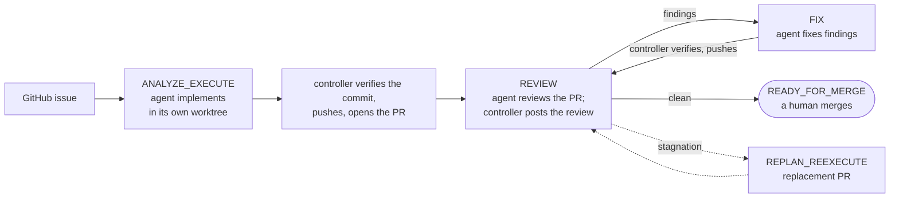

# AutoForge / 智铸

**A deterministic controller that takes a GitHub issue through implement,
review and fix, using coding agents you already have, and stops at a pull
request ready for a human to merge.**

智铸：AI 驱动的软件工程自动化控制器。

AutoForge is not another coding agent. It runs Claude Code, OpenCode (and
optionally Pi) as workers. It keeps the workflow state itself, checks
every claim an agent makes against GitHub, and makes every GitHub write
itself.

> **Status: pre-Alpha, under active development.** The issue → PR → review
> → fix → `READY_FOR_MERGE` loop works end to end. It is not production
> ready, and no public end-to-end demonstration has been recorded yet
> ([demo procedure](docs/demo.md)). Agents run as you on your machine, and
> every real run calls models you pay for. Read
> [Safety and trust boundaries](#safety-and-trust-boundaries) before your
> first real run.

## Why AutoForge?

You can already give one issue to a coding agent and get a branch back.
What you don't get is the rest of the process: a second reviewer, fixes
for its findings, another review of the new revision, and a reliable
record of where things stand when something breaks halfway. Without that
record, "done" is whatever the agent says it is.

AutoForge adds that process around the agents:

| Running an agent directly | Running it through AutoForge |
|---|---|
| One session; if it dies, you reconstruct where it was | A multi-phase run with durable state; `resume` continues after a `Ctrl-C`, a kill or a reboot |
| The agent says it committed, pushed or fixed something | The controller reads the result back from git and GitHub before the run moves on |
| The same agent often judges its own work | A separate review phase, routed to a model you choose (another vendor's by default) |
| A review applies to whatever the branch holds now | A clean review is bound to one PR, HEAD SHA and base; a later push sends the run back to review |
| The agent typically runs with your GitHub login available | Agents get no GitHub credential; the controller performs every GitHub write itself |
| You decide where to stop it | Review rounds, stagnation and a step budget bound every run; anything the controller can't verify ends in `BLOCKED` with a reason |

## How it works



Agents do the semantic work: implementing, reviewing, fixing. Each phase
ends with a machine-readable `CONTROL_RESULT` block, and state advances
only when that block validates *and* GitHub confirms it. Prose like "done"
or "LGTM" never counts. The controller owns everything else: routing each
phase to a provider and model, pushing, opening the PR, posting reviews,
retries, recovery and the safety gates. When it cannot work out the safe
next state, it stops at `BLOCKED` instead of guessing.

By default every run ends at `READY_FOR_MERGE`, `BLOCKED` or `FAILED`, and
a human merges. A controller-owned merge, followed by an EPIC progress
update and a move to the next issue, exists behind an opt-in gate and is
[experimental](#current-maturity).

The full state machine is in [Workflow](docs/agent-guides/workflow.md), and
what each phase verifies on GitHub is in
[GitHub safety](docs/agent-guides/github-safety.md).

## Key capabilities

- **Independent verification**: the implementation commit must be the
  worktree's own HEAD and descend from the default branch; the PR must be
  open at that HEAD; the review comment must appear exactly once for the
  right round and SHA. A claim that does not check out stops the run.
  ([GitHub safety](docs/agent-guides/github-safety.md))
- **Revision-bound review**: a clean review is bound to the PR, its HEAD,
  its base branch and its merge base. If any of them moves, the run goes
  back to `REVIEW`. ([Review binding](docs/agent-guides/workflow.md#bind-reviews-to-pr-head-sha-and-to-the-pr-identity))
- **Durable, resumable runs**: state is written atomically, and side
  effects are checkpointed before they run. `resume` reconciles with
  GitHub before re-entering the interrupted phase, and a corrupt state file
  fails loudly instead of being reset.
  ([State and recovery](docs/agent-guides/state-and-recovery.md))
- **Bounded execution**: review rounds, stagnation detection and a
  cumulative step budget mean a run can't loop forever. `BLOCKED` waits
  for you to fix the cause and run `unblock`.
  ([Troubleshooting](docs/troubleshooting.md))
- **Provider routing**: each phase runs on a configured profile
  (provider, model, effort). The built-in routing uses Claude Code to
  implement and fix and OpenCode to review. A Claude-only starter exists,
  and Pi is optional. ([Configuration](docs/configuration.md))
- **Opt-in candidate validation**: once you configure
  `validation.commands` (empty by default), the controller runs them on
  the exact commit an agent hands back. It refuses to push a candidate that
  fails, and refuses a clean review over a failing record.
  ([ADR 0006](docs/adr/0006-candidate-validation-evidence-and-review-certificates.md))

## Prerequisites

| You need | Notes |
|---|---|
| Linux on x86_64, or macOS on Apple Silicon | Both are tested in CI on every commit. macOS on Apple Silicon has also been run by the maintainer ([#482](https://github.com/iceboundrock/AutoForge/pull/482) fixed a macOS-only stop); it has no outer sandbox (`sandbox.mode: required` is refused) and weaker process containment than Linux. Intel Macs, Linux ARM64 and WSL2 are untested. Windows does not work (the lock uses POSIX `fcntl`). |
| CPython 3.11 or 3.12 | The interpreters CI tests. 3.13 and later are untested; `uv` can fetch 3.12 for you. |
| [`uv`](https://docs.astral.sh/uv/getting-started/installation/) | Installs AutoForge into its own environment. |
| `git`, with a global `user.name` and `user.email` | The implementer commits as you. |
| [GitHub CLI](https://cli.github.com/) `gh` 2.48.0 or newer, signed in | The controller's only route to GitHub. See [token permissions](docs/security.md#github-token-permissions). |
| [Claude Code](https://docs.anthropic.com/en/docs/claude-code) (`claude`), signed in | Implements and fixes in the built-in routing. |
| [OpenCode](https://opencode.ai/) (`opencode`) 2.0.0 or newer | Reviews and replans in the built-in routing. Not needed with the Claude-only starter. |
| A state directory on a filesystem with hard links | `.autoforge/` by default. vfat/exFAT and some FUSE, SMB and overlay mounts are refused. |

AutoForge has no account and stores no model credential. Each agent CLI
uses your own login or key, and each vendor bills you. CI on the branches
AutoForge pushes uses your GitHub Actions minutes.
`autoforge doctor` checks all of the above, but only for the agent CLIs
your configuration actually uses. [Compatibility](docs/compatibility.md)
has the full matrix and the evidence behind each entry, including the agent
CLI versions that have been verified.

## Installation

The PyPI distribution is **`autoforge-cli`**, and the command it installs
is `autoforge`. The `autoforge` project on PyPI is unrelated: never
`pip install autoforge`.

**Recommended: a pinned commit of `main`.** This README and the docs
describe `main`. Use a full 40-character commit SHA:

```bash
uv tool install --python 3.12 'git+https://github.com/iceboundrock/AutoForge@<commit>'
autoforge --version
```

Re-run with `--reinstall` and another commit to upgrade.
`uv tool uninstall autoforge-cli` removes it. For full YAML support
(PyYAML), install
`'autoforge-cli[yaml] @ git+https://github.com/iceboundrock/AutoForge@<commit>'`.
If the shell can't find `autoforge` afterwards, run
`uv tool update-shell` and open a new shell.

**From PyPI.** The only published version is the prerelease `0.1.0a0`
(2026-10-28). It is a pre-Alpha snapshot that predates much of what this
README describes, including the starter configurations and the removal of
LOCAL mode. It is not the Public Alpha
([#255](https://github.com/iceboundrock/AutoForge/issues/255)).
Before installing, check that the
[PyPI project page](https://pypi.org/project/autoforge-cli/) links back to
this repository:

```bash
uv tool install --python 3.12 --prerelease allow autoforge-cli
```

`--prerelease allow` is needed while every published version is a
prerelease. Security fixes land only on `main`
([SECURITY.md](SECURITY.md#supported-versions)).

**From a built wheel**, out of a checkout of the commit you want:

```bash
uv build
uv tool install --python 3.12 dist/autoforge_cli-<version>-py3-none-any.whl
```

**For development on AutoForge itself**, see
[Contributing](#contributing).

However you install it, run `autoforge` from a checkout of the repository
whose issues it works on. Continue a run with the controller that created
it, or a newer one. An older controller refuses a run that a newer one
wrote
([details](docs/usage.md#a-run-a-newer-controller-wrote)).

## Quick start

[Getting started](docs/getting-started.md) walks through a first run step
by step, including what each `doctor` row means and the common first-run
failures. The short version follows.

**1. Pick a repository you can safely experiment on.** A new private one
is best: a run pushes a branch, opens a PR, posts reviews and may open
follow-up issues there.

```bash
gh repo create first-run --private --add-readme --clone
cd first-run
```

Create an EPIC issue and a work issue in it, and make the work issue a
sub-issue of the EPIC (or pass `--epic` below). Both must be in this same
repository. [Getting started, step 3](docs/getting-started.md#3-choose-and-prepare-a-repository)
also covers keeping `.autoforge/` and `autoforge.yaml` out of git.

**2. Write a configuration.** Without `--config`, the built-in routing
applies (Claude Code plus OpenCode). A starter makes the models you pay for
visible. Take it from the same revision you installed:

```bash
ref=<commit>   # the commit you installed from
curl -fsSL -o autoforge.yaml \
  "https://raw.githubusercontent.com/iceboundrock/AutoForge/$ref/examples/starter-two-providers.yaml"
```

Use `starter-claude-only.yaml` if you only have Claude Code. The
implementer then reviews its own work, which is weaker. Every key is in
[`autoforge.example.yaml`](autoforge.example.yaml) and
[Configuration](docs/configuration.md).

**3. Check, preview, run.** Run everything from the checkout. `--config`
goes *before* the subcommand. Replace `<owner>/<repo>` and the issue
numbers with your own.

```bash
# read-only check of git, gh, the agent CLIs, the repository and the config
autoforge --config autoforge.yaml doctor

# preview: reads the repository, issue and EPIC through gh; starts no agent,
# writes nothing to git or GitHub, saves no state
autoforge --config autoforge.yaml run \
  --epic https://github.com/<owner>/<repo>/issues/1 \
  --issue https://github.com/<owner>/<repo>/issues/2 --dry-run

# the real run: calls paid models, pushes a branch, opens a PR, posts reviews
autoforge --config autoforge.yaml run \
  --epic https://github.com/<owner>/<repo>/issues/1 \
  --issue https://github.com/<owner>/<repo>/issues/2
```

While a run is in progress, don't commit or switch branches in this
checkout. The controller compares HEAD before and after every agent launch,
and stops at `BLOCKED` if it moved.

**4. See where it stopped, and continue.**

```bash
autoforge --config autoforge.yaml status   # phase, PR, review rounds, reviewed HEAD, block reason
autoforge --config autoforge.yaml resume   # continue after Ctrl-C, a kill or a reboot
```

- **`READY_FOR_MERGE`**: the latest review found nothing left to fix.
  Read the PR and the review comment, then merge or close it on GitHub
  yourself. If you push to the PR branch first, `resume` reviews the new
  head.
- **`BLOCKED`**: the controller hit something it won't decide alone: a
  failed check, a claim it couldn't verify, a bound reached. Fix the
  cause, then run
  `autoforge --config autoforge.yaml unblock --reason "..."` and `resume`.
  [Troubleshooting](docs/troubleshooting.md) is indexed by what you see.

Every command and where each one can stop is in
[Running the remote workflow](docs/usage.md).

## Safety and trust boundaries

The defaults keep a human in charge of merging, but they do not sandbox
the agents. Before a real run, know these facts:

- **Agents run as you.** By default they have your user ID, your network
  access and the model credentials you give them. They work in a per-issue
  `git worktree` with an allow-listed environment. That is logical
  isolation, not a sandbox: an agent can read whatever your user can read.
- **The OS sandbox is opt-in and Linux-only.** `sandbox.mode: required`
  runs every agent and validation command inside a `bwrap` sandbox,
  provided the host supports it: Linux 6.12+ with Landlock ABI 6,
  unprivileged user, PID and IPC namespaces, and bubblewrap 0.11+. On a host that can't
  enforce it, macOS included, the step is refused rather than run unsandboxed. Even
  enforced, agents keep your UID and the host network. `doctor` shows what
  your host supports. ([Outer sandbox](docs/usage.md#outer-sandbox))
- **Issue and PR text is untrusted input.** Anyone who can write the
  issue, its comments or the code an agent reads can try to steer that
  agent, and an injected instruction runs as you. Use repositories and
  issues whose authors you trust, or a dedicated user, VM or container.
- **Your content goes to your model vendors.** Everything an agent reads
  is sent to the vendor of the model it runs.
- **Agents never get a GitHub credential, and never merge.** The
  controller makes every GitHub write itself and keeps its `gh` login away
  from agents. One caveat: an agent's same-user read of a credential
  *file* by absolute path is outside this guarantee unless the sandbox is
  enforced.
- **Merging is off by default.** A controller merge requires both
  `safety.allow_merge: true` in the config *and* `--allow-merge` on the
  command line. Even then, the controller re-verifies the PR on GitHub and
  fails closed. Without both, a human merges.
- **A clean review is not proof of correctness.** A clean review means the
  reviewer agent found nothing. A validation record means a command passed
  on one candidate on your host. Neither replaces your own review or your
  CI.
- **Logs are redacted on a best-effort basis.** Tokens and authorization
  headers are masked, and no environment dump is written, but redaction
  makes no claim of completeness.

[Security boundaries](docs/security.md) is the full statement: what
AutoForge protects, what it doesn't, the GitHub token permissions it needs
and the recommended settings for a repository you care about. To report a
vulnerability privately, see [SECURITY.md](SECURITY.md).

## Current maturity

AutoForge is pre-Alpha (`0.x`). The Public Alpha is tracked in
[#255](https://github.com/iceboundrock/AutoForge/issues/255) and has not
shipped. The default test suite runs against an in-memory GitHub and
scripted agents. It never calls a real model and never merges a real PR.

| Capability | Status |
|---|---|
| Issue → implementation → PR → review → fix → re-review → `READY_FOR_MERGE`, with SHA binding, loop bounds, stagnation and `REPLAN_REEXECUTE` | **Supported**: the default path |
| Durable state, `resume`, `unblock`, journal-first recovery of an interrupted push or PR creation | **Supported** |
| `doctor`, dry run, redacted per-invocation logs | **Supported** |
| Controller-run candidate validation (`validation.commands`) | **Opt-in**: nothing runs until you configure it |
| Outer sandbox (`sandbox.mode: required`, Linux `bwrap`) | **Opt-in, experimental**: off by default, and enforced only on a capable host |
| Controller-owned `MERGE` behind the merge gate, and `UPDATE_EPIC` | **Experimental**: verified only against the in-memory fake; never merged a real PR or edited a real EPIC |
| Parallel EPIC scheduler (`autoforge epic ...`) | **Experimental**: verified offline only; has not driven a real EPIC. Workers never merge. ([Running an EPIC in parallel](docs/usage.md#running-an-epic-in-parallel)) |
| Pi provider (`provider: pi`) | **Experimental, opt-in**: no built-in profile uses it. ([Pi guide](docs/pi.md)) |
| `claude-sdk` provider | **Experimental, opt-in**: launches on one pinned SDK pair; no model has been called through it. ([SDK policy](docs/sdk-policy.md)) |
| `opencode-sdk` provider, container sandbox backend | **Not yet**: `opencode-sdk` refuses every launch; no configuration can select the container backend |
| Unattended production operation; the merge gate consulting branch rules; merge queues | **Not yet** |

The supported path keeps the merge gate closed: a human reviews and merges
every PR. `doctor` checks which branch rules require CI, but the merge gate
itself does not consult them yet.

## Documentation

The [documentation index](docs/README.md) lists everything by intent.
Common entry points:

| I want to… | Read |
|---|---|
| make a first run, step by step | [Getting started](docs/getting-started.md), starter configs in [`examples/`](examples) |
| check which OS, Python, `gh` and agent CLI versions work | [Compatibility](docs/compatibility.md) |
| use every command, merge, unblock or recover | [Running the remote workflow](docs/usage.md), [Troubleshooting](docs/troubleshooting.md) |
| configure profiles, bounds, validation, the sandbox or the merge gate | [Configuration](docs/configuration.md), [`autoforge.example.yaml`](autoforge.example.yaml) |
| know what is protected and which GitHub token permissions are needed | [Security boundaries](docs/security.md) |
| understand the phases and the code's structure | [Workflow](docs/agent-guides/workflow.md), [Architecture](docs/agent-guides/architecture.md), [State and recovery](docs/agent-guides/state-and-recovery.md) |
| read the design decisions | [Architecture decision records](docs/README.md#architecture-decisions) |

## Contributing

Bug reports and suggestions go to
[GitHub Issues](https://github.com/iceboundrock/AutoForge/issues), and
contributions arrive as pull requests against `main`. Report security
issues privately ([SECURITY.md](SECURITY.md)), never in a public issue.

For a development setup, from a clone of this repository:

```bash
uv sync              # .venv with autoforge-cli (editable) and the dev tools
uv run autoforge --help
make check           # what CI runs: lockfile check, pytest, ruff, ruff format, mypy
```

[AGENTS.md](AGENTS.md) is the repository contract: safety invariants,
architectural boundaries, and which guide to read before changing what.
Human and agent contributors alike start there.
[Development](docs/development.md) covers the `make` targets and CI, and
[Testing](docs/agent-guides/testing.md) the coverage contract.

## License

[MIT](LICENSE) © 2026 Ruoshi Li
