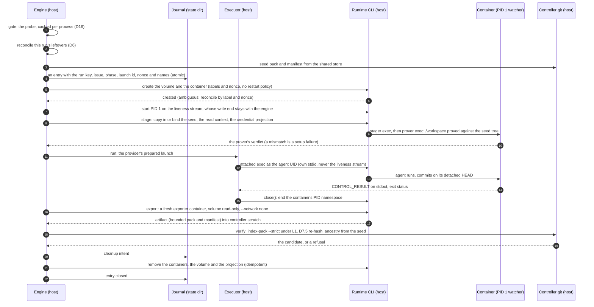
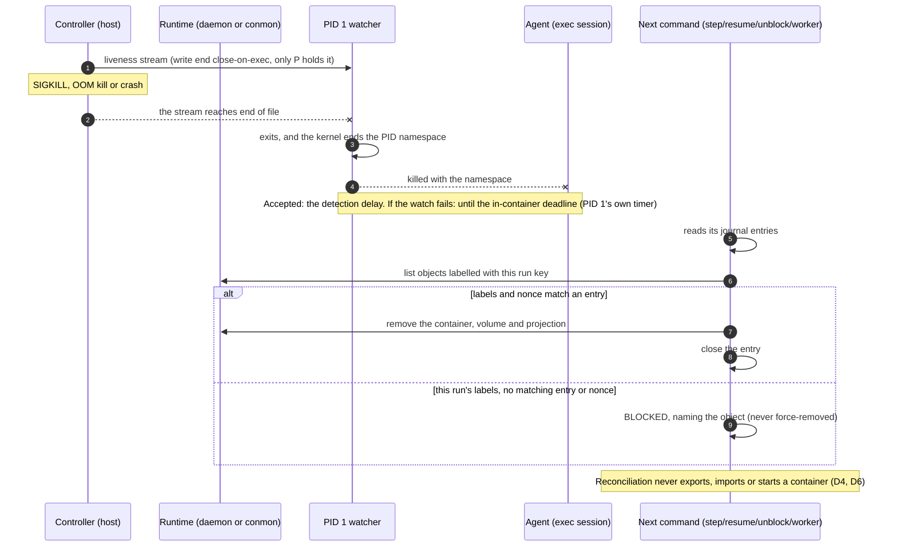

# ADR 0013. Container sandbox backend: the lifecycle contract, trust boundaries and rollout

- **Status:** proposed. This is a design record, and nothing in it is
  implemented. #267's first acceptance criterion asks for an approved
  record. Approval is a maintainer's, given on #267, and this change cannot
  supply it. Written at `main` `32178d8` (2026-11-08), where every
  reference below was read. #267 was planned at `711ff09` and reconciled at
  `388ecb3`; §1.4 lists what has changed since then.
  - *Implemented with it:* nothing. No configuration key, state field,
    protocol number, launch class, prompt, default or behaviour changes.
    Five tests in `tests/test_container_backend_record.py` keep the record
    honest. The invariant map (§5) takes every decision of the records it
    maps (`test_adr_0013_maps_every_decision_of_the_records_it_names`).
    Every decision it marks amended carries a dated #267 amendment in its
    own record, and nothing else does
    (`test_adr_0013_amended_decisions_carry_a_dated_amendment_and_no_others`).
    No protocol number is claimed
    (`test_adr_0013_claims_no_state_protocol_number`). The record's links
    and its amendments' links resolve
    (`test_adr_0013_and_its_amendments_link_to_what_exists`), and every ADR
    has a row in the documentation index
    (`test_every_adr_has_a_row_in_the_documentation_index`).
  - *Recorded here:* the twelve decisions #267's planning reconciliation
    lists (D1 to D12, numbered as there) and the ones its other criteria
    need: the lifecycle seam (D13), identity and secret projection (D14),
    what runs where (D15), the capability matrix (D16), the failure
    taxonomy (D17), the threat model (D18), configuration and state (D19),
    and rollout (D20).
- **Decides:** #267 (ENV-A1), for EPIC #266.
- **Amends** (each amendment is dated 2026-11-08 and applies to the
  container backend only. It takes effect when #273 makes that backend
  selectable. Until then every enforced launch is bwrap's, and each amended
  decision holds as written):
  - [ADR 0002](0002-executor-nothing-outlives-the-invocation.md) §3 and §4e,
    through a new §4f;
  - [ADR 0004](0004-authority-boundary-and-typed-external-effects.md)
    D1.1, the sentence that names the candidate;
  - [ADR 0005](0005-outer-sandbox-and-host-resource-capability-model.md):
    D1.2, D2.1, D4.1, D5.1, D6.1, D6.3, D6.5, D8.4, D9.1, D10.2, D10.3,
    D10.5, D10.6, D12.3, D13.1, D14.1, D15.4, D17.1, §3 and §9, through a
    new §11;
  - [ADR 0006](0006-candidate-validation-evidence-and-review-certificates.md)
    D6.3, D8.1 and D8.2;
  - [ADR 0008](0008-parallel-epic-scheduler-authority-run-identity-claims-and-locks.md)
    D13.4.

  ADR 0006 D6.1 was checked and needs no amendment (§5.4).
- **Related:** ADR 0007 (SDK helpers and the interaction contract), ADR
  0009 (LOCAL's removal; `preferred` means `required`), ADR 0011 (stop
  classification), ADR 0012 (the advisor launch class). The issues: #23
  (protocol numbering), #126 and #147 (pause and interaction), #255 (the
  Public Alpha), #257 (the security audit), #266's children #268 to #275,
  #276, #277, #278, #290, #292 and #294, and #280 (the sandbox pin).

## 1. Context

### 1.1 The baseline at `32178d8`

AutoForge has one outer-sandbox backend, Bubblewrap (ADR 0005). It runs
only in REMOTE mode, which since ADR 0009 is the only mode.

- **Launch classes.** There are two (`sandbox_policy.LaunchClass`). A
  *REMOTE agent* is every agent launch. An *export command* is
  `validation.commands` in a candidate's export and
  `merge.verification_commands` in the pre-merge export. LOCAL's classes
  went with ADR 0009. ADR 0012's advisor class is designed but not
  implemented.
- **The description.** The engine hands a provider a `SandboxPlan`. It
  holds the launch's facts, all of them host paths. The provider adds its
  declaration (`ProviderRequirements`: executable, install roots, auth
  items) and gets back a `LaunchDescription`. That description is a list
  of mounts at host paths, plus the environment rewrite, the network
  position and the `/proc`, `/dev` and `/sys` policy (`sandbox.py`).
- **The seam.** `sandbox_bwrap.prepare()` turns a description and a command
  into a `BwrapLaunch`: an argv to spawn in the command's place, its
  descriptors and a pre-exec hook. Once `bwrap` exits, the launch reads the
  status records back (`collect`, `outcome`), and `close()` runs in every
  case. The executor spawns it, so ADR 0002's limits, stop, capture, duplex
  handling and containment apply to `bwrap` unchanged. The backend owns no
  process.
- **The git surface.** The agent works in a host worktree,
  `<common>/autoforge/worktrees/<n>`. The common dir is projected
  read-only, with an overlay whose writable upper layer is a private object
  directory. The candidate is that worktree's `HEAD`, read through the
  common dir, and the controller imports its objects strictly
  (D6.1, D6.3, D6.5).
- **Lifetime.** `--die-with-parent` makes the kernel kill the sandbox when
  the controller dies, `SIGKILL` included, and the PID namespace takes
  every inner process with it (ADR 0005 D10.6, ADR 0002 §4e).
- **Mode and pin.** `sandbox.mode` is `disabled`, `required`, or
  `preferred`, which means `required` (ADR 0009 D7). A run is pinned to the
  mode it was created under, and a weaker mode needs
  `--accept-config-change` (`sandbox_pin.py`, `PIN_SCHEMA = 1`, #280). The
  recorded configuration refuses every schema but its own
  (`config_fingerprint.FINGERPRINT_SCHEMA = 1`). The state protocol is 16.
- **Capability.** Enforcing needs Linux 6.12 or later with Landlock ABI 6,
  unprivileged user, PID and IPC namespaces, and an unprivileged overlay
  mount (ADR 0005 D14.1). Agent CLIs and toolchains come from the host,
  projected read-only (D13.1, D15.4). Launches share the host network
  namespace (D9.1).

### 1.2 What #267 asks for

#267 asks for a container backend's contract, decided before any of
#266's children implement it. It covers the interface from today's launch
description to a backend's create, run, collect and cleanup, the trust
boundaries, the capability conformance, and how the backend is rolled out
beside the bwrap baseline. The baseline must be preserved. The planning
reconciliation of 2026-10-23 found that a container backend contradicts
several accepted decisions as written. #267 therefore requires dated
amendments and an invariant-by-invariant map, and it lists twelve decisions
with the owner's answers to most of them. This record restates neither
#266's motivation nor #267's analysis, beyond what a decision needs. It
records the decisions, the alternatives each rejects, and what each child
issue must deliver.

### 1.3 What a container runtime changes

Nothing in this record was measured on a container runtime. Where it was
written, an agent launch on Debian 13 with kernel 7.0.14, rootless Podman
5.4.2 could not set up its user namespace: `podman info` and
`podman images` both failed with
`newuidmap: write to uid_map failed: Operation not permitted`. Docker is
not installed there. The facts below come from #267's planning comments
and from the runtimes' documented designs. #271, #272 and #275 measure
them, and if a measurement contradicts a decision here, the child that
measured it amends this record.

- **A container is not the controller's child.** Docker's containers
  belong to the daemon, through containerd-shim. Podman's are supervised by
  conmon, which detaches from the CLI. Killing the CLI process the
  executor spawned does not stop the container. `--die-with-parent` has no
  equivalent.
- **The runtime's API is authority.** Whoever reaches the Docker socket,
  or runs Podman as the operator, can start a container that bind-mounts
  anything that user can read. Under a rootful daemon, that user is root.
- **A container has its own network namespace** unless it is given
  `--network host`. Rootless runtimes route its traffic through a
  user-mode helper (RootlessKit, slirp4netns or pasta). Whether host
  loopback is reachable through that helper depends on its options.
- **A bind is only a bind where the daemon shares the controller's
  filesystem.** Behind Docker Desktop, `podman machine` or a `DOCKER_HOST`
  that names another machine, a host path resolves on a different machine.
- **Container metadata persists until removal.** A container's
  configuration, its environment values included, stays in the runtime's
  storage until the container is removed.

### 1.4 Where #267's planning text is out of date

- **LOCAL is gone** (ADR 0009). #267 names REMOTE, LOCAL, validation and
  premerge launch classes. They are now two: REMOTE agent and export
  command (§1.1). The container backend is REMOTE-only because REMOTE is
  all there is.
- **#280 has landed.** The sandbox pin exists (`sandbox_pin.py`), and its
  docstring already reserves the next pin schema for #273's backend fact.
  D8 uses that mechanism, as #267 requires.
- **The ADR 0005 line numbers #267 cites have moved.** #280 and ADR 0009's
  notes edited that record after `388ecb3`, and this record's own
  amendments move them again. This record cites decisions by their
  identifiers.
- **Amendments the planning table did not list.** Mapping each invariant
  (§5) found more decisions the container backend contradicts as written:
  ADR 0004 D1.1's sentence naming the candidate; ADR 0005 D4.1, D5.1, D8.4,
  D10.2, D10.3, D10.5, D12.3, D13.1, D15.4 and D17.1; ADR 0006 D6.3, D8.1
  and D8.2; and ADR 0008 D13.4. ADR 0008 is otherwise preserved, and so is
  ADR 0004.

### 1.5 Terms

- **Backend:** what enforces a launch's outer sandbox: `bwrap`, or
  `container`.
- **Runtime:** the container engine the `container` backend drives: Docker
  Engine or Podman. Podman is a runtime, not a backend (D8).
- **Run step:** the one process an invocation is about, the agent or the
  repository command. Its executor child is the runtime's attached client.
- **Helpers:** AutoForge's own programs inside the image: the *watcher*
  (PID 1, D6), the *stager* (builds `/workspace`), the *prover* (D2), and
  the *exporter* (D5).
- **Seed:** what a launch's `/workspace` is built from. It is a bounded
  pack with a manifest, and on bind runtimes also a materialized tree
  (D2, D11, D12).
- **Artifact:** what an export produces: a bounded pack plus a manifest.
  It is untrusted data (D5).
- **Journal:** the controller's durable record of each runtime object it
  is about to create or remove (D6, D19).
- **Remote execution sandbox:** a container runtime on another machine
  (#276, #277). It is not AutoForge's REMOTE mode.

## 2. Decisions

D1 to D12 are #267's numbered decisions, in its order. Each decision names
the child that implements it, or says it is documentation only. §6 repeats
the assignment and the order. Where a child's body and this record
disagree, this record wins until the child amends it with a recorded
rationale.

### D1. Authority (decision 1; documentation only)

The host controller keeps every workflow transition, every write to the
shared object store, every git network operation, every GitHub read and
write, every read-back, the issuance of every `ReviewCertificate`, and
merge authorization. The controller's hardened git performs the writes and
network operations: strict import under L1, then fetch and push through
`git_transport`. Its `gh` performs the GitHub work, as typed effects.

A container runs agents, repository-defined commands and AutoForge's
helpers, and nothing else. It holds no GitHub or git credential, no runtime
socket, no controller state and no host path but the staging root (D12).
What it produces is a claim: the `CONTROL_RESULT` and the artifact, both
verified on the host (D5).

The container runtime is a process launcher that the controller drives
through its CLI (D13). It is not a lifecycle controller. AutoForge sets no
restart policy, uses no compose file or orchestrator, and never leaves
runtime-side scheduling in place across commands.

*Rejected.*

- **Sandcastle's runtime and branch ownership,** as #267 names it: its
  `run()`, and its ownership of the runtime and of branches. An external
  runtime that owns a run's lifecycle and its branches is a second
  lifecycle controller, and branch ownership is git write authority on the
  sandbox side. It would also replace the Python agent providers.
  AutoForge embeds none of it.
- **The Dev Containers CLI as the lifecycle.** Its configuration comes from
  the repository (`devcontainer.json`). It can add mounts, `runArgs` and
  privileges, and its `initializeCommand` runs on the host (D14).
- **A container that pushes its own candidate.** That would need a
  credential inside.

### D2. Source and workspace (decision 2; #292 the host side, #271 the container side)

A container launch sees exactly two inputs derived from the repository.

- **`/source`** is a controller-prepared, read-only snapshot of one exact
  commit. `materialize()` (`materialize.py`) writes it byte-exact and
  proves it with its hash-back proof, into a controller-owned staging root
  (D12). It is present only where D12 proves a bind.
- **`/workspace`** is a private writable volume, one per launch.
  - For an agent, it holds a self-contained git repository: the stager
    runs `git init`, strictly indexes the seed pack, and checks out the
    seed commit on a detached `HEAD` (ADR 0005 D6.2).
  - For an export command, it holds a writable copy of the seed commit's
    tree with no `.git` (ADR 0006 D6.5).

**Never bound,** on any runtime: the operator's checkout, live or dirty;
any worktree; the git common dir or any part of it; `$HOME`; any `.git`
admin directory; host credentials; sockets; controller state; and a
provider's operator configuration root.

**A read-only bind does not make content immutable.** The host path can
change after it was proved. So the prover, AutoForge's own code running
D6.3's walk of ADR 0006, proves `/workspace`'s tree (its `.git` aside, for
an agent) against the seed commit's tree id inside the container, before
any agent or repository command runs there. It runs as its own exec after the stager. Nothing of the agent has
run in that container by then, and its verdict reaches the controller on
that exec's output. A mismatch is a setup failure (D17), never a result.
For an export command, this proof is what keeps ADR 0006's claim, "the
validator saw C", true in a container. A host-side proof of the bind
source alone would not: the command runs in a copy of it (ADR 0006 D6.3 as
amended).

*Rejected.*

- **Binding the operator's checkout or a host worktree.** Both are live and
  mutable, and both reach the common dir.
- **ADR 0005's Design A inside a container,** a read-only common dir with a
  private object overlay. It exposes the operator's unpushed work (D11).
  Under rootless UID mapping it needs the operator's UID inside, and an
  overlay of a host directory is not a runtime bind.
- **A writable issue-only bind as the default.** It would let a container
  write host files directly. It stays a separately reviewed future
  alternative, and neither it nor copy-in may bypass exact candidate
  verification (D5).

### D3. Lifetimes (decision 3; documentation only, each row's child implements it)

| Object | Lifetime | Owner | Created | Removed |
|---|---|---|---|---|
| image | content-keyed and cached across runs; reused while its key is unchanged | AutoForge's build (#271) | on a cache miss, in a build container (D7) | never by a run; `doctor` lists it with its size; the operator prunes it |
| launch container | one launch: one run step and its helpers | the controller | the create step | the cleanup step, or reconciliation (D6) |
| exporter container | one export | the controller | the export step | right after it |
| `/workspace` volume | one launch | the controller | the create step | cleanup, once the export is imported or refused |
| per-issue cache volume | the issue: launches that produce a change share it (ADR 0005 §2.5) | the controller creates it; the operator removes it | at the issue's first change-producing launch | never by AutoForge (ADR 0005 D8.4) |
| staging root (`/source`) | one launch | the controller (#292) | the stage step | cleanup (it is controller-written only) |
| projected model credential | one launch | the controller (#290, #270) | the stage step | cleanup, or reconciliation |
| agent session data | one launch, inside the container's private home | nobody beyond the launch | by the agent CLI | with the container (#278 owns any later need, D14) |
| candidate artifact | until the strict import ends; then the shared store holds the candidate and the state binds it | the controller (#269) | the export step | after the import |
| provider login and refresh state | long-lived, on the host | the operator | the operator's login | never by AutoForge (D14) |
| controller GitHub credential | long-lived, on the host | the operator, through `gh` | — | never by AutoForge; never in a container |

*Rationale.* Each container-side object lives for one launch. That makes
the environment rebuildable: a launch never depends on what an earlier one
left behind, except through artifacts the controller verified. Two objects
outlive a launch. The image is a pure function of its inputs (D7). The
cache follows ADR 0005's rule: only launches that produce a change share
it, and each one's output is reviewed.

*Rejected.*

- **A container per issue or per phase,** kept alive between launches. It
  would hold processes across invocations (ADR 0002) and carry agent-written
  state into the next role.
- **A volume per issue for `/workspace`.** See D4.

### D4. Seeding: FIX from the last verified candidate (decision 4; #269)

A launch's seed commit:

- **`FIX` and `REVIEW`:** the last verified candidate. That is the commit
  the controller strictly imported and bound to the run, which is the PR
  head it pushed and read back. Never an earlier container's workspace or
  volume.
- **`ANALYZE_EXECUTE` and `REPLAN_REEXECUTE`:** the base the controller
  verified: the start commit, or the default branch head for a
  replacement.
- **`UPDATE_EPIC`:** the default branch head.
- **A relaunch of the same phase entry** (after a timeout, a stop, or a
  failure that `resume` relaunches): the seed plus the entry's *carried
  commit*. That is the `HEAD` the controller exported and strictly imported
  at the end of an earlier launch of the same entry, when it descends from
  the seed. Uncommitted changes are never carried.

The controller exports at every end of a change-producing launch that it
runs: success, failure, timeout or stop. After a controller crash,
reconciliation removes the leftover volume without exporting it (D6), so
the crashed launch's work is lost. Under bwrap that work survives in the
worktree.

*Consequence.* #187's prompt note, which tells an agent what an earlier
launch left uncommitted, has nothing to report under the container
backend. #271's container prompt says that uncommitted work is discarded
at the end of each launch.

*Rejected.*

- **Reusing a volume across launches,** even of one role. The next launch
  would start from an unverified workspace, with an agent-writable
  `.git/config`, hooks and untracked files. Across roles that breaks
  `REVIEW`'s independence, as ADR 0005 D8.1 argues for the home.
- **Exporting during reconciliation.** It would make the clean-up path an
  import path too, run on a volume whose launch the controller never saw
  end. Reconciliation stays remove-only.

### D5. The candidate and its import (decision 5; #269 the semantics, #271 the wiring)

#269 owns the engine's *candidate source*, one abstraction over both
backends:

- **bwrap:** unchanged. It reads the worktree's `HEAD` through the common
  dir (ADR 0005 D6.3) and imports the private object directory strictly
  (D6.5).
- **container:** the artifact.

The artifact is untrusted data: one pack, bounded in size, plus a manifest.

- **The manifest is a claim.** It names the claimed `HEAD`, the seed
  commit and the object format.
- **The exporter** runs in a fresh container with the volume mounted
  read-only and `--network none`. It packs the objects reachable from the
  workspace's `HEAD` and not from the seed. The artifact leaves through the
  exporter's output or the runtime's copy-out, into a controller-owned
  scratch directory. Its output is untrusted. A tampered exporter gives the
  agent nothing it does not already have, which is the choice of what to
  commit.
- **The host's checks.** The claimed commit is the candidate only when all
  of these hold:
  - `index-pack --strict` has put it in the shared store. It runs under L1
    (ADR 0008 D12.3), through `local_git_request`'s hardening (ADR 0004
    D7.3).
  - ADR 0004 D7.5 re-hashes it.
  - It descends from the seed.
  - The phase's existing candidate rules accept it.
- **Failure.** A pack that fails `--strict`, an artifact over its bound, a
  manifest that does not parse or names another seed, or a claimed `HEAD`
  that is not a commit descending from the seed: each is a candidate
  refusal under the phase's existing rules. It is never retried, and
  nothing is published, as with ADR 0005 D6.5's failure.
- **What the host never does.** It never mounts the volume. It never runs
  git with the container's repository as its repository, and never reads
  that repository's configuration or hooks. It never applies a diff, and
  never copies working-tree files back. rsync may serve as a transport
  beneath this check. It is never the content boundary.

*Rationale.* ADR 0005 D6.5 already treats the agent's objects as untrusted
input and verifies them by content. Only the input changes, from a host
directory to a pack, and a pack is the smallest form that carries exactly
the commits.

*Rejected.*

- **Copying working-tree files out** (rsync, `docker cp` of `/workspace`)
  and committing them on the host. That applies a raw diff, which #267
  excludes, and it runs host git over agent-chosen paths.
- **Reading the volume's repository from the host.** Agent-written
  configuration and hooks would reach a host git process.

### D6. Supervision: what replaces ADR 0005 D10.6 (decision 6; #272)

This is the contract a daemon-owned container can meet. It replaces
"controller death kills the sandbox" for the container backend.

1. **Names and labels.** Every container and volume a launch creates has a
   run-scoped name and these labels: the run key (ADR 0008's `RunKey`),
   the issue, the phase, the launch id, the object's kind, and a
   per-launch nonce. The controller first writes a journal entry holding
   all of them, atomically. Only then does it create anything (D19).
2. **Ownership.** An object belongs to the run only when its labels and
   nonce match a journal entry. Nothing is stopped or removed otherwise.
3. **The death-watch.** The container's PID 1 is AutoForge's watcher.
   - It runs under a non-root UID that is distinct from the agent's, with
     every capability dropped.
   - It reads a liveness stream whose write end only the controller holds.
     That end is close-on-exec and never inherited by another long-lived
     process.
   - The stream reaches the container over a runtime channel separate from
     the agent's stdio. The agent runs in an exec session of its own, so
     Pi's RPC duplex and OpenCode 2.x's stdin are never borrowed.
   - When the stream reaches end of file, PID 1 exits, and the kernel ends
     every process in the container's PID namespace. Inside the namespace
     the kernel ignores `SIGKILL` sent to init, and a different UID cannot
     signal it at all.
   - #272 designs the transport and proves it on both runtimes.
4. **The in-container deadline.** PID 1 ends the container at the launch's
   runtime ceiling plus ADR 0002's kill graces, so a watch that fails still
   ends at a known time.
   - Agent launches use the profile's `max_runtime_seconds`. The container
     backend requires it to be finite for every agent profile, and refuses
     at load a configuration that leaves it unset (D19).
   - Export commands use `execution.command_timeout_seconds`.
5. **Every exit path the controller runs:** success, failure, timeout,
   stop, `Ctrl-C`, or an exception inside the executor's guard.
   - The run step's `close()` ends the container's PID namespace before
     the invocation returns. That keeps ADR 0002 §3 on each of those paths
     (ADR 0002 §4f).
   - The engine then removes the container, the volume and the credential
     projection. It journals that intent first.
   - Clean-up is idempotent and retried within bounds. A clean-up that
     still fails leaves its entry for reconciliation, and it is reported.
6. **Reconciliation.** It runs at every `step`, `resume` and `unblock`, and
   when a scheduler worker starts on an issue, before any launch.
   - It lists the runtime's objects that carry this run's run-key label,
     and removes each one that matches a journal entry.
   - An object with this run's labels but no matching entry or nonce is
     reported, and the run enters `BLOCKED` naming it. Nothing is guessed
     or force-removed.
   - An entry whose objects are already gone is closed.
   - Reconciliation never starts a container, and never exports or imports
     anything (D4).
7. **No restart policy is ever set.** `--rm` may be passed as well, but
   nothing relies on it.
8. **Proof under `required`.** The probe and `doctor` start a stand-in
   parent that holds a liveness stream, kill it with `SIGKILL`, and measure
   how long the runtime takes to report the container gone. #272 measures
   and states the bound. A host that does not meet it is refused under
   `required` before anything of the step is saved or launched.

**The residual, as the owner accepted it on 2026-10-23.** After a
`SIGKILL` of the controller, an OOM kill or a crash, a container keeps
running for the watch's detection delay. If the watch itself fails, it
runs until its in-container deadline.

- **Not accepted:** a survival that only the next reconciliation bounds.
- **No immediate-death claim** is made for `--rm`, `rm -f`, `--init` or
  start-up clean-up, here or in any document or diagnostic.
- **A survivor can** go on running the agent and spending model tokens,
  keep its projected model credential live, use its network, and write its
  own `/workspace`.
- **A survivor cannot** write GitHub (it has no credential), touch the host
  checkout or controller state, or get its output accepted, since import
  happens only on the controller's verified path.
- **Other cases.** With no restart policy, nothing comes back after a
  reboot. A suspended laptop runs nothing, the controller included, so
  suspension produces no survivor.

*Rejected.*

- **The strict reading,** that nothing may outlive the controller ever.
  The container backend could then never be enforced. It is REMOTE-only,
  and REMOTE's `preferred` means `required`, so it would have no use.
- **Reconciliation alone.** It runs at the next AutoForge command, which
  can be hours away.
- **`--rm`, `--init` or start-up clean-up as the guarantee.** None of them
  ends a running container when its client dies.
- **The agent's stdin as the liveness channel.** For Pi RPC and Claude's
  stream-json it carries protocol records. Closing it is the orderly
  shutdown request (ADR 0002 §4a), and an untrusted process holds its
  reading end.
- **A host-side watchdog process** that outlives the controller. That is a
  long-lived owner, which AGENTS.md's runtime model excludes.
- **Container root as PID 1.** Under rootless, container root is the
  operator's UID on the host, and the watcher needs no privilege.

### D7. The image (decision 7; #271 the contract, #273 the diagnostics)

The owner decided on 2026-10-23 that AutoForge installs the agent CLIs
itself, and that the operator may configure MCP servers and Skills, which
AutoForge installs with them.

- **Inputs, from operator configuration only** (strict key validation),
  never from the repository or an agent:
  - a base image named by digest, which holds the toolchains the
    repository needs;
  - AutoForge's own layer: the watcher, stager, prover and exporter, at
    this controller's version;
  - each agent CLI at a pinned version: Claude Code, OpenCode 2.x and Pi.
    The SDK helpers of ADR 0007 join when they land, at their exact pins;
  - each operator-configured MCP server and Skill, at a pinned version.

  No `Dockerfile`, `devcontainer.json` or build script of the repository is
  ever read.
- **Where the build runs.** In a build container, never on the host. It
  has network access for its downloads and sees no host path but a context
  directory the controller wrote. It holds no credential. A base image
  that needs registry authentication is pulled by the operator first, and
  AutoForge then references it by digest from local storage.
- **Caching.** The image's key is the digest of every input. An unchanged
  configuration reuses the cached image, which costs the fewest resources.
  Every launch names the image by its content-addressed id, never by a
  mutable tag. The id is recorded in the launch's facts (D16) and in
  validation's policy P (ADR 0006 D8.1 as amended).
- **Toolchains come from the base image.** AutoForge installs none.
  `sandbox.read_only_paths` (ADR 0005 D15.4) projects host paths, so it has
  no meaning under the container backend and is refused there (D19).
- **Installing is not enabling.** Every launch keeps today's isolation
  flags: Claude Code's `--safe-mode --strict-mcp-config`
  (`providers.py`), Pi's `--no-extensions --no-skills`, and OpenCode's
  refusal of integrations (#165, [Pi policy](../pi-policy.md),
  [SDK policy](../sdk-policy.md)). An installed integration stays disabled.
  Enabling one needs its own reviewed amendment of those policies, which
  states:
  - what each integration may load;
  - which credentials it may receive, under #290's projection rules, and
    never a GitHub credential;
  - that it runs inside the same container, under the same network policy.

  No child of #266 enables an integration without that amendment.
- **Diagnostics (#273).** The dry run and `doctor` show the image id and
  its inputs, and each installed CLI, MCP server and Skill with its
  version and whether it is enabled.

*Rejected.*

- **An image the operator finishes,** CLIs included. The CLI versions and
  their provenance would be invisible, and so would drift.
- **Projecting the host's CLIs into the container.** Host install roots
  bound into a container are the arbitrary host mounts #267 excludes.
  ADR 0005 D13.1's projection is bwrap's mechanism.
- **The repository's development-container configuration.** It is
  repository-controlled, and Dev Containers' `initializeCommand` runs on
  the host (D14).
- **Mutable tags** such as `latest`.

### D8. Backend selection, runtime detection and the pin (decision 8; #273, with #271's detection)

- **The key.** `sandbox.backend` is `bwrap` or `container`. An absent key
  means `bwrap`. `container` is neutral: Podman is a runtime the backend
  detects, and it gets no value of its own. That is the owner's decision
  of 2026-10-23.
- **Modes.** `container` requires `sandbox.mode: required`, or `preferred`,
  its alias. `container` together with `disabled` is refused at load,
  because it would run every launch on the host. Under `required`, every
  covered launch runs enforced inside the selected backend or is refused.
  It never falls back to the other backend, or to the host.
- **Detection.** An operator setting, `sandbox.container.runtime: podman`
  or `docker`, names the runtime.
  - If it is unset, the backend uses Podman when `podman` is on the
    controller's `PATH`, and Docker otherwise.
  - Detection runs once, with no fall-through. If the detected runtime's
    probe fails, the step is refused naming the runtime and the setting.
  - A runtime's identity is what it reports about itself (its product and
    version, from its own `version` and `info`). The executable's name is
    never taken as proof: a `docker` that is Podman's compatibility wrapper
    is identified as Podman.
  - A repository setting can never name a runtime. The configuration file
    is the operator's, and under an enforced mode `config_file_problem`
    refuses one that lies in a tree a launch writes.
- **Selectable only after #272.** Until #272's lifecycle and clean-up land,
  the configuration loader refuses `container` and names #272. #271's
  wiring may land behind that refusal.
- **The pin.** The run's pin records the backend. For `container`, it also
  records the runtime's product (Docker Engine or Podman) and the kind of
  endpoint.
  - A `step`, `resume` or `unblock`, or a worker resuming the issue, that
    would run under a different backend or runtime is refused before any
    phase executes, with nothing written.
  - `--accept-config-change` does not override that refusal in this
    record. A later amendment may allow a switch at a phase boundary,
    together with its candidate-source rule.
  - A new version of the same runtime only re-runs the capability probe,
    which runs once per controller process anyway (ADR 0005 D12.2). The
    version is recorded in each launch's facts.
  - The mechanism is #280's: `sandbox_pin` gains a schema whose parser
    still reads schema 1. A schema-1 pin means `bwrap`, and the next
    command records the backend as `upgraded` (D19).

*Rationale for Podman first.* Podman is rootless and daemonless by default.
Docker's default installation is rootful, which D10 refuses. On a host
with both, Podman is therefore the one more likely to be usable as
installed. This is not measured. An operator who wants Docker names it.

*Rationale for the pin.* The candidate source (D5), the journal and
reconciliation (D6) all depend on the backend and the runtime. Containers
Podman created are not in Docker's listing. A runtime switch would
therefore hide one run's leftovers from its own reconciliation.

*Rejected.*

- **`docker` as the value.** It would call Podman Docker.
- **Two values, `docker` and `podman`.** That is two backends to keep in
  parity for one design, contrary to the owner's decision.
- **Detection by executable name.**
- **Falling through to the second runtime.** The runtime would then depend
  on a transient probe failure.
- **Pinning the version.** Every runtime upgrade would strand a run.
- **Leaving the runtime unpinned.**
- **Allowing a switch with `--accept-config-change` now.** There is no rule
  yet for what happens to a worktree's unimported work, or to a volume's
  leftovers, at a switch.

### D9. Network (decision 9; #270)

| Launch | bwrap (unchanged) | container |
|---|---|---|
| agent | the host network namespace, with host abstract sockets scoped out (ADR 0005 D9.1) | the runtime's rootless bridge network, in the container's own namespace; never `--network host` |
| export command, `*_network: host` (the default) | the host network namespace | the bridge |
| export command, `*_network: isolated` (ADR 0005 D9.2) | `--unshare-net` | `--network none` |
| stager, prover, exporter | — | `--network none` |
| image build | — | network access, in its build container (D7) |

- **A capability under `required`.** From inside a container on the
  bridge, two things must be unreachable: a host loopback listener (a
  nonce TCP listener the probe opens on `127.0.0.1` and `::1`) and a host
  abstract Unix socket.
  - Whether a runtime's rootless network reaches host loopback depends on
    its network helper and that helper's options. It is not measured
    here.
  - #270 chooses the options that close it, and the probe proves them.
    A host where the probe reaches the listener is refused.
- **The exposure that remains:**
  - general egress, LAN services included. A container daemon or a
    debugger listening on a LAN or wildcard address can be reached, which
    is why `doctor`'s listener rows (ADR 0005 D9.3) stay relevant;
  - DNS.

  Bridge networking does not restrict traffic to model endpoints, and
  "network sandboxed" is never claimed. Egress mediation is #294, after the
  MVP.
- **#257's residuals R3 and R4,** as #266 names them, are mapped onto this
  position by #270. The repository does not reproduce them, so this record
  does not restate them.

*Rationale.* Through a shared network namespace a sandboxed process
reaches host loopback services, which ADR 0005 §2.2 calls an escape. A
backend with a namespace of its own can close that without losing the
model API.

*Rejected.*

- **`--network host`.** It brings back the shared namespace's loopback and
  abstract-socket exposure.
- **`--network none` for agents.** No agent could reach its model API.
- **An egress allow-list in the MVP.** That is #294.

### D10. Rootless only (decision 10; #270 the policy, #273 the refusal)

The owner decided on 2026-10-23: rootless only.

- **Refusal.** A rootful daemon, whether Docker Engine running as root or
  rootful Podman, is refused before anything of the step is saved or
  launched, and `doctor` names the reason. Rootlessness is what the runtime
  reports about itself: Docker's `info` lists a `rootless` security option,
  and Podman's reports `host.security.rootless`. #271 checks these fields
  against the installed runtimes.
- **The trust boundary under rootless.**
  - The runtime and every container run as the operator's UID on the host,
    which is what container root maps to. An escape from a container, a
    runtime bug, or the runtime's API therefore carries the operator UID's
    authority, never root's. That is bwrap's baseline.
  - The runtime's API socket (rootless Docker's lives under
    `$XDG_RUNTIME_DIR`) is authority equal to the operator's: it can
    bind-mount anything the operator can read. No container ever reaches
    it. It is never mounted, `/run` and `$XDG_RUNTIME_DIR` are forbidden
    sources (ADR 0005 D4.3), and host loopback is unreachable (D9). A
    daemon exposed on TCP to the LAN is D9's residual.
- **Inside the container.**
  - The agent and repository commands run as a fixed non-root UID, which
    the user namespace maps to one of the operator's subordinate UIDs.
    They never get the operator's own UID (no `keep-id`-style mapping) and
    never run as container root.
  - Every capability is dropped, `no-new-privileges` is set, the root
    filesystem is read-only, the runtime's default seccomp profile applies,
    and a PID limit is set.
  - The only writable places are the volume, the cache volume, the private
    home and temp.
  - The watcher runs under another non-root UID (D6).
  - #270 owns the exact policy and measures each item. An item a runtime
    cannot enforce is a capability, and the probe names it (D16).
- **Docker Desktop**, whose engine runs rootful inside a VM, is refused by
  this rule. Whether a VM-isolated rootful engine deserves different
  treatment is a later, separate decision.

*Rationale for the subordinate UID.* An escape from the container then
lands as a UID that owns none of the operator's files, which is stronger
than bwrap. The staged inputs are made readable by their modes (`0644`,
`0755`), not by mapping the operator's UID inside.

*Rejected.*

- **Rootful with diagnostics.** Root-equivalent authority would sit one
  socket away from every agent.
- **`keep-id`.** It gives an escape the operator's UID, to make binds
  easier.
- **The agent as container root.**

### D11. Git history depth (decision 11; #292)

The owner's guidance (2026-10-23): use as few resources as possible, as
long as AutoForge still runs correctly. Its recommended default is
confirmed.

- **The seed holds** the commits the phase's prompt names by SHA (the
  base, the merge base, the candidate) and the objects between them, with
  the oldest of them as a shallow boundary. Usually that is the base
  commit at depth 1 plus the verified candidate's own commits, and for a
  relaunch also the carried commit (D4).
- **It holds no** tags, other branches, remote, reflogs, stash, notes or
  replacement refs. `HEAD` is detached at the seed commit.
- **More history** comes only from explicit operator settings:
  `sandbox.container.history_depth` (a number of commits below the
  boundary, or `full`) and `sandbox.container.history_tags` (whether tags
  reachable from the included history come with it). The repository and
  agents never set them. The dry run and `doctor` show them.
- **The agent's prompt states** that the repository is shallow, how deep
  it is, and which setting gives more. AutoForge cannot tell a failure
  caused by shallow history from any other failure, so it does not claim
  to diagnose one.
- **Export commands are unaffected.** Their workspace has no `.git` in
  either backend (ADR 0006 D6.5).

*Against ADR 0005 D6.7.* D6.7 accepts exposing the operator's unpushed
work under bwrap. The container path exposes less. The base is a
default-branch head the controller verified or the run's recorded base,
and the candidate's commits are the run's own, pushed by K1 before `FIX` or
`REVIEW` sees them. Nothing unpushed reaches a container, so D6.7's
acceptance is not needed there.

*Rejected.*

- **Full history by default.** On a large repository it costs hundreds of
  MB or more per launch, and it exposes everything.
- **A fixed deeper default.**
- **Tags by default.** Most builds do not read them.
- **A depth an agent requests.** Agents never configure their own seed.

### D12. Read-only `/source` bind or copy-in and copy-out, per runtime (decision 12; #271 the probe, #292 the staging)

The owner decided on 2026-10-23 that the choice is made per runtime, by
proven capability, not as one global default.

- **Bind, where the runtime is proven to share the controller host's
  filesystem** (local rootless Docker, local rootless Podman).
  - `/source` is a read-only bind of the launch's staging root,
    `<git common dir>/autoforge/sandbox/<key>/stage/<launch id>`
    (ADR 0005 D8.4 as amended). The controller creates it through
    `safefs`, under L1, and removes it after the launch. It holds the
    materialized tree and the seed pack with its manifest.
  - The staged tree is proved again before hand-off (#292), and once more
    inside the container (D2).
- **Copy-in and copy-out everywhere else:** a daemon inside a VM, a
  `DOCKER_HOST` or Docker context that names another machine, and remote
  execution sandboxes (#276, #277).
  - Only the seed pack and its manifest are copied in, because they carry
    the exact tree. No separate `/source` is sent. The stager writes the
    tree inside, and the prover proves it (D2).
  - None of these hosts is in the MVP (D16). Copy-in is designed so that
    supporting one later reopens nothing here.
- **Proof, not names.** #271's probe writes a nonce file into a fresh
  staging root and checks, from inside a container with it bound, that it
  reads the same nonce. "Local", "remote", a `docker` basename or a context
  name is never taken as proof. The result is cached for the controller
  process, as the capability is.
- **The operator's override goes one way.** `sandbox.container.transfer:
  copy` forces copy-in on a runtime that can bind, for example to avoid
  SELinux relabelling or UID-mapping problems. The setting's only other
  value is `auto`, so a bind can never be forced where the probe did not
  prove a shared filesystem.
- **The output is the same everywhere:** the artifact of D5. rsync may
  serve only as a transport optimisation beneath its integrity check.

The optional writable issue-only bind (D2) is a separate, later
alternative. Neither it nor copy-in is a way around exact candidate
verification.

*Rejected.*

- **One global default.** Bind everywhere breaks wherever the daemon sees
  another filesystem. Copy-in everywhere costs a full copy on the local
  runtimes where a bind is free.
- **Deciding by endpoint name.** A context named `default` can point
  anywhere.
- **A forced bind.** Where the daemon does not share the filesystem, the
  path names another machine's directory.

### D13. The lifecycle seam: create, stage, run, export, verify, cleanup (#268)

**Decision.** The run step keeps the existing prepare seam. The other
steps become operations of a backend-neutral backend interface, which the
engine sequences and journals. Executor requests are not wrapped.

| Step | Called by | Takes | Gives | Process | Journaled | Failure and retry |
|---|---|---|---|---|---|---|
| plan | the engine's facts, completed by the provider's declaration, as `SandboxPlan.describe` does today; pure | the role-level request: launch class, roles, the provider's declaration, limits, network position | a compiled launch, typed and immutable (bwrap: today's `LaunchDescription`; container: a container description) | none | no | a policy refusal (`SandboxPolicyError`), before anything exists |
| create | the engine | the compiled launch and its owner (run key, issue, phase, launch id, nonce) | a handle | the runtime CLI | yes, the entry is written before the call | an ambiguous outcome is reconciled by label and nonce before any re-issue, never blindly retried (ADR 0004 D4.3's rule, applied to a local object) |
| stage | the engine | the handle, the seed (#292), the read context, the credential projection (#290) | the prover's verdict | the runtime CLI; the stager's and prover's execs | the projection gets its own entry | a setup failure (D17); the handle is cleaned up |
| run | the executor, through the provider | the handle, the command, its environment | `ExecutionResult` with `SandboxFacts` | the attached runtime client is the executor's child | no | ADR 0002 as today; `close()` ends the container's PID namespace |
| export | the engine | the handle | the artifact in a controller-owned scratch directory; nothing for `REVIEW` and `UPDATE_EPIC` | the exporter container | no; its output is untrusted | a candidate refusal |
| verify | the engine (#269) | the artifact and the seed | the imported candidate, or a refusal | the controller's hardened git | the binding is state (D19) | never retried; publishes nothing |
| cleanup | the engine | the handle | removed, or left for reconciliation | the runtime CLI | yes, intent first; the entry closes after removal | idempotent; bounded retry |
| reconcile | the engine, at `step`, `resume`, `unblock` and worker start | the run key and the journal | entries closed, or `BLOCKED` | the runtime CLI | closes entries | remove-only (D6) |
| probe | the gate and `doctor` | — | a `ProbeResult` naming the missing capability | one minimal launch of the same shape | no | once per controller process |

**bwrap under this interface.** Plan is `compile_launch` as it is. Create,
stage, cleanup and reconcile do nothing. Run is `sandbox_bwrap.prepare()`.
Export and verify are D6.5's import and D6.3's read, which #269 wraps as
the bwrap candidate source. Nothing a bwrap launch does changes.

**What the run step must do.** Its prepared launch is spawned by the
executor exactly as a `BwrapLaunch` is: an argv, an environment, the
descriptors, the hooks. Its `close()` runs in every case, and for the
container it ends the container's PID namespace (D6). The executor's limits
and stop kill the client's process group as today. Killing the client does
not stop the container, which is why `close()` must.

**Placement** (ADR 0005 D13.3 to D13.5 and `docs/agent-guides/architecture.md`
keep holding):

- **Executor layer.** `sandbox_bwrap.py` is unchanged. A new container
  backend module is the only place that knows a runtime flag. The
  container description, its compiler and its facts live in this layer and
  carry no workflow semantics.
- **Engine layer.** The engine sequences the steps, writes the journal,
  and chooses the seed and the candidate source (#269).
- **Providers** declare requirements as data, and never emit a runtime
  flag. Under the container backend they declare the image-provided CLI
  they need (ADR 0005 D13.1 as amended).
- **The controller's runtime CLI calls** are controller plumbing, like its
  git: never sandboxed. They go through the executor as hardened requests
  with an allow-listed environment and an empty client-configuration
  directory, so no credential store, credential helper or CLI plugin runs.
  The endpoint is the runtime's default local rootless one for the
  operator. In the MVP, a `DOCKER_HOST`, `CONTAINER_HOST` or Docker context
  that names another endpoint is refused, and `doctor` names it.

*Rejected.*

- **A backend that wraps `ExecutionRequest`** and runs the whole lifecycle
  inside `execute()`. The executor would have to persist a journal and
  know seeds and candidates, which are workflow semantics, and the engine
  could not reconcile.
- **`prepare()` alone,** returning `docker run --rm …`. It cannot write the
  journal before the create. The container would outlive its client.
  Export is a separate step.
- **The runtime's HTTP API**, through an SDK or a hand-written client. That
  adds a dependency, the API differs between Docker and libpod, and the
  controller process would hold the socket. The CLI keeps argv lists,
  AGENTS.md's convention, and lets the empty client configuration apply.
- **A per-launch helper process that owns the container.** That is a new
  long-lived owner.

### D14. Identity and secret projection (#290 per provider, #270 the delivery, #272 the clean-up)

The principle #267 asks for: identity stays on the host, and the execution
environment can be rebuilt (身份留在宿主机、执行环境可以重建).

| What | Lives | Owner | Lifetime | Reaches a container as |
|---|---|---|---|---|
| provider login and refresh state | on the host: an environment key, or a dedicated provider directory (ADR 0005 D7.1) | the operator, who logs in once; refresh stays on the host | long-lived | never whole; only what the next row projects |
| projected model credential, one launch | made per launch from the login | the controller (#290 per provider; #270 the mechanism) | one launch; removed at clean-up, or by reconciliation after a crash | an environment variable, its value never on an argv; or a read-only file in the container's private home, where a bind is proven |
| agent conversation and session data | inside the container's private home | nobody beyond the launch | one launch | — |
| git candidate artifacts | the volume, then the exported pack | the controller (#269) | until the strict import | out only, through the export |
| controller GitHub write credential | `gh`'s configuration on the host | the operator; the controller uses it | long-lived | never |

**Rules for every launch and every re-creation:**

- **A replacement container gets a new projection** from the host's login.
  It never gets a restored home, a credential helper, an SSH agent, a
  GitHub token, or a copy of a database taken mid-transaction.
- **A login that rotates its refresh token on use** must not have that
  token projected. The exception is a rotated result that comes back to
  the host's login through a controller-owned path, which #290 designs
  and tests. Otherwise the container's first refresh invalidates the
  host's copy, and the operator's next run fails.
- **AutoForge never reads, copies or logs a credential's contents**
  (ADR 0005 D7.2, preserved). On a copy-in runtime a file credential cannot
  be delivered without reading it, so those runtimes deliver only `env`
  credentials. #290 may change that only by amending D7.2 with a recorded
  rationale.
- **A projected environment value persists in the runtime's container
  record** until the container is removed, in storage the operator owns,
  and the runtime's `inspect` shows it. Diagnostics never print a
  container's environment. After a crash the record stays until
  reconciliation removes the container. That is a residual (D18).
- **Session data never crosses launches in the MVP.** No launch resumes
  an earlier conversation today: Claude Code runs with
  `--no-session-persistence`, Pi with `--no-session`, and no adapter passes
  a resume option (`providers.py`). A later
  design that needs a session across launches (#278, or #126's durable
  pause) exports a bounded artifact through the controller, taken after
  the CLI has stopped. It never copies a live database and never keeps a
  container alive across a pause.

**Interactive Dev Containers and unattended agents.** The
[Dev Containers specification](https://containers.dev/) describes
configurable environments and
[secrets](https://github.com/devcontainers/spec/blob/main/docs/specs/secrets-support.md)
handed to its lifecycle commands. It is not a universal OAuth broker.
[VS Code's Git credential forwarding](https://code.visualstudio.com/remote/advancedcontainers/sharing-git-credentials)
relays the host's credential helper into the container, for a developer's
own interactive session. The two settings differ:

- **Interactive:** a human present, the repository's code trusted, one
  user's session.
- **Unattended:** an untrusted agent exposed to prompt injection, and
  nobody watching.

AutoForge adopts the principle and rejects every mechanism that forwards
live authority: credential-helper and SSH-agent forwarding, runtime-socket
forwarding, `initializeCommand` on the host, and repository-controlled
`mounts`, `runArgs` or `privileged`.

**Contracts:**

- **#270 delivers a closed set of mechanisms,** each tested with fake
  credentials: an environment variable, and a read-only file in the
  private home on bind runtimes. Nothing else in the MVP.
- **#290 maps each provider** (Claude Code, OpenCode 2.x, Pi; no Codex) to
  one of those mechanisms, with its refresh story under the rules above.
- **#272 removes projections at clean-up and in reconciliation.**

### D15. Launch classes, and what runs where (#271)

Under the container backend:

| Inside a container | On the host |
|---|---|
| every agent launch: Claude Code (text and stream-json), OpenCode, Pi RPC and its auth preflight, and the SDK helpers when they land | the controller |
| every repository-defined command: `validation.commands` and `merge.verification_commands` | its git: fetch, push, materialize, the seed pack, the strict import |
| `doctor`'s sandboxed `--version` of each provider | its `gh`: every GitHub read and write, effect and read-back |
| AutoForge's helpers: the watcher, stager, prover and exporter | the runtime CLI calls of the lifecycle (D13), and `doctor`'s read-only version checks of the runtime |
| the image build, in its build container | — |

**No host fallback.** Every code modification, compilation, dependency
installation and test execution runs inside a container. A covered launch
the container backend cannot run is refused. No shell, build or test
command of the run ever runs on the host instead. The two launch classes
keep their rows (ADR 0005 §2.5 as amended):

- a change-producing agent launch shares the per-issue cache volume;
- `REVIEW` and export commands get no persistent cache.

ADR 0012's advisor class is unimplemented. If it is reopened, its D7
applies here too: no workspace volume, model authentication only.

### D16. The capability matrix (#271, #272, #273, #275)

A container host is capable when one real minimal launch proves it, of the
same shape as a real launch (ADR 0005 D14.1's principle). Each requirement
below is named by the probe when it is missing:

1. a container runtime (Docker Engine or Podman), with its CLI on the
   controller's `PATH` and a local endpoint the operator owns;
2. rootless (D10);
3. the image resolvable by id, with this controller's helpers inside;
4. user enforcement: the command runs as the non-root agent UID mapped to a
   subordinate UID, capabilities dropped, `no-new-privileges`, a read-only
   root;
5. user, mount, PID, IPC and network namespaces of the container's own,
   where a host session-keyring key cannot be read and a host SysV segment
   is not listed;
6. the volume writable by the agent UID, and the staging method decided
   (D12);
7. the network position (D9): a host loopback listener and a host abstract
   socket unreachable from the bridge, and no route under `--network none`;
8. the death-watch: a `SIGKILL`ed stand-in parent, and the container gone
   within #272's stated bound;
9. the in-container deadline: a container whose stream stays open ends at
   its deadline;
10. labels: the probe's container is found by its label and nonce, and
    removed.

| Host | Level |
|---|---|
| Linux, local rootless Podman, probe passes | capable once #275 lands (MVP) |
| Linux, local rootless Docker Engine, probe passes | capable once #271, #272 and #273 land (MVP) |
| Linux, any rootful runtime | refused (D10) |
| Linux, a rootless network that reaches host loopback | refused until the runtime's options close it (D9) |
| an environment that refuses a rootless user namespace (observed where this record was written: `newuidmap` refused, §1.3) | unsupported |
| Docker Desktop on macOS, Windows or Linux | refused (D10) |
| `podman machine` on macOS or Windows | not in the MVP; unsupported until a child proves copy-in and the death-watch across the VM boundary |
| a `DOCKER_HOST`, `CONTAINER_HOST` or Docker context naming a TCP or SSH endpoint | not in the MVP; refused (#276, #277) |
| every bwrap row | unchanged (ADR 0005 D14.1) |

**The gate** is ADR 0005 D12.2's. Under `required`, the capability is
established before anything of the step is saved, charged or spawned. The
result is cached for the controller process. A dry run runs no probe.

**The facts are qualified by backend** (ADR 0005 D1.2 as amended).
`SandboxFacts` gains:

- the backend (`bwrap` or `container`);
- the runtime's product and version, and that it is rootless;
- the image id and the staging method (`bind` or `copy`);
- the network position;
- the teardown fact ("removed with the container's PID namespace,
  uncounted");
- the watch fact.

Every surface says which backend enforced a launch, for example "enforced
by a rootless Podman container". It never uses a bare "sandboxed" that
would hide two different sets of guarantees.

### D17. The failure taxonomy (each step's child)

| Failure | Step | Class (`errors.py`) | Outcome |
|---|---|---|---|
| the host is not capable | gate | `SandboxCapabilityError` | refused; nothing saved (ADR 0005 D12.2) |
| a policy refusal | plan | `SandboxPolicyError`, raised as `SandboxLaunchRefusedError` | a launch refusal |
| create, stage or prover failure; the image missing | before the command runs | `SandboxLaunchRefusedError` | a setup failure (ADR 0005 D10.8): charged after the gate, never an agent result |
| the command never started | run | `SandboxLaunchRefusedError` | the same; a command's own exit status is never the discriminator |
| the command ended by something the executor did not send: an OOM kill inside, a container killed from outside, PID 1's deadline | run | the command's abnormal end | the existing failure path |
| a limit or a stop | run | as today (`ExecutionTimeoutError`) | as today; `close()` ends the namespace |
| the export fails, or the artifact is malformed, over its bound or inconsistent with its manifest | export, verify | a candidate refusal (`ObjectImportError`) | as today's import failure |
| an ambiguous create | create | — | reconciled by label and nonce first; then a refusal |
| a clean-up failure | cleanup | reported | the entry stays for reconciliation |
| ownership that cannot be proven | reconcile | `BLOCKED` | names the object; never removed |
| a different backend or runtime than the pin | entry | `ConfigurationError` | refused; nothing written |

A child that adds a stop sink or a reason code does so through ADR 0011's
process. This record assigns none. A listing error during reconciliation is
retried within bounds and then blocks. It is never read as "nothing left".

### D18. The threat model for container launches (#270 records it in `github-safety.md`)

The actors are ADR 0005 §2.2's. What an enforced container launch
guarantees, against G1 to G6:

- **G1 holds, and is stronger.** No host path is visible but the staging
  root, read-only, on bind runtimes. Controller state, logs, the lock, the
  checkout, the worktrees and the common dir are all absent.
- **G2 holds.** Host credentials, sockets and keyrings are absent, and the
  runtime socket is never mounted. Host abstract sockets and host loopback
  cannot be reached (D9).
- **G3 is amended.** No host process is visible or can be signalled from
  inside. The runtime client, which is the executor's child, is outside
  the container and out of reach.
- **G4 holds.** Writes land only in the container's writable places (D10)
  and the volumes. On the host they exist only as the runtime's storage of
  those objects.
- **G5 holds, and is stronger.** No shared repository state is visible at
  all. The candidate comes back only as an untrusted, strictly imported
  pack (D5).
- **G6 is amended.** Nothing outlives the invocation on any path the
  controller runs. After the controller's death, D6's bound applies.

**The threats #267 names:**

| Threat | Mitigation | Residual |
|---|---|---|
| the host runtime socket | never mounted; forbidden by path; host loopback unreachable; the controller's own calls use an empty client configuration | a daemon on a LAN or wildcard TCP address, reachable through egress (D9) |
| root | rootless only (D10); a non-root agent UID mapped to a subordinate UID; no capabilities | a kernel, runc or crun exploit lands as the operator's UID, which is outside the threat model, as kernel and `bwrap` exploits are |
| the filesystem | no host path but the staging root; the root filesystem read-only; per-launch volumes | the image's content and the base image's provenance are the operator's to choose |
| the network | its own namespace; host loopback and abstract sockets unreachable | general egress and DNS (#294) |
| secrets | a projection per launch; no GitHub credential anywhere; values never on an argv | every tool in the container can read the projected model credential (ADR 0005 D7.4); an environment value persists in the runtime record until removal (D14) |
| repository hooks | the repository's hooks, filters and configuration run only inside, under the agent's own git; the host never runs git over the container's repository (D5); no repository container configuration is read (D7) | none on the host |

**Out of scope, as in ADR 0005:** kernel and runtime exploits, a malicious
operator, network egress, resource exhaustion beyond the stated limits,
side channels, and credentials the operator deliberately projects. A
survivor of a killed controller (D6) is in scope, and is bounded.

### D19. Configuration and state (each key's and field's child; numbering on #23)

**Configuration**, under strict key validation. Each key lands with its
child. This record fixes the name of `sandbox.backend`. The other names
are proposals that their child may rename without reopening anything here.

| Key | Child | Meaning |
|---|---|---|
| `sandbox.backend` | #273 | `bwrap` (the default; also the meaning of an absent key) or `container` |
| `sandbox.container.runtime` | #271 | `podman` or `docker`; unset: detected (D8) |
| `sandbox.container.transfer` | #271 | `auto` or `copy` (D12) |
| `sandbox.container.image` | #271 | the base image by digest, CLI versions, MCP servers and Skills (D7) |
| `sandbox.container.history_depth`, `history_tags` | #292 | D11 |

The loader also enforces these rules:

- `container` together with `mode: disabled` is refused.
- `read_only_paths` is refused with `container`.
- Under `container`, every agent profile needs a finite
  `max_runtime_seconds` (D6).
- `validation_network` and `premerge_network` map as D9 says.

**The recorded configuration.** `FINGERPRINT_SCHEMA = 1`: the recorded
configuration refuses every other schema on load. None of these keys
enters it, because adding one would need schema 2 and strand every run
already recorded. The backend and the runtime go into the sandbox pin
instead (D8).

The image is recorded per launch, and in validation's policy P. It stays
out of the fingerprint. A changed image mid-run is like an upgraded host
CLI today: it is not refused, the facts show it, and it withdraws
validation evidence through P.

**Persisted state.** Each field below is in
[#23's consolidated coordination request](https://github.com/iceboundrock/AutoForge/issues/23#issuecomment-6371806891).
No protocol number is claimed here; #23 assigns it when the child's change
is ready.

- **#273:** the pin's new schema: the backend, the runtime's product and
  the endpoint kind. Its parser reads schema 1 as `bwrap`.
- **#272:** the lifecycle journal. It has one entry per created object
  (names, labels, nonce, kind, stage), written atomically before the
  create and closed after a verified removal. It goes in `state.json` or
  in a file of its own under the run's state directory; #272 chooses, on
  #23. Either way it is controller intent, never a liveness signal.
  Reconciliation reads it for one decision only: which labelled objects
  are the run's to remove, and which block the run because no entry
  matches them (D6).
- **#269:** the candidate-source binding: the exported candidate bound to
  the run, the phase entry's carried commit, and the seed's identity.

The runtime's objects (containers, volumes, images) are not state; the
runtime holds them. The run log gains additive facts (D16) and stays
unversioned, under ADR 0005 D17.1's rule for logs.

### D20. Rollout and compatibility (documentation only)

- **The default stays `bwrap`.** No existing configuration, run or pin
  changes meaning, and no existing run is migrated. A run created under
  bwrap stays bwrap (D8).
- **The order of the children** is §6's. Each child can complete its own
  acceptance criteria without a later child's acceptance.
- **The backend is selectable only once #272 has landed** (D8).
- **Status in the documents.** Until #273 lands, the documents say
  "designed (ADR 0013), not implemented". After that, the backend is
  experimental until #274's real-backend proof is recorded on both
  runtimes. A skipped live test is never reported as a pass.
- **The Public Alpha, #255, does not depend on this EPIC.**
- **Going back.** An operator returns to bwrap only with a new run, since
  the pin refuses a switch (D8).

## 3. Sequences

### 3.1 One agent launch: create, stage, run, export, verify, cleanup

### 3.2 Controller death, the death-watch, and reconciliation

### 3.3 Identity: projecting, destroying and re-creating

## 4. Docker Engine, Podman, and remote execution sandboxes

None of the rows below was measured for this record. The facts are each
runtime's documented design and #267's planning comments. The last column
says what follows for AutoForge.

| | Docker Engine (rootless) | Podman (rootless) | Remote execution sandbox (#276, #277) |
|---|---|---|---|
| Who owns the container | the rootless daemon, through containerd-shim | conmon; there is no daemon | a service on another machine |
| Killing the CLI stops it | no | no | no |
| Default installation | rootful; rootless needs its setup tool | rootless | the service's |
| API authority | a socket under `$XDG_RUNTIME_DIR`, equal to the operator's | the operator's own processes, with an optional socket | a service credential the controller would hold |
| Bind of a host path | where the daemon shares the filesystem; proven by nonce (D12) | the same | never; copy-in only |
| Network | RootlessKit | pasta or slirp4netns | the service's |
| In the MVP | yes (#271 to #273) | yes (#275) | no |
| What follows here | D6's journal and death-watch, D10's rootless check, D12's proof | the same contract; detected first when both are present (D8) | copy-in (D12) and D6's contract hold, and a new trusted party needs its own record |

## 5. The invariant map

Each row marks invariants of the accepted records as **preserved**,
**amended** (with the amendment it links to), or **superseded** (LOCAL
decisions that ADR 0009 removed before this record). Every decision of
ADRs 0004, 0005, 0006 and 0008 appears exactly once, together with ADR
0004's effect kinds, ADR 0005's guarantees G1 to G6, and ADR 0002's
sections. The tests named in the header check this.

### 5.1 ADR 0002

| Invariants | Status | Note |
|---|---|---|
| §3 | **amended** | [§4f](0002-executor-nothing-outlives-the-invocation.md#4f-amendment-container-backends-267-2026-11-08): it holds on every path the controller runs; after the controller's death, D6's bound |
| §4a | **preserved** | the duplex child is the runtime's attached client; closing its stdin stays the orderly shutdown request |
| §4b | **preserved** | containment covers the client; "a container runtime" still escapes the subreaper, and D6 is what bounds the backend's own containers |
| §4c | **preserved** | the idle and runtime limits act on the client's output; the in-container deadline is in addition (D6) |
| §4d | **preserved** | a stop kills the client's group, and `close()` ends the container |
| §4e | **amended** | [§4f](0002-executor-nothing-outlives-the-invocation.md#4f-amendment-container-backends-267-2026-11-08): the outer process, the controller-death and the containment-adoption rules are bwrap's; the container's replace them |

### 5.2 ADR 0004

| Invariants | Status | Note |
|---|---|---|
| D1.1 | **amended** | [D1.1's note](0004-authority-boundary-and-typed-external-effects.md#21-operation-classification-item-1): the four classes stand; under the container backend the candidate is the imported artifact's commit (D5), not a worktree's `HEAD` |
| D1.2, D1.3 | **preserved** | the classification is provider-neutral, and no approval grants an effect |
| D2.1, D2.1a, D2.2, D2.3, D2.4, D3.1 | **preserved** | runtime objects are local resources, not external effects; their journal is not an effect record (D19) |
| D4.1, D4.2, D4.3, D4.4, D4.5, D4.5a, D4.6, D4.7 | **preserved** | D13's ambiguous create borrows D4.3's rule for a local object and adds no effect kind |
| D5.1, D5.2, D5.3, D5.4, D5.5, D5.6, D5.7, D5.8, D5.9 | **preserved** | no kind is added or changed |
| K1 | **preserved** | it pushes an exact candidate whose objects are in the shared store after the strict import (D5) |
| K2, K3, K4, K5, K6, K7, K8, K9, K10, K11, K12 | **preserved** | unchanged |
| D6.1, D6.2, D6.3, D6.4 | **preserved** | the seed is built from objects; no ref is created (D6.4) |
| D7.1, D7.2, D7.3, D7.4, D7.5 | **preserved** | the seed pack and the import run through `local_git_request`; D7.5 re-hashes the candidate |
| D8.1, D8.2, D8.3, D8.4, D8.5, D8.6 | **preserved** | the published-content policy is unchanged |
| D9.1, D9.2, D9.3, D9.4, D9.4a, D9.5, D9.6, D9.7, D9.8 | **preserved** | unchanged |
| D10.1, D10.2 | **preserved** | the read context is delivered at a container path the prompt names, read-only where bound; the controller never reads it back (D2, D12) |
| D11.1 | **preserved** | the container's own threat model is D18, beside it |
| D12.1, D12.2, D12.3, D12.4, D12.5, D12.6, D12.7 | **preserved** | module ownership is unchanged |
| D13.1, D13.2, D13.3, D13.4, D13.5, D13.6, D13.7, D13.8, D13.9, D13.10, D13.11, D13.12 | **preserved** | no protocol number is claimed (D19) |

### 5.3 ADR 0005

| Invariants | Status | Note |
|---|---|---|
| D1.1 | **preserved** | the container backend is another outer sandbox; the four mechanisms stay apart |
| D1.2 | **amended** | [§11](0005-outer-sandbox-and-host-resource-capability-model.md#11-amendment-the-container-backend-267-2026-11-08): "sandboxed" is a fact about one launch and its backend (D16) |
| D2.1 | **amended** | [§11](0005-outer-sandbox-and-host-resource-capability-model.md#11-amendment-the-container-backend-267-2026-11-08): G3 and G6 for container launches; D18 |
| G1, G2, G4, G5 | **preserved** | each holds for container launches, and G1 and G5 are stronger (D18) |
| G3, G6 | **amended** | [§11](0005-outer-sandbox-and-host-resource-capability-model.md#11-amendment-the-container-backend-267-2026-11-08) (D18, D6) |
| D3.1 | **preserved** | every launch is covered, with no host fallback (D15) |
| D4.1 | **amended** | [§11](0005-outer-sandbox-and-host-resource-capability-model.md#11-amendment-the-container-backend-267-2026-11-08): the root is the image; no host path is visible but the staging root |
| D4.2, D4.3 | **preserved** | they apply to the one host path a container launch binds, the staging root |
| D4.4 | **preserved** | the staging root is controller-written and a volume starts empty, so the residual does not arise for container launches |
| D5.1 | **amended** | [§11](0005-outer-sandbox-and-host-resource-capability-model.md#11-amendment-the-container-backend-267-2026-11-08): container launches map to D2, D9, D10 and D15 instead of the table's rows |
| D6.1 | **amended** | [§11](0005-outer-sandbox-and-host-resource-capability-model.md#11-amendment-the-container-backend-267-2026-11-08): per backend, a host-linked worktree (bwrap) or a private repository per launch (container) |
| D6.2 | **preserved** | the agent commits on a detached `HEAD`, in the private repository |
| D6.3 | **amended** | [§11](0005-outer-sandbox-and-host-resource-capability-model.md#11-amendment-the-container-backend-267-2026-11-08): the candidate is the imported artifact's commit (D5) |
| D6.4, D6.6 | **preserved** | bwrap's; the container backend creates no host worktree, so there is nothing to bind or pin |
| D6.5 | **amended** | [§11](0005-outer-sandbox-and-host-resource-capability-model.md#11-amendment-the-container-backend-267-2026-11-08): the same strictness, with an untrusted pack as the input |
| D6.7 | **preserved** | the container path exposes less (D11) |
| D7.1, D7.2, D7.3, D7.4 | **preserved** | D14: D7.2 stands, so copy-in runtimes deliver only `env` credentials |
| D8.1, D8.2, D8.3 | **preserved** | a private home per launch inside the container; path-valued names rewritten to container paths |
| D8.4 | **amended** | [§11](0005-outer-sandbox-and-host-resource-capability-model.md#11-amendment-the-container-backend-267-2026-11-08): the staging root and the per-launch runtime objects are removed by the controller; the cache volume keeps the never-delete rule |
| D8.5 | **preserved** | #273 adds volumes and images to the list |
| D9.1 | **amended** | [§11](0005-outer-sandbox-and-host-resource-capability-model.md#11-amendment-the-container-backend-267-2026-11-08): the container's own network namespace (D9) |
| D9.2, D9.3 | **preserved** | mapped to `--network none` and kept as rows (D9) |
| D10.1 | **preserved** | the same namespaces and keyring requirement, proven by the container probe (D16) |
| D10.2, D10.3, D10.5, D10.6 | **amended** | [§11](0005-outer-sandbox-and-host-resource-capability-model.md#11-amendment-the-container-backend-267-2026-11-08): the runtime owns the container; PID 1 is AutoForge's watcher; `close()` ends the namespace; D6 replaces the death-kill |
| D10.4 | **preserved** | additive, backend-qualified facts (D16) |
| D10.7, D10.8 | **preserved** | duplex through the exec session; a setup failure is a refusal (D17) |
| D11.1 | **preserved** | a provider-native sandbox may fail inside a container (#270 measures it), and it is never the boundary |
| D12.1, D12.2 | **preserved** | the mode and the gate are unchanged; the gate runs the selected backend's probe |
| D12.3 | **amended** | [§11](0005-outer-sandbox-and-host-resource-capability-model.md#11-amendment-the-container-backend-267-2026-11-08): the pin also holds the backend and the runtime (D8) |
| D12.4 | **preserved** | #273 adds the container's rows |
| D13.1 | **amended** | [§11](0005-outer-sandbox-and-host-resource-capability-model.md#11-amendment-the-container-backend-267-2026-11-08): providers declare an image-provided CLI (D7, D13) |
| D13.2, D13.3, D13.4, D13.5 | **preserved** | the same placement; a new module is the only place that knows a runtime flag (D13) |
| D14.1 | **amended** | [§11](0005-outer-sandbox-and-host-resource-capability-model.md#11-amendment-the-container-backend-267-2026-11-08): the container's own probe and table (D16) |
| D14.2 | **preserved** | a backend that cannot run refuses |
| D15.1, D15.2, D15.3 | **preserved** | an absent `sandbox.backend` means bwrap; a backend switch is refused through D12.3 as amended |
| D15.4 | **amended** | [§11](0005-outer-sandbox-and-host-resource-capability-model.md#11-amendment-the-container-backend-267-2026-11-08): refused under the container backend (D7) |
| D16.1 | **preserved** | facts still decide nothing; the journal is controller intent, read only to decide which labelled objects reconciliation removes or blocks on (D6, D19) |
| D17.1 | **amended** | [§11](0005-outer-sandbox-and-host-resource-capability-model.md#11-amendment-the-container-backend-267-2026-11-08): three persisted additions, each through #23 (D19) |
| §3 | **amended** | [§11](0005-outer-sandbox-and-host-resource-capability-model.md#11-amendment-the-container-backend-267-2026-11-08): the controller-death row (D6) |
| §9 | **amended** | [§11](0005-outer-sandbox-and-host-resource-capability-model.md#11-amendment-the-container-backend-267-2026-11-08): a container runtime dependency and its daemon; egress mediation stays a non-goal (#294) |

### 5.4 ADR 0006

| Invariants | Status | Note |
|---|---|---|
| D1.1, D1.2, D1.3 | **preserved** | the trust statements are unchanged (D1.2's LOCAL part went with ADR 0009) |
| D2.1, D2.2, D2.3, D2.4, D2.5, D2.7 | **preserved** | the candidate identity is a commit and a tree id, whichever backend produced it |
| D2.6 | **superseded** | `LocalCandidate`, ADR 0009 |
| D3.1, D3.3, D3.4, D3.5, D3.6 | **preserved** | definitions come from trusted configuration only |
| D3.2 | **superseded** | LOCAL definitions, ADR 0009 |
| D4.1, D4.2 | **preserved** | candidate-tree scope |
| D5.1, D5.2, D5.3, D5.4, D5.5, D5.8 | **preserved** | the gates are unchanged |
| D5.6, D5.7 | **superseded** | LOCAL gates, ADR 0009 |
| D6.1 | **preserved** | checked, and no amendment is needed: the container path imports the candidate strictly into the shared store before anything materializes it (D5), so D6.1's precondition holds as written |
| D6.2 | **preserved** | the writer writes the staging root, or the seed's source |
| D6.3 | **amended** | [D6.3's note](0006-candidate-validation-evidence-and-review-certificates.md#26-remote-materialization-a-byte-exact-export-with-a-hash-back-proof-item-6): the proof must also hold at hand-off inside the container (D2) |
| D6.4, D6.5, D6.6 | **preserved** | the store is not visible to a container validator; what validators see is unchanged |
| D7.1, D7.2, D7.3, D7.4 | **superseded** | the LOCAL convergence rule, ADR 0009 |
| D8.1, D8.2 | **amended** | [D8.1's and D8.2's notes](0006-candidate-validation-evidence-and-review-certificates.md#28-execution-policy-p-and-sandbox-facts-item-8): P gains the backend, the runtime's product, the image id and the staging method; records copy the backend-qualified facts |
| D8.3, D8.4, D8.5, D8.6 | **preserved** | a record from one backend never applies under another, because P differs; container setup failures make no record |
| D9.1, D9.2, D9.3, D9.4, D9.5, D9.6 | **preserved** | the REVIEW evidence section is unchanged |
| D10.1, D10.2, D10.3, D10.4, D10.5, D10.6, D10.7 | **preserved** | the new facts are bounded strings (D10.3) |
| D11.1, D11.2, D11.3, D11.4 | **preserved** | persistence is unchanged |
| D12.1, D12.2, D12.3, D12.4, D12.6 | **preserved** | certificates are unchanged (their LOCAL parts went with ADR 0009) |
| D12.5 | **superseded** | LOCAL `DONE`, ADR 0009 |
| D13.1, D13.2, D13.3 | **preserved** | the merge gate is unchanged |
| D14.1, D14.2 | **preserved** | invalidation is derived at use time, and a changed image withdraws evidence through P |
| D15.1, D15.2, D15.3, D15.4, D15.5 | **preserved** | no protocol number is claimed |
| D17.1, D17.2, D17.3, D18.1 | **preserved** | provider neutrality and CI are unchanged |

### 5.5 ADR 0008

| Invariants | Status | Note |
|---|---|---|
| D1.1, D1.2 | **preserved** | no second lifecycle controller: container reconciliation is the per-issue engine's, at its entry (D6) |
| D2.1, D2.2, D2.3, D2.4, D2.5 | **preserved** | admission is unchanged |
| D3.1, D3.2, D3.3, D3.4, D3.5, D3.6, D4.1, D4.2, D4.3, D4.4 | **preserved** | the graph and the ready set are unchanged |
| D5.1, D5.2, D5.3, D5.5 | **preserved** | runtime objects carry the `RunKey` in their labels (D6) |
| D5.4 | **preserved** | the container backend creates no worktree; export containers need no namespace, as validation exports do |
| D6.1, D6.2, D6.3, D7.1, D7.2, D7.3, D7.4 | **preserved** | scheduler state and claims are unchanged |
| D8.1, D8.2, D8.3, D8.4 | **preserved** | live ownership is unchanged |
| D8.5 | **preserved** | a container reaches nothing under `<common>/autoforge` at all |
| D9.1, D9.2, D9.3, D9.4, D9.5, D9.6, D9.7, D9.8 | **preserved** | a worker's engine reconciles at its start (D6) |
| D10.1, D10.2, D10.3, D10.4, D10.5, D10.6 | **preserved** | no launch, and no container, inherits a lock descriptor |
| D11.1, D11.2, D11.3, D11.4 | **preserved** | the lock order is unchanged |
| D12.1, D12.2, D12.3, D12.5 | **preserved** | under D12.3, the container path's new common-dir writes (creating the staging root, importing the pack) take L1 |
| D12.4 | **preserved** | enforced, no residual |
| D13.1, D13.2, D13.3 | **preserved** | no fence is needed before controller effects |
| D13.4 | **amended** | [D13.4's note](0008-parallel-epic-scheduler-authority-run-identity-claims-and-locks.md#213-stale-worker-fencing-before-controller-effects-decision-13): a container may outlive a worker killed with `SIGKILL`, within D6's bound |
| D14.1, D14.2, D14.3, D14.4, D14.5 | **preserved** | the scheduler's restart classification does not touch containers |
| D15.1, D15.2, D15.3 | **preserved** | workers stop before `MERGE` |
| D16.1, D16.2, D16.3, D16.4, D16.5 | **preserved** | a worker's teardown runs the run step's `close()` |
| D17.1, D17.2, D17.3, D17.4 | **preserved** | standalone behaviour is unchanged |
| D17.5 | **superseded** | LOCAL, ADR 0009 |
| D18.1, D18.2, D18.3, D18.4 | **preserved** | `max_parallel` bounds concurrent containers as it bounds workers |

## 6. Child contracts and order

The order below gives every child acceptance criteria it can complete on
its own. #292 no longer waits on #271's probe, which removes the
#292↔#271 cycle. #292 produces both staging forms backend-neutrally and
tests them without a runtime, and #271 chooses between them. Each issue's
body still has to be brought into line with this table. That is an edit on
GitHub, which this change does not make.

| Order | Child | Delivers (decisions) | Completes without |
|---|---|---|---|
| 1 | #268 | the backend-neutral lifecycle interface; bwrap behind it, unchanged; backend-qualified `SandboxFacts` (D13, D16's facts) | any runtime |
| 2 | #292 | the seed pack and manifest, and the materialized staging root, each proved; the history settings (D2, D11, D12's staging) | #271: tested on the bwrap path and with fakes |
| 2 | #269 | the candidate source: bwrap's, unchanged, and the artifact import with its refusals; FIX seeding; the carried commit (D4, D5) | a runtime: tested with packs built in temporary repositories |
| 2 | #270 | the container security policy, the network mapping, the credential-delivery mechanisms and the threat-model text (D9, D10, D14's mechanisms, D18) | #290: tested with fake credentials |
| 3 | #290 | each provider's mapping and refresh story (D14) | #271: specified against #270's mechanisms |
| 4 | #271 | the container module, the image contract and build, runtime detection, the shared-filesystem probe, the helpers, the container prompts, and validation in a container: the prover's hand-off proof, P's and the records' container inputs (D2's container side, D7, D8's detection, D12, D15; ADR 0006 D6.3, D8.1 and D8.2 as amended) | #272: `container` stays refused at load |
| 5 | #272 | the journal, labels, death-watch transport, in-container deadline, clean-up, reconciliation, and the measured bound (D6) | #273 |
| 6 | #273 | `sandbox.backend`, the pin's schema, `doctor` and dry-run reporting, the refusals (D8, D10's refusal, D16, D19) | #274 |
| 7 | #275 | rootless Podman: its adapter differences, and #272's lifecycle tests on Podman (D8, D16) | #274 |
| 8 | #274 | the end-to-end proof on rootless Docker and rootless Podman: the MVP gate (D20) | — |
| later | #294, #276, #277, #278 | egress mediation; remote execution sandboxes; session continuity | — |

## 7. Test plan for the children

All tests use fake credentials, fake sockets, `tmp_path` repositories and
fake runtime executables, except where a row says "real runtime". A real
runtime test is gated, runs only on a host whose probe passes, and reports
itself as skipped otherwise, never as passed.

- **#268.** The interface with bwrap behind it changes no byte of a bwrap
  launch: the existing executor, sandbox and parity suites run unchanged.
  A fake backend shows the engine calling the steps in order, journaling
  before create and cleanup, and calling `close()` on every exit path,
  `KeyboardInterrupt` and an exception inside the guard included.
- **#292.** The seed carries exactly the commits D11 names. With the
  settings unset it has no tag, no other ref and no reflog. The staging
  root fails its proof after a byte is changed on the host.
- **#269.** A pack with an extra commit that does not descend from the
  seed, one over its bound, a manifest naming another seed, a claimed
  `HEAD` that is not a commit, and a pack that fails `--strict` are each a
  candidate refusal that publishes nothing. A valid artifact yields a
  candidate that D7.5 re-hashes. FIX seeds from the bound candidate and
  never from a volume. A relaunch carries the committed `HEAD` and not
  uncommitted files.
- **#270.** Real runtime: the agent's UID is a subordinate one, with no
  capabilities, no writable root and no host session-keyring key. The
  host loopback nonce listener and a host abstract socket are unreachable
  from the bridge, and `--network none` has no route. Every fake credential
  sentinel outside the projection is absent.
- **#271.** Fake runtime: detection order and its absence of fall-through,
  identity from the runtime's own report and not its name, the empty
  client configuration, and a refused non-local endpoint. Real runtime: the
  nonce bind proof both ways, and `transfer: copy`. The image key changes
  with each input and not otherwise. No repository build file is read.
- **#272.** Real runtime: a `SIGKILL`ed stand-in parent leaves no
  container after the stated bound. A blocked watch ends at the deadline.
  Each crash window, between the journal entry and the create, between
  the create and the start, after the run and before the export, and
  during clean-up, is reconciled at the next `step`, `resume`, `unblock`
  and worker start, and leaves nothing. A labelled object with an unknown
  nonce blocks and is not removed. Reconciliation run twice is a no-op.
- **#273.** A `container` with `disabled` and a `read_only_paths` with
  `container` are refused at load. A rootful runtime is refused with state
  byte-identical. A schema-1 pin loads as bwrap. A different backend or
  runtime is refused with nothing written, `--accept-config-change`
  included. The dry run launches nothing, the probe included. Every
  surface names the backend.
- **#275.** #272's real-runtime tests run on Podman.
- **#274.** One scripted REMOTE loop per runtime, end to end, with the
  exact candidate and base SHAs recorded, failures observed from outside,
  and the redaction checked.

## 8. What does not change

- **The bwrap backend.** Its launches, its decisions and its tests are
  unchanged, and it stays the default.
- **`CONTROL_RESULT` stays untrusted,** and GitHub read-back stays
  authoritative.
- **Effects** (ADR 0004): the same kinds, records, reconciliation and
  transport.
- **Dry run** makes no write, launches nothing and runs no probe.
- **#165's logical isolation** stays in force inside the container.
- **Merge safety, redaction and output bounds** are unchanged.
- **No state protocol number is claimed** (D19).

## 9. Non-goals

- No production code, tests of the backend, prompts or configuration in
  this change.
- No egress mediation, proxy or firewall (#294).
- No remote execution sandbox, `podman machine` or Docker Desktop support
  (D16).
- No enabling of MCP servers, plugins, hooks or Skills (D7).
- No Codex support.
- No second lifecycle controller, no daemon of AutoForge's own, and no
  embedded Sandcastle `run()` (D1).
- No change to which writes are controller-owned.

## 10. Consequences

- **A host without Landlock ABI 6** (Ubuntu 24.04's and Debian 12's default
  kernels, for example) can enforce, once the MVP lands, through a local
  rootless runtime. That is a statement about the design. No such host has
  been measured.
- **Toolchains move from the host to the base image** the operator names.
  A build that relied on host paths through `sandbox.read_only_paths`
  needs them in that image instead.
- **Every launch starts from a verified seed.** Uncommitted work never
  crosses launches, and a crashed launch's committed work is lost (D4).
- **A killed controller's container survives for a bounded time** (D6).
  Docs and diagnostics say so and never claim immediate death.
- **Repository tests that need nested containers or user namespaces** may
  fail inside: the agent has no capabilities. #270 measures this, and
  until then it is not claimed either way.
- **AGENTS.md's runtime model** (the per-issue worktree an agent runs in),
  `docs/agent-guides/architecture.md`, `github-safety.md`,
  `state-and-recovery.md`, `secrets-and-logging.md`, `testing.md`,
  `docs/configuration.md`, `docs/usage.md`, `docs/security.md`,
  `docs/compatibility.md`, `docs/troubleshooting.md`, `docs/pi-policy.md`
  and the README change with the children whose behaviour they describe.
  If an implementation contradicts a decision here, the child amends this
  record with a recorded rationale.
