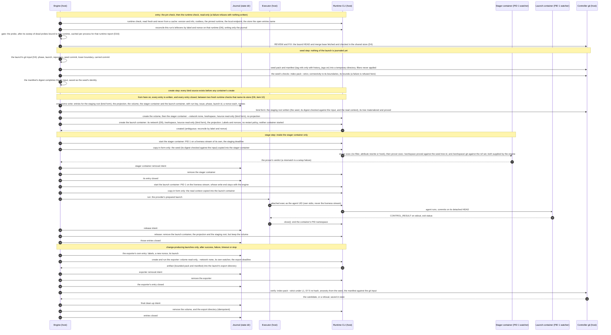
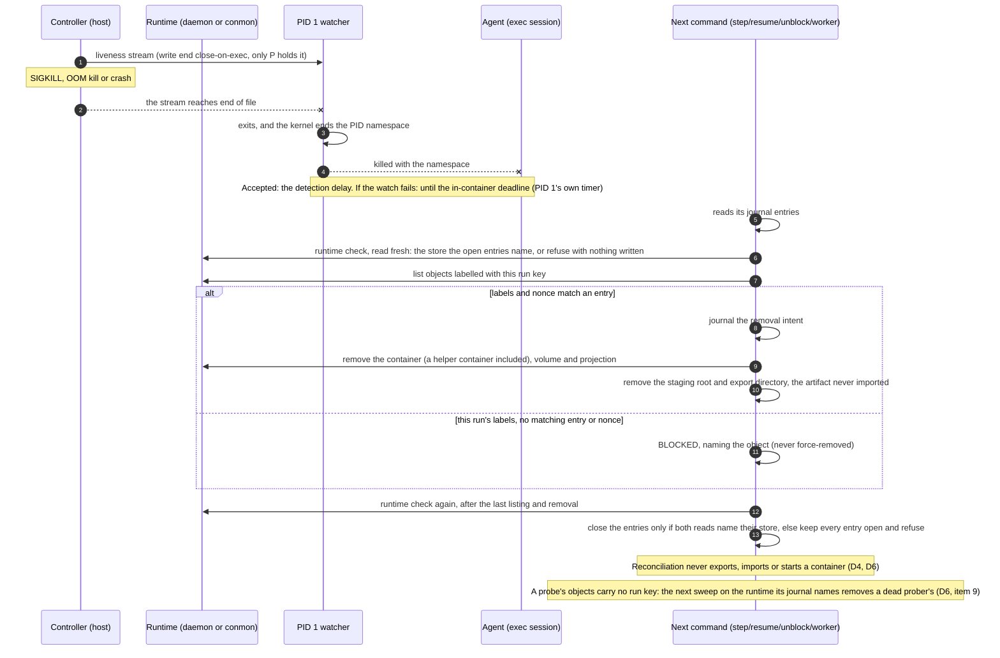
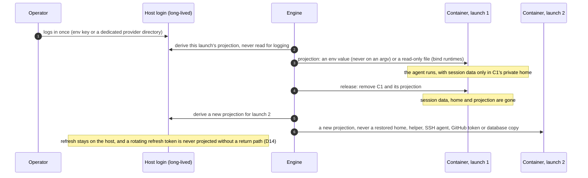

# ADR 0013. Container sandbox backend: the lifecycle contract, trust boundaries and rollout

- **Status:** accepted with required changes, which makes the acceptance
  conditional. The maintainer accepted this record and its dated
  amendments on 2026-11-08
  ([#267's acceptance comment](https://github.com/iceboundrock/AutoForge/issues/267#issuecomment-6726955695)),
  as proposed at `427c797`. The acceptance holds only if four required
  changes are made in the record before it merges. This revision makes
  them, and a later review checks that it carries them:
  - **A.** Every phase binds its revision before the launch, in the
    launch's git input (D4). Verify refuses an artifact that disagrees
    with that binding (D5).
  - **B.** The seed is checked on its own: `index-pack --strict`,
    connectivity against its shallow boundaries, a size and object-count
    bound (D4). The seeded repository is checked after the stager (D2).
  - **C.** No repository filter or hook runs in staging, on the host or in
    the stager. Submodules, LFS and sparse checkouts each get a stated
    support level (D2).
  - **D.** The tree proof and the seed pack are two artifacts. The copy-in
    form's only tree proof is the one inside the container, and D2 states
    why that is acceptable.

  §7 holds the tests the changes add. No other decision was reopened.

  Three corrections followed the acceptance. Each spells out what an
  accepted decision needs in order to be implementable, and none reopens
  one. The maintainer accepted them on 2026-11-08, on the same terms
  ([#267's second acceptance comment](https://github.com/iceboundrock/AutoForge/issues/267#issuecomment-6728978305)):
  - **The bind sources exist before the container.** A runtime configures
    a bind only when it creates a container. So the host-side work moves
    out of the stage step: a seed step that journals nothing builds and
    checks the seed, and the staging root is journaled, written and proved
    before the create. The stage step keeps the in-container work (D13).
  - **ADR 0005 D4.2's C7 gains one relocation,** the staging root at
    `/source`, which D12's bind needs. It is a dated amendment like the
    others (§11 there).
  - **With `history_tags` on, the manifest binds the seed's tags,** and the
    prover accepts exactly those (D2, D4, D11).

  The corrections that followed review round 3 are these three. The
  maintainer accepted them on 2026-11-09, on the same terms: required
  changes A to D still apply, and no decision was reopened
  ([#267's third acceptance comment](https://github.com/iceboundrock/AutoForge/issues/267#issuecomment-6729991033)):
  - **The stager and the prover run offline in a container of their
    own.** An exec session shares its container's network namespace, and
    an agent's launch container is on the bridge. So D9's `--network none`
    for these two helpers could not hold while they ran as execs in that
    container. They now run in the launch's *stager container*, a helper
    container like the exporter. It is created with `--network none` and
    no projection, and the launch container starts only after it is
    removed (D9, D13). D9's helper network policy is unchanged.
  - **A probe's objects are journaled, and recovery runs before the
    probe.** A probe journal, which the probing process holds locked, owns
    every object a probe creates, `doctor`'s included. A sweep removes a
    dead prober's objects (D6). At a command's entry a read-only runtime
    check runs first, then reconciliation, then the probe. So a new probe
    failure, such as a missing image, no longer keeps a crashed launch's
    leftovers in place.
  - **The lifecycle journal is a file of its own,** beside `state.json`. A
    refusal at the probe therefore still leaves `state.json`
    byte-identical (D16, D19). #272 names the file and its format, on #23.

  Two more corrections followed review round 4. The maintainer accepted
  them on 2026-11-09, on the same terms: required changes A to D still
  apply, and no decision was reopened
  ([#267's fourth acceptance comment](https://github.com/iceboundrock/AutoForge/issues/267#issuecomment-6731707060)).
  Neither reopens or amends a decision. Each makes round 3's journals safe
  to implement:
  - **A journal is bound to the runtime that holds its objects.** A probe
    journal names the runtime's product and its store, as the runtime
    check reported them. A sweep acts only on a journal bound to the
    runtime its own command proved. It keeps and reports any other
    journal, and never reads another store's listing as "nothing left"
    (D6, item 9). The run's lifecycle journal carries the same binding,
    and the runtime check refuses a store other than its open entries'
    (D6, D16).
  - **The probe lock is taken outside L1, and the journal follows it.** The
    probe's directory and its lock file are created under L1. The `flock`
    is taken after L1 is released, without waiting, and is checked. Only
    then is the journal written, and every object comes after the journal.
    A sweep therefore never removes a live prober's object or journal.
    ADR 0008 D11.2 stays preserved: no lock is acquired while L1 is held,
    and a probe lock is never waited on (D6, item 9, and §5.5).

  Two more corrections followed review round 5. They postdate the four
  acceptances, and the maintainer has not accepted them yet. The first
  reopens no decision. The second is one more dated amendment, of ADR
  0008 D10.5:
  - **What closes an entry is read fresh, from the store it names.** The
    process caches the probe's result only, for the runtime report it was
    proved on. The runtime check itself is never cached. Every command's
    entry reads it again, and so does every pass that can close an entry
    or remove a journal: reconciliation, a sweep, a launch's clean-up and
    a probe's own end. Each pass reads it once more after its last listing
    and removal, and closes nothing unless both reads name the store its
    entries or its journal name. So a store that changed after the cache
    was filled, or during the pass, never makes objects look gone (D6,
    item 10; D16).
  - **`doctor` takes probe locks under the container backend.** ADR 0008
    D10.5 says `doctor` takes no lock, but its probe and its sweep take a
    probe lock and L1 (D6, item 9). A dated amendment (2026-11-09) allows
    exactly those two, for the container backend only. `doctor` still
    never takes L0 or L2, so it never fails on, waits for or excludes an
    orchestrator. Under bwrap and outside a checkout, `doctor` still
    takes no lock, and neither do `status`, `epic status`, `epic stop` or
    any dry run (§5.5).

  This is a design record, and nothing in it is implemented. Written at
  `main` `32178d8` (2026-11-08), where every reference below was read.
  #267 was planned at `711ff09` and reconciled at `388ecb3`; §1.4 lists
  what has changed since then.
  - *Implemented with it:* nothing. No configuration key, state field,
    protocol number, launch class, prompt, default or behaviour changes.
    Six tests in `tests/test_container_backend_record.py` keep the record
    honest. The invariant map (§5) takes every decision of the records it
    maps (`test_adr_0013_maps_every_decision_of_the_records_it_names`).
    Every decision it marks amended carries a dated #267 amendment in its
    own record, and nothing else does
    (`test_adr_0013_amended_decisions_carry_a_dated_amendment_and_no_others`).
    The **Amends** list below names, per record, exactly what the map
    marks amended (`test_adr_0013_amendment_inventory_matches_the_map`).
    No protocol number is claimed
    (`test_adr_0013_claims_no_state_protocol_number`). The record's links
    and its amendments' links resolve
    (`test_adr_0013_and_its_amendments_link_to_what_exists`), and every ADR
    has a row in the documentation index
    (`test_every_adr_has_a_row_in_the_documentation_index`).
  - *Recorded here:* the twelve decisions #267's planning reconciliation
    lists (D1 to D12, numbered as there) and the ones its other criteria
    need: the lifecycle seam (D13), identity and secret projection (D14),
    what runs where (D15), the capability matrix (D16), the failure
    taxonomy (D17), the threat model (D18), configuration and state (D19),
    and rollout (D20).
- **Decides:** #267 (ENV-A1), for EPIC #266.
- **Amends** (each amendment is dated 2026-11-08, except ADR 0008
  D10.5's, which is dated 2026-11-09. Each applies to the container
  backend only. It takes effect when #273 makes that backend selectable.
  Until then every enforced launch is bwrap's, and each amended decision
  holds as written):
  - [ADR 0002](0002-executor-nothing-outlives-the-invocation.md) §3 and §4e,
    through a new §4f;
  - [ADR 0004](0004-authority-boundary-and-typed-external-effects.md)
    D1.1, the sentence that names the candidate;
  - [ADR 0005](0005-outer-sandbox-and-host-resource-capability-model.md):
    D1.2, D2.1, D4.1, D4.2 (its C7), D5.1, D6.1, D6.3, D6.5, D8.4, D9.1,
    D10.2, D10.3, D10.5, D10.6, D12.3, D13.1, D14.1, D15.4, D17.1, §3 and
    §9, through a new §11;
  - [ADR 0006](0006-candidate-validation-evidence-and-review-certificates.md)
    D6.3, D8.1 and D8.2;
  - [ADR 0008](0008-parallel-epic-scheduler-authority-run-identity-claims-and-locks.md)
    D10.5 (`doctor`'s probe locks) and D13.4.

  ADR 0006 D6.1 was checked and needs no amendment (§5.4).
- **Related:** ADR 0007 (SDK helpers and the interaction contract), ADR
  0009 (LOCAL's removal; `preferred` means `required`), ADR 0011 (stop
  classification), ADR 0012 (the advisor launch class). The issues: #23
  (protocol numbering), #126 and #147 (pause and interaction), #255 (the
  Public Alpha), #257 (the security audit), #266's children #268 to #275,
  #276, #277, #278, #290, #292 and #294, and #280 (the sandbox pin).

## 1. Context

### 1.1 The baseline at `32178d8`

AutoForge has one outer-sandbox backend, Bubblewrap (ADR 0005). It runs
only in REMOTE mode, which since ADR 0009 is the only mode.

- **Launch classes.** There are two (`sandbox_policy.LaunchClass`). A
  *REMOTE agent* is every agent launch. An *export command* is
  `validation.commands` in a candidate's export and
  `merge.verification_commands` in the pre-merge export. LOCAL's classes
  went with ADR 0009. ADR 0012's advisor class is designed but not
  implemented.
- **The description.** The engine hands a provider a `SandboxPlan`. It
  holds the launch's facts, all of them host paths. The provider adds its
  declaration (`ProviderRequirements`: executable, install roots, auth
  items) and gets back a `LaunchDescription`. That description is a list
  of mounts at host paths, plus the environment rewrite, the network
  position and the `/proc`, `/dev` and `/sys` policy (`sandbox.py`).
- **The seam.** `sandbox_bwrap.prepare()` turns a description and a command
  into a `BwrapLaunch`: an argv to spawn in the command's place, its
  descriptors and a pre-exec hook. Once `bwrap` exits, the launch reads the
  status records back (`collect`, `outcome`), and `close()` runs in every
  case. The executor spawns it, so ADR 0002's limits, stop, capture, duplex
  handling and containment apply to `bwrap` unchanged. The backend owns no
  process.
- **The git surface.** The agent works in a host worktree,
  `<common>/autoforge/worktrees/<n>`. The common dir is projected
  read-only, with an overlay whose writable upper layer is a private object
  directory. The candidate is that worktree's `HEAD`, read through the
  common dir, and the controller imports its objects strictly
  (D6.1, D6.3, D6.5).
- **Lifetime.** `--die-with-parent` makes the kernel kill the sandbox when
  the controller dies, `SIGKILL` included, and the PID namespace takes
  every inner process with it (ADR 0005 D10.6, ADR 0002 §4e).
- **Mode and pin.** `sandbox.mode` is `disabled`, `required`, or
  `preferred`, which means `required` (ADR 0009 D7). A run is pinned to the
  mode it was created under, and a weaker mode needs
  `--accept-config-change` (`sandbox_pin.py`, `PIN_SCHEMA = 1`, #280). The
  recorded configuration refuses every schema but its own
  (`config_fingerprint.FINGERPRINT_SCHEMA = 1`). The state protocol is 16.
- **Capability.** Enforcing needs Linux 6.12 or later with Landlock ABI 6,
  unprivileged user, PID and IPC namespaces, and an unprivileged overlay
  mount (ADR 0005 D14.1). Agent CLIs and toolchains come from the host,
  projected read-only (D13.1, D15.4). Launches share the host network
  namespace (D9.1).

### 1.2 What #267 asks for

#267 asks for a container backend's contract, decided before any of
#266's children implement it. It covers the interface from today's launch
description to a backend's create, run, collect and cleanup, the trust
boundaries, the capability conformance, and how the backend is rolled out
beside the bwrap baseline. The baseline must be preserved. The planning
reconciliation of 2026-10-23 found that a container backend contradicts
several accepted decisions as written. #267 therefore requires dated
amendments and an invariant-by-invariant map, and it lists twelve decisions
with the owner's answers to most of them. This record restates neither
#266's motivation nor #267's analysis, beyond what a decision needs. It
records the decisions, the alternatives each rejects, and what each child
issue must deliver.

### 1.3 What a container runtime changes

Nothing in this record was measured on a container runtime. Where it was
written, an agent launch on Debian 13 with kernel 7.0.14, rootless Podman
5.4.2 could not set up its user namespace: `podman info` and
`podman images` both failed with
`newuidmap: write to uid_map failed: Operation not permitted`. Docker is
not installed there. The facts below come from #267's planning comments
and from the runtimes' documented designs. #271, #272 and #275 measure
them, and if a measurement contradicts a decision here, the child that
measured it amends this record.

- **A container is not the controller's child.** Docker's containers
  belong to the daemon, through containerd-shim. Podman's are supervised by
  conmon, which detaches from the CLI. Killing the CLI process the
  executor spawned does not stop the container. `--die-with-parent` has no
  equivalent.
- **The runtime's API is authority.** Whoever reaches the Docker socket,
  or runs Podman as the operator, can start a container that bind-mounts
  anything that user can read. Under a rootful daemon, that user is root.
- **A container has its own network namespace** unless it is given
  `--network host`. Rootless runtimes route its traffic through a
  user-mode helper (RootlessKit, slirp4netns or pasta). Whether host
  loopback is reachable through that helper depends on its options.
- **A bind is only a bind where the daemon shares the controller's
  filesystem.** Behind Docker Desktop, `podman machine` or a `DOCKER_HOST`
  that names another machine, a host path resolves on a different machine.
- **Container metadata persists until removal.** A container's
  configuration, its environment values included, stays in the runtime's
  storage until the container is removed.

### 1.4 Where #267's planning text is out of date

- **LOCAL is gone** (ADR 0009). #267 names REMOTE, LOCAL, validation and
  premerge launch classes. They are now two: REMOTE agent and export
  command (§1.1). The container backend is REMOTE-only because REMOTE is
  all there is.
- **#280 has landed.** The sandbox pin exists (`sandbox_pin.py`), and its
  docstring already reserves the next pin schema for #273's backend fact.
  D8 uses that mechanism, as #267 requires.
- **The ADR 0005 line numbers #267 cites have moved.** #280 and ADR 0009's
  notes edited that record after `388ecb3`, and this record's own
  amendments move them again. This record cites decisions by their
  identifiers.
- **Amendments the planning table did not list.** Mapping each invariant
  (§5) found more decisions the container backend contradicts as written:
  ADR 0004 D1.1's sentence naming the candidate; ADR 0005 D4.1, D4.2's
  C7, D5.1, D8.4, D10.2, D10.3, D10.5, D12.3, D13.1, D15.4 and D17.1;
  ADR 0006 D6.3, D8.1 and D8.2; and ADR 0008 D13.4. ADR 0008 is otherwise
  preserved, and so is ADR 0004.

### 1.5 Terms

- **Backend:** what enforces a launch's outer sandbox: `bwrap`, or
  `container`.
- **Runtime:** the container engine the `container` backend drives: Docker
  Engine or Podman. Podman is a runtime, not a backend (D8).
- **Run step:** the one process an invocation is about, the agent or the
  repository command. Its executor child is the runtime's attached client.
- **Helpers:** AutoForge's own programs inside the image: the *watcher*
  (PID 1, D6), the *stager* (builds `/workspace`), the *prover* (D2), and
  the *exporter* (D5).
- **Launch container:** the container a launch's run step runs in, the
  agent or the repository command (D13).
- **Helper container:** a container of a launch that runs only helpers,
  with `--network none` and no projected credential (D9, D14). There are
  two kinds. The *stager container* runs the stager and the prover before
  the launch container starts. Each *exporter* runs after the launch
  container is removed (D5, D6).
- **Probe:** the real minimal launch that establishes a host's capability
  (D16). Its objects belong to the process that runs it, not to a run
  (D6).
- **Seed:** what a launch's `/workspace` is built from. It is a bounded
  pack with a manifest, and on bind runtimes also a materialized tree
  (D2, D11, D12).
- **Artifact:** what an export produces: a bounded pack plus a manifest.
  It is untrusted data (D5).
- **Journal:** the controller's durable record of each runtime object it
  is about to create or remove (D6, D19).
- **Remote execution sandbox:** a container runtime on another machine
  (#276, #277). It is not AutoForge's REMOTE mode.

## 2. Decisions

D1 to D12 are #267's numbered decisions, in its order. Each decision names
the child that implements it, or says it is documentation only. §6 repeats
the assignment and the order. Where a child's body and this record
disagree, this record wins until the child amends it with a recorded
rationale.

### D1. Authority (decision 1; documentation only)

The host controller keeps every workflow transition, every write to the
shared object store, every git network operation, every GitHub read and
write, every read-back, the issuance of every `ReviewCertificate`, and
merge authorization. The controller's hardened git performs the writes and
network operations: strict import under L1, then fetch and push through
`git_transport`. Its `gh` performs the GitHub work, as typed effects.

A container runs agents, repository-defined commands and AutoForge's
helpers, and nothing else. It holds no GitHub or git credential, no runtime
socket, no controller state and no host path but its bind sources (D12).
What it produces is a claim: the `CONTROL_RESULT` and the artifact, both
verified on the host (D5).

The container runtime is a process launcher that the controller drives
through its CLI (D13). It is not a lifecycle controller. AutoForge sets no
restart policy, uses no compose file or orchestrator, and never leaves
runtime-side scheduling in place across commands.

*Rejected.*

- **Sandcastle's runtime and branch ownership,** as #267 names it: its
  `run()`, and its ownership of the runtime and of branches. An external
  runtime that owns a run's lifecycle and its branches is a second
  lifecycle controller, and branch ownership is git write authority on the
  sandbox side. It would also replace the Python agent providers.
  AutoForge embeds none of it.
- **The Dev Containers CLI as the lifecycle.** Its configuration comes from
  the repository (`devcontainer.json`). It can add mounts, `runArgs` and
  privileges, and its `initializeCommand` runs on the host (D14).
- **A container that pushes its own candidate.** That would need a
  credential inside.

### D2. Source and workspace (decision 2; #292 the host side, #271 the container side)

A container launch sees exactly two inputs derived from the repository.

- **`/source`** is a controller-prepared, read-only snapshot of one exact
  commit. `materialize()` (`materialize.py`) writes it byte-exact and
  proves it with its hash-back proof, into a controller-owned staging root
  (D12). It is present only where D12 proves a bind: the *bind form*.
  #292's `materialize()` criterion applies to this form only. The *copy-in
  form* stages no tree on the host.
- **`/workspace`** is a private writable volume, one per launch.
  - For an agent, it holds a self-contained git repository: the stager
    runs `git init`, strictly indexes the seed pack, writes the tag refs
    the manifest names (none, unless `history_tags` is on: D11), and
    checks out the seed commit on a detached `HEAD` (ADR 0005 D6.2), under
    the rules below.
  - For an export command, it holds a writable copy of the seed commit's
    tree with no `.git` (ADR 0006 D6.5). In the bind form the stager
    copies it from `/source`, the materialized tree that the host proved.
    In the copy-in form the stager writes it from the seed pack, under the
    rules below. In both forms the prover then proves the copy.

**Never bound,** on any runtime: the operator's checkout, live or dirty;
any worktree; the git common dir or any part of it; `$HOME`; any `.git`
admin directory; host credentials; sockets; controller state; and a
provider's operator configuration root.

**A read-only bind does not make content immutable.** The host path can
change after it was proved. So the prover, AutoForge's own code running
D6.3's walk of ADR 0006, proves `/workspace`'s tree (its `.git` aside, for
an agent) against the seed commit's tree id inside a container of the
launch, the stager container below, before any agent or repository
command runs on that tree. It does so in both forms.

- The controller hands the prover that tree id, read from the shared
  store. The id never comes from the pack or the manifest.
- The stager and the prover run in the launch's *stager container*
  (D13). It is a helper container: the volume is mounted, its network is
  `--network none` and it holds no projection (D9, D14). No agent or
  repository command ever runs in it. The prover runs as its own exec
  there, after the stager.
- The launch container, where the agent or the command runs, starts only
  after the stager container has ended and been removed. No process of
  staging runs beside the agent or the command. Between the prover's
  verdict and that start, no container of the launch is running, and the
  host never mounts the volume (D5).
- The prover's verdict reaches the controller on its exec's output. A
  mismatch is a setup failure (D17), never a result.

For an export command, this proof is what keeps ADR 0006's claim, "the
validator saw C", true in a container. A host-side proof of the bind
source alone would not: the command runs in a copy of it (ADR 0006 D6.3 as
amended).

**The tree proof and the seed pack are two artifacts.**

- **The tree** says which exact tree a launch gets. In the bind form it is
  the materialized tree in the staging root, which the host proves with
  `materialize()`'s hash-back walk (ADR 0006 D6.3) before the containers
  that bind it are created (D13). The in-container proof above follows
  it.
- **The seed pack and its manifest** carry the history the agent's
  repository needs (D11). The pack's own checks (D4) prove its objects and
  their connectivity. They prove no tree on disk, so the pack never
  replaces a tree proof.
- **In the copy-in form** no tree is staged on the host. The in-container
  proof is the only tree proof, and that is acceptable for these reasons:
  - **No host proof is lost.** A host-side proof guards a host path that
    is used after it was proved. In the copy-in form no host path is
    bound. The bytes reach `/workspace` only from the pack, which the host
    built from the shared store and checked (D4). A host-side tree proof
    would prove a directory that no launch reads.
  - **It is the tree that matters.** The tree that matters is the one the
    command runs in, and only an in-container walk can see it. ADR 0006
    D6.3 as amended says the same of the bind form.
  - **No trusted party is added.** The prover is AutoForge's code, from the
    content-addressed image (D7), at the controller's version. It runs in
    the stager container, which no agent or repository code enters,
    before the launch container starts. It checks a tree id that the
    controller supplies. The only parties that could
    falsify its verdict are the image and the runtime, and the bind form's
    in-container proof already trusts both.

**The seeded repository is checked after the stager.** The seed pack holds
objects only, so the checks of a repository's refs, alternates, remotes,
hooks and configuration apply to `/workspace/.git` as the stager left it.
The prover makes them, beside its tree proof and before any agent runs:

- the refs are exactly the seed's ref set, and no ref has a reflog:
  - `HEAD`, detached at the seed commit (or at the carried commit, for a
    relaunch: D4);
  - with `sandbox.container.history_tags` off, the default, nothing else;
  - with it on, also exactly the tag refs the manifest names, each at the
    object id the manifest gives it (D11). A missing tag, an extra one, or
    one at another object fails the check;
- `.git/shallow` names exactly the manifest's boundaries;
- there is no alternates file and no remote;
- there is no hook;
- the configuration holds only the keys the stager writes.

The engine hands the prover the expected ref set together with the tree
id. It takes the set from the manifest it built, whose digest the launch's
git input binds (D4), never from the copy in the container. A repository
that fails one of these checks is a setup failure (D17). An export
command's workspace has no `.git`, and the prover checks that none is
there.

**No repository filter or hook runs in staging,** on the host or in the
stager.

- **On the host.** The host builds the seed pack from objects, and
  `materialize()` writes the tree from blobs. Neither checks anything out,
  so no attribute, filter or hook of the repository applies there.
- **In the stager.** The stager's git runs with no system or global
  configuration and no hooks, and with LFS smudging off. For the checkout,
  every path's `filter`, `ident`, `text`, `eol` and
  `working-tree-encoding` attributes are unset, so each file is written
  with its blob's bytes. A `$GIT_DIR/info/attributes` written for the
  checkout and removed afterwards is one way to do this, because it
  overrides the tree's `.gitattributes`. #271 chooses the way, and its
  tests prove it.
- **The result.** Neither the image's git configuration nor the
  repository's own attributes can rewrite bytes before the prover runs. A
  rewrite that got through anyway would fail the tree proof.

**What staging supports.** Each case below gets a diagnostic that says
which it is. The diagnostic goes in the launch's facts, and in the agent's
prompt where the agent is affected:

| Case | Support | What a launch gets |
|---|---|---|
| a submodule (a gitlink) | supported as an empty directory | an empty directory at the gitlink path, as `materialize()` gives today; the submodule's commit is never fetched, read or staged |
| Git LFS | unsupported for content | the pointer files, byte for byte; no LFS object is fetched or smudged, the image's git-lfs included |
| a sparse checkout | unsupported | the seed commit's whole tree; no sparse pattern is read or applied, and a tree over the seed's bound is refused by D4's bound, which names its setting |

*Rejected.*

- **Binding the operator's checkout or a host worktree.** Both are live and
  mutable, and both reach the common dir.
- **ADR 0005's Design A inside a container,** a read-only common dir with a
  private object overlay. It exposes the operator's unpushed work (D11).
  Under rootless UID mapping it needs the operator's UID inside, and an
  overlay of a host directory is not a runtime bind.
- **A writable issue-only bind as the default.** It would let a container
  write host files directly. It stays a separately reviewed future
  alternative, and neither it nor copy-in may bypass exact candidate
  verification (D5).

### D3. Lifetimes (decision 3; documentation only, each row's child implements it)

| Object | Lifetime | Owner | Created | Removed |
|---|---|---|---|---|
| image | content-keyed and cached across runs; reused while its key is unchanged | AutoForge's build (#271) | on a cache miss, in a build container (D7) | never by a run; `doctor` lists it with its size; the operator prunes it |
| launch container | one launch: its run step | the controller | the create step, after its journal entry; started only once the stager container is removed (D13) | the release, right after the run step; or reconciliation (D6) |
| stager container | one launch's staging: the stager and the prover | the controller | the create step, after its journal entry, with `--network none` and no projection | the stage step, right after the prover's verdict and before the launch container starts, journaled; or the release, after a failed stage; or reconciliation (D6) |
| exporter container | one export of a change-producing launch | the controller | the export step, after its own journal entry | right after the export ends, journaled; or reconciliation (D6) |
| `/workspace` volume | one launch; for a change-producing launch, until the verify step's outcome is saved | the controller | the create step, after its journal entry | the final clean-up: for a change-producing launch only once the candidate is bound or refused, otherwise at the release; or reconciliation (D6) |
| per-issue cache volume | the issue: launches that produce a change share it (ADR 0005 §2.5) | the controller creates it; the operator removes it | at the issue's first change-producing launch | never by AutoForge (ADR 0005 D8.4) |
| staging root (`/source`), the bind form only | one launch | the controller (#292) | the create step, after its journal entry and before the creates of the stager container and the launch container, which both bind it (D13) | the release (it is controller-written only); or reconciliation |
| projected model credential | one launch | the controller (#290, #270) | the create step, after its journal entry: an environment value or a read-only file bind, both configured in the launch container's create, never in a helper container's (D14) | the release, right after the run step; or reconciliation |
| agent session data | one launch, inside the container's private home | nobody beyond the launch | by the agent CLI | with the launch container (#278 owns any later need, D14) |
| candidate artifact | until the verify step's outcome is saved; then the shared store holds the candidate and the state binds it | the controller (#269) | the export step, in the launch's export directory (ADR 0005 D8.4 as amended) | the final clean-up, after the verify step; or reconciliation, never imported |
| provider login and refresh state | long-lived, on the host | the operator | the operator's login | never by AutoForge (D14) |
| controller GitHub credential | long-lived, on the host | the operator, through `gh` | — | never by AutoForge; never in a container |

*Rationale.* Each container-side object lives for one launch. That makes
the environment rebuildable: a launch never depends on what an earlier one
left behind, except through artifacts the controller verified. Within a
change-producing launch the volume is the one object kept past the run
step, because the export reads it. The objects that hold the credential
go first. Two objects outlive a launch. The image is a pure function of its inputs (D7). The
cache follows ADR 0005's rule: only launches that produce a change share
it, and each one's output is reviewed.

*Rejected.*

- **A container per issue or per phase,** kept alive between launches. It
  would hold processes across invocations (ADR 0002) and carry agent-written
  state into the next role.
- **A volume per issue for `/workspace`.** See D4.

### D4. Seeding: from the revision the controller verified and bound (decision 4; #269)

A launch's seed commit is always a commit the controller verified and
bound to the phase entry before the launch, taken from the shared object
store. It is never an earlier container's workspace or volume, and never
a commit the container names.

- **`REVIEW`:** the HEAD bound to the review round. Before the reviewer
  launches, the controller reads the PR's HEAD, its base branch and their
  merge base from GitHub. It fetches the HEAD and the merge base into the
  shared object store through its own transport, and binds all three to
  the round (`github-safety.md`, "Before REVIEW"; `workflow.md`, "Bind
  reviews to PR HEAD SHA"). The seed commit is that bound HEAD, and the
  seed's lower end is that bound merge base.
  - The bound HEAD is usually the candidate the controller imported and
    pushed itself. It can also be a commit another actor put on the PR
    branch: an operator's push, a force-push, a rebase, or the base merged
    into the branch. In every case the round reviews the bound HEAD, and
    the seed carries that HEAD, not the run's last own candidate.
  - The seed is built from the binding, after the fetch, and the PR is not
    read again. If the PR moves while the reviewer works, the round is
    stale under the existing rules (`REVIEW -> REVIEW`). The next round
    binds the new HEAD and gets a new seed. No seed is updated in place.
- **`FIX`:** the verified candidate bound to its own entry, which is the
  reviewed HEAD of the round whose findings it resolves. The `FIX` entry
  checks that the PR still has that HEAD, base and merge base, and
  fetches the HEAD into the shared store before the launch. The seed's
  lower end is that round's bound merge base.
  - Usually the reviewed HEAD is the controller's last imported and pushed
    candidate. When the round reviewed another actor's push, it is that
    push.
  - A PR head past the reviewed HEAD, a retargeted base or a moved merge
    base routes `FIX -> REVIEW` with no fixer launched, as today
    (`workflow.md`). No container is created and no seed is built. A
    `FIX` launch therefore never seeds from a head that no review round
    bound.
- **`ANALYZE_EXECUTE` and `REPLAN_REEXECUTE`:** the base the controller
  verified: the start commit, or the default branch head for a
  replacement. It is bound in the launch's git input (below), in the
  seed step.
- **`UPDATE_EPIC`:** the default branch head, bound in the same way.
- **An export command** (`validation.commands`, `merge.verification_commands`):
  the commit it validates, from the shared store, with no history (D2).
  At `REVIEW`'s entry that is the bound HEAD, whoever pushed it. ADR 0006
  D5.5 runs the validation it is missing.
- **A relaunch of the same phase entry** (after a timeout, a stop, or a
  failure that `resume` relaunches): the seed plus the entry's *carried
  commit*. That is the `HEAD` the controller exported and strictly imported
  at the end of an earlier launch of the same entry, when it descends from
  the seed. Uncommitted changes are never carried. `REVIEW` exports
  nothing, so it never has a carried commit, and a relaunch of the same
  round seeds from the same bound HEAD.
  - The stager checks out the carried commit. Where this record says the
    stager checks out the seed commit, or the prover proves its tree, it
    means the carried commit for such a relaunch.

**The launch's git input: every phase binds its revision before the
launch.** In the seed step of every launch (D13), before any journal
entry of it, #269 produces one immutable input. It holds:

- the phase, and the launch's identity (the run key, the issue and the
  launch id of D6);
- the repository's identity: its owner and name, and its object format;
- the expected seed commit, chosen by the rules above;
- the seed's lower boundary: the bound merge base for `REVIEW` and `FIX`,
  and the base for the other phases. An export command has none;
- the carried commit, if there is one;
- the digest of the seed manifest that #292 built from the rest.

The binding has these consequences:

- **No later switch.** Once the input exists, nothing switches the launch
  to a newer default-branch head, PR head or candidate. `ANALYZE_EXECUTE`,
  `REPLAN_REEXECUTE` and `UPDATE_EPIC` bind their base or default-branch
  head here, as `REVIEW` and `FIX` bind theirs at their entry. A default
  branch that moves during the launch changes nothing in it.
- **Hand-off.** No container receives a seed unless its manifest's digest
  is the one the input holds. The bind form checks the digest as the seed is written
  into the staging root, before the create. The copy-in form checks it
  before the copy-in, at the stage step.
- **The verify step** (D5) refuses an artifact whose manifest disagrees
  with the input.
- **Names and state.** This record fixes the input's content. The type's
  name is #269's. Its persisted part is D19's "seed's identity".

**How the bound revision enters the seed.** #292 builds the seed from the
shared store, through `local_git_request`'s hardening, and only after the
fetch above has succeeded. For `REVIEW` and `FIX` it holds:

- the seed commit (the bound HEAD) and the bound merge base;
- every commit reachable from the bound HEAD and not from the merge base;
- as shallow boundaries, the merge base and each parent of one of those
  commits that lies outside the range. A merge of the base branch into
  the PR branch can add parents like that. The agent then has every
  commit's parent tree, and `git diff` from the merge base to the HEAD
  gives the PR's diff;
- the trees and blobs of all of these.

In every phase, the manifest names the launch's identity, the
repository's object format, the seed commit, its lower boundary (the
merge base, for `REVIEW` and `FIX`), every shallow boundary, the carried
commit if there is one, and the seed's tag refs, each with its object id.
That last list is empty unless `history_tags` is on, and then it is the
set the controller selected (D11). Through the manifest's digest, the
launch's git input binds that set as it binds the commits.

Before the seed is built, the controller checks two things in the shared
store: the bound HEAD and the merge base are present as commits, and the
merge base is an ancestor of the HEAD. If either check fails, the launch
is refused before anything is journaled or created, as a failed fetch is
today. Nothing is launched, and `resume` fetches again. The stager checks
out the seed commit on a detached `HEAD`, and the prover proves that
commit's tree (D2). The reviewer's prompt names the same HEAD and merge
base that the manifest names. A different commit at either end would be
a different review.

**The seed is checked on its own,** in every phase, in the seed step
(D13): before hand-off and before any journal entry of the launch. A
`REVIEW` seed can now be another actor's push, so the run's own history
does not bound its size. The host, through `local_git_request`'s
hardening, makes three checks:

- **The pack.** It runs `index-pack --strict` over the seed pack, into a
  controller-owned temporary directory and never into the shared store.
- **Connectivity, against the manifest's shallow boundaries.**
  - The seed commit, and the carried commit if any, are present.
  - The closure above the boundaries is complete: every commit, tree and
    blob reachable from them without crossing a boundary is in the pack.
  - The pack holds exactly the commits D11 names, no more and no fewer.
  - It holds a tag object only if the manifest's tag set reaches it, and
    it holds every one that set reaches. Each tag ref the manifest names
    peels, through tag objects in the pack, to a commit in the pack. With
    `history_tags` off, the pack holds no tag object.
- **Its bounds.** The pack has a size bound and an object-count bound,
  both operator settings (D19). A history setting (D11) can make a seed
  larger, and the refusal then names that setting.

A seed that fails any of these is refused as a setup failure (D17). It is
refused before any journal entry, so nothing is created and no clean-up
follows. The pack holds objects only. The checks of refs, alternates,
remotes, hooks and configuration therefore apply to the seeded repository
after the stager, not to the pack (D2).

The controller exports at every end of a change-producing launch that it
runs: success, failure, timeout or stop. After a controller crash,
reconciliation removes the leftover volume without exporting it (D6), so
the crashed launch's work is lost. Under bwrap that work survives in the
worktree.

*Consequence.* #187's prompt note, which tells an agent what an earlier
launch left uncommitted, has nothing to report under the container
backend. #271's container prompt says that uncommitted work is discarded
at the end of each launch.

*Rejected.*

- **Seeding `REVIEW` from the run's last own candidate.** When another
  actor moved the PR, the round would review a commit it does not name,
  and a clean verdict would bind a HEAD the reviewer never saw.
- **Seeding from a PR head read again at the seed step.** The seed and
  the round's binding could then name different commits. The binding is
  read once, and the seed follows it.
- **Reusing a volume across launches,** even of one role. The next launch
  would start from an unverified workspace, with an agent-writable
  `.git/config`, hooks and untracked files. Across roles that breaks
  `REVIEW`'s independence, as ADR 0005 D8.1 argues for the home.
- **Exporting during reconciliation.** It would make the clean-up path an
  import path too, run on a volume whose launch the controller never saw
  end. Reconciliation stays remove-only.

### D5. The candidate and its import (decision 5; #269 the semantics, #271 the wiring)

#269 owns the engine's *candidate source*, one abstraction over both
backends:

- **bwrap:** unchanged. It reads the worktree's `HEAD` through the common
  dir (ADR 0005 D6.3) and imports the private object directory strictly
  (D6.5).
- **container:** the artifact.

The artifact is untrusted data: one pack, bounded in size, plus a manifest.

- **The manifest is a claim.** It names the claimed `HEAD`, the launch's
  identity, the seed commit, its lower boundary, the carried commit if
  any, and the object format.
- **The exporter** runs in a fresh helper container with the volume
  mounted read-only and `--network none`, after the launch container is
  removed
  (D6). It packs the objects reachable from the workspace's `HEAD` and not
  from the seed. The artifact leaves through the exporter's output or the
  runtime's copy-out, into the launch's export directory, which only the
  controller writes (ADR 0005 D8.4 as amended). Its output is untrusted. A
  tampered exporter gives the agent nothing it does not already have,
  which is the choice of what to commit.
  - The exporter is a runtime object of the launch like any other. It is
    journaled before it is created, labelled, supervised within a bound,
    and reconciled (D6).
- **The host's checks.** The claimed commit is the candidate only when all
  of these hold:
  - `index-pack --strict` has put it in the shared store. It runs under L1
    (ADR 0008 D12.3), through `local_git_request`'s hardening (ADR 0004
    D7.3).
  - ADR 0004 D7.5 re-hashes it.
  - It descends from the seed.
  - The manifest agrees with the launch's git input (D4): the same
    launch, seed commit, lower boundary, carried commit and object format.
    The host takes each expected value from the input it bound in the
    seed step, never from the container.
  - The phase's existing candidate rules accept it.
- **Failure.** A pack that fails `--strict`, an artifact over its bound, a
  manifest that does not parse or disagrees with the launch's git input,
  or a claimed `HEAD` that is not a commit descending from the seed: each
  is a candidate refusal under the phase's existing rules. It is never
  retried, and nothing is published, as with ADR 0005 D6.5's failure.
- **What the host never does.** It never mounts the volume. It never runs
  git with the container's repository as its repository, and never reads
  that repository's configuration or hooks. It never applies a diff, and
  never copies working-tree files back. rsync may serve as a transport
  beneath this check. It is never the content boundary.

*Rationale.* ADR 0005 D6.5 already treats the agent's objects as untrusted
input and verifies them by content. Only the input changes, from a host
directory to a pack, and a pack is the smallest form that carries exactly
the commits.

*Rejected.*

- **Copying working-tree files out** (rsync, `docker cp` of `/workspace`)
  and committing them on the host. That applies a raw diff, which #267
  excludes, and it runs host git over agent-chosen paths.
- **Reading the volume's repository from the host.** Agent-written
  configuration and hooks would reach a host git process.

### D6. Supervision: what replaces ADR 0005 D10.6 (decision 6; #272)

This is the contract a daemon-owned container can meet. It replaces
"controller death kills the sandbox" for the container backend.

1. **Names and labels.** Every container and volume a launch creates has a
   run-scoped name and these labels: the run key (ADR 0008's `RunKey`),
   the issue, the phase, the launch id, the object's kind, and a nonce.
   The controller first writes a journal entry holding all of them,
   atomically. Only then does it create anything (D19).
   - This covers every container of the launch: the launch container and
     its helper containers, the stager container (D13) and each exporter.
     An exporter gets an entry and a nonce of its own, written before its
     create, so a crash between its create and its removal leaves an
     object that reconciliation can prove is the run's.
   - The credential projection has an entry of its own, and so do the
     launch's host directories (the staging root and the export
     directory). Each entry names the launch it belongs to.
   - A runtime configures a container's binds, volumes and network only
     when it creates the container. An exec into a running container can
     neither add a mount nor change the network. So the entries of
     everything the create step makes are written together, in one atomic
     write after the seed step: the staging root (bind form), the
     credential projection (which D14 configures at the launch container's
     create), the volume, the stager container and the launch container.
     The staging root is then written and proved, and only after that are
     the volume and the two containers created (D13). Nothing is bound
     into a running container.
2. **Ownership.** An object belongs to the run only when its labels and
   nonce match a journal entry. Nothing is stopped or removed otherwise. A
   probe's objects belong to its probe in the same way, through the
   probe's own journal (item 9).
3. **The death-watch.** The container's PID 1 is AutoForge's watcher.
   - It runs under a non-root UID that is distinct from the agent's, with
     every capability dropped.
   - It reads a liveness stream whose write end only the controller holds.
     That end is close-on-exec and never inherited by another long-lived
     process.
   - The stream reaches the container over a runtime channel separate from
     the agent's stdio. The agent runs in an exec session of its own, so
     Pi's RPC duplex and OpenCode 2.x's stdin are never borrowed.
   - When the stream reaches end of file, PID 1 exits, and the kernel ends
     every process in the container's PID namespace. Inside the namespace
     the kernel ignores `SIGKILL` sent to init, and a different UID cannot
     signal it at all.
   - #272 designs the transport and proves it on both runtimes.
4. **The in-container deadline.** PID 1 ends the container at the launch's
   runtime ceiling plus ADR 0002's kill graces, so a watch that fails still
   ends at a known time.
   - Agent launches use the profile's `max_runtime_seconds`. The container
     backend requires it to be finite for every agent profile, and refuses
     at load a configuration that leaves it unset (D19).
   - Export commands use `execution.command_timeout_seconds`.
   - A helper container, the stager container or an exporter, is
     supervised in the same way. Its PID 1 is the same watcher, on a
     liveness stream of its own that only the controller holds. Its
     deadline is a fixed bound that the facts record: the staging bound,
     which #271 states, for the stager container, and the export bound,
     which #269 states, for an exporter. The controller's calls that run
     its helpers go through the executor with that bound as their timeout,
     and their `close()` ends the helper container's PID namespace on every
     path (ADR 0002 §4f). For an exporter, the artifact's size bound is
     enforced while the stream is read. An artifact over the bound ends the
     exporter, and the launch's export is a candidate refusal (D5).
5. **Every exit path the controller runs:** success, failure, timeout,
   stop, `Ctrl-C`, or an exception inside the executor's guard. Each
   removal journals its intent first and closes its entry only after a
   verified removal, read from the store the entry names (item 10).
   - **The stager container goes before the run step.** The stage step
     removes it as soon as the prover's verdict is read, and only then
     starts the launch container (D13). If the stage step fails, or is
     interrupted, the release removes it with the rest.

   The steps after the run step come in this order:
   - **Close.** The run step's `close()` ends the launch container's PID
     namespace before the invocation returns. That keeps ADR 0002 §3 on
     each of those paths (ADR 0002 §4f).
   - **Release.** The engine removes the launch container, the stager
     container if it is still there, the credential projection and the
     staging root. Nothing after the run step needs them, and the launch
     container's record holds the projected environment (D14). The volume
     is not removed here for a change-producing launch.
   - **Export,** only for a change-producing launch that ended by success,
     failure, timeout or stop (D4). It is skipped on `Ctrl-C` and after an
     exception inside the guard. The engine writes the exporter's entry,
     creates and runs it (item 4), then removes it. If the exporter fails
     to start, the engine retries within bounds, each attempt under a new
     entry and nonce, and after that the export is a candidate refusal.
   - **Verify** (D5). The engine imports the artifact strictly, or refuses
     it, and saves the outcome (D19).
   - **Final clean-up.** Only after the verify step's outcome is saved, or
     once the export is skipped, does the engine remove the volume and the
     export directory. A launch with nothing to export (`REVIEW`,
     `UPDATE_EPIC`, an export command) removes its volume at the release.
   - Clean-up is idempotent and retried within bounds. A clean-up that
     still fails leaves its entry for reconciliation, and it is reported.
     A clean-up whose runtime reads name another store than its entries
     is such a failure: it closes nothing (item 10).
   - A change-producing launch's volume therefore exists from the create
     step until the candidate is bound or refused, or the export is
     skipped. No removal of it is issued while an export of it may still
     run or be retried.
6. **Reconciliation.** It runs at every `step`, `resume` and `unblock`, and
   when a scheduler worker starts on an issue, before any launch.
   - It lists the runtime's objects that carry this run's run-key label,
     and removes each one that matches a journal entry. Helper containers
     are included: the stager container and each exporter. A running one
     is stopped first. After the controller's death its watcher has
     normally ended it already.
   - It runs after the runtime check and before the probe (D16), so a new
     probe failure never keeps it from removing what an earlier launch
     left. A probe's objects carry no run key, so it never lists them
     (item 9).
   - It removes the staging root and the export directory that an open
     entry names. A partial or complete artifact left in the export
     directory is deleted, never imported.
   - An object with this run's labels but no matching entry or nonce is
     reported, and the run enters `BLOCKED` naming it. Nothing is guessed
     or force-removed.
   - An entry whose objects are already gone is closed. That covers an
     entry written before a create that never happened, and a staging
     root that was never written.
   - Each entry names the runtime it was written under: the runtime's
     product and its store, as the runtime check reported them (D16).
     Reconciliation lists only that runtime. The runtime check refuses a
     command whose runtime reports another store than the run's open
     entries name, before reconciliation and with nothing written (D16).
     That check is read fresh, never from a cache, and reconciliation
     reads it again before it closes any entry (item 10). So an object in
     another store is never taken for one that is gone.
   - Reconciliation never starts a container, and never exports or imports
     anything (D4). A volume that a crash left before its export is
     removed without one, and that launch's work is lost.
7. **No restart policy is ever set.** `--rm` may be passed as well, but
   nothing relies on it.
8. **Proof under `required`.** The probe and `doctor` start a stand-in
   parent that holds a liveness stream, kill it with `SIGKILL`, and measure
   how long the runtime takes to report the container gone. #272 measures
   and states the bound. A host that does not meet it is refused under
   `required` before anything of the step is saved or launched.
9. **A probe's objects.** A probe creates runtime objects and a host
   directory too: item 8's stand-in launch, D12's nonce proof and D16's
   minimal launch. It can also run where no run exists, in `doctor`, or in
   a gate before a run has a journal. So a probe belongs to the process
   that runs it, and it has a journal of its own.
   - **The probe directory, its lock and its journal,** in this order.
     The probing process creates no runtime object and no staging root
     before step 3, and it never acquires a lock while it holds L1:
     1. **Under L1,** in one critical section that acquires nothing, as
        ADR 0008 D12.1's sandbox directories are made. `safefs` creates
        `<git common dir>/autoforge/sandbox/probe/` if it is absent, the
        probe's directory `probe/<probe id>` (a random id, never reused),
        and in it an empty lock file, created exclusively
        (`O_CREAT | O_EXCL | O_NOFOLLOW | O_CLOEXEC`) and kept open. Then
        L1 is released.
     2. **Outside L1,** it takes an exclusive `flock` on that descriptor
        without waiting (`LOCK_EX | LOCK_NB`). Holding it, it checks three
        things: the lock file's path still names the inode it locked, the
        inode has one link, and the filesystem's `flock` is a local kernel
        lock (ADR 0008 D11.4's list). A lock that is refused, or a path or
        link check that fails, means a sweep took the directory first
        (below). The prober then closes the descriptor and starts again
        from step 1, under a new probe id, within a bound #272 states.
        Past the bound, the probe fails and names the contention. On a
        filesystem whose `flock` is not local, the prober removes the
        directory as its own end does, and the probe fails and names the
        filesystem. No object of the probe exists yet in either case.
     3. **The journal.** Only then does it write the journal beside the
        lock file, atomically. The journal is bound to a runtime (below)
        and has an entry (names, labels, nonce) for every object the probe
        will create, the probe's own staging root in that directory
        included. Only after that does the probe create anything.

     The prober holds the lock until its directory is gone. The lock is on
     a file of its own because an atomic replacement of the journal would
     drop a lock held on it. The descriptor is close-on-exec, so no
     runtime process the probe starts can inherit it and keep the lock
     held after the prober dies. The kernel releases the lock when the
     process ends, however it ends. This is the OS-level file locking of
     AGENTS.md's runtime model, not a heartbeat.
   - **What that order guarantees.**
     - Only a prober that holds its lock and has checked it writes a
       journal. It removes the journal before it releases the lock, or it
       leaves the journal for a sweep and never acts on the directory
       again (its own end, below). So a sweep that takes a directory's
       lock and finds a journal has proved that no live prober acts on it.
     - A directory with no journal holds no object, because every object
       is made after the journal and removed before it.
     - A sweep can still take a lock in step 2's window, between the lock
       file's creation and its `flock`, while the prober is alive. It then
       removes only an empty lock file and a directory. The prober finds
       this at step 2 and starts again.
     - So no sweep removes an object or a journal of a live prober.
   - **Bound to its runtime.** The journal's header names the runtime that
     will hold the probe's objects: the runtime's product and its store,
     as the runtime check reported them (D16), at the local endpoint
     (D13). #271 names the fields of the store, for example Docker's
     engine id and Podman's graph root, from each runtime's own `info`. A
     probe creates objects only on that runtime.
   - **Labels.** A probe's objects carry the probe's kind, its probe id
     and their nonce, and no run key. No run's reconciliation lists them,
     and the sweep below lists nothing else.
   - **Its own end.** On every path the probe runs, in this order:
     - it removes each of its objects, journaling each removal first;
     - it reads the runtime's report again (item 10). Only if that read
       names the journal's runtime does it close the entries of the
       removals it verified, then remove the staging root, and then the
       journal. Otherwise the journal and the directory stay, for a sweep
       on the journal's runtime, and the probe fails and names the change;
     - then, under L1, the lock file and the directory, if the journal is
       gone;
     - last, it closes the lock's descriptor.

     So the lock is held until nothing of the probe is left, or until
     what is left is a journal that a sweep can act on.
   - **Its containers.** A probe container is started only with the
     watcher as PID 1, on a stream the prober holds, and with the probe's
     own short deadline. Item 8's stand-in parent ends at the same
     deadline by itself, so neither outlives the probe's bound after a
     crash. A container that was created and never started has no
     watcher, and `--rm` never fires for it. The sweep is what removes
     it.
   - **The sweep.** Before a probe creates anything, and in `doctor`, the
     process sweeps the checkout's probe directories on one runtime: the
     one its own runtime check proved (D16), read again for the sweep
     (item 10). For a gate that is the run's pinned runtime, and for
     `doctor` the one D8 detects. A process whose runtime check failed
     sweeps nothing. The sweep never waits on a probe lock. For each
     directory:
     - **The lock.** It opens the lock file without following a link and
       tries the lock without waiting (`LOCK_EX | LOCK_NB`). A held lock
       belongs to a live prober, `doctor`'s or a gate's, or to another
       sweep that owns the directory now. The directory is skipped.
     - **The check.** Having taken the lock, it makes step 2's check. If
       the path no longer names the locked inode, another sweep removed
       the directory while this one was opening it, and the directory is
       skipped. On a filesystem whose `flock` is not local, the sweep
       removes nothing there and reports it. While the sweep holds the
       lock, it is the directory's only owner, and a second sweeper skips
       the directory.
     - **No journal.** The directory holds no object, at most the
       unfinished temporary file of a journal's atomic write. The sweep
       removes that file, then the lock file and the directory under L1,
       as the probe's own end does, then its descriptor.
     - **A journal bound to the swept runtime.** The prober is dead. The
       sweep lists that runtime's objects by the probe's labels and removes
       each one whose labels and nonce match an entry, stopping a running
       one first. Each removal is journaled first. An entry whose object
       that runtime does not list is closed. The sweep then removes the
       directory as the probe's own end does. It closes those entries and
       removes the directory only once item 10's second read names the
       journal's runtime. Otherwise it closes nothing, keeps the journal,
       which gains only the removal intents it wrote, and the directory,
       and reports them as it reports a journal not bound to the swept
       runtime (below).
     - **A journal not bound to the swept runtime.** This covers a journal
       bound to another product or to another store of the same product,
       and a journal that cannot be read, has an unknown format or names
       no runtime. The sweep lists nothing and removes nothing. It keeps
       the journal and the directory byte-identical and releases the lock.
       Another store's listing would not show the journal's objects, and
       would be read as "nothing left", which would strand them as objects
       no journal names. `doctor` reports the directory, the runtime it is bound to,
       and the setting (`sandbox.container.runtime`) under which a sweep
       reaches it. The directory blocks no run and no probe. A sweep on
       its own runtime removes it later. If that runtime never comes back,
       it stays, reported.
     - **No lock file.** Step 1 creates a directory with its lock file,
       and the end removes both, each in one section under L1. So under
       L1 a directory with no lock file is not a live prober's: a process
       died inside one of those sections. Under L1 the sweep checks again
       that the lock file is absent, and removes the directory if nothing
       else is in it. Otherwise it reports it and leaves it.
     - **Unknown objects.** A probe-labelled object on the swept runtime
       that no journal of the checkout bound to that runtime names is
       reported by `doctor` and never removed. It is another checkout's
       probe, or one whose journal was removed by hand. It belongs to no
       run, so it blocks none.
     - The sweep is idempotent. A sweep that dies while it holds a dead
       prober's lock leaves the directory to the next sweep, which takes
       it over.
   - **Locks and their order.** A probe lock is taken only with `LOCK_NB`:
     by a prober on its own directory, and by a sweep on a dead one's. It
     is never taken while L1 is held, and nothing ever waits on it. L1 is
     taken for step 1's creation and for the removal of a lock file and
     its directory, each one critical section that acquires nothing. The
     removal is entered while the remover holds that directory's probe
     lock, which is the only way the two are ever held together. Only
     those two sections change the shared parent `probe/`. The journal and
     the staging root inside the directory are written by the lock's
     holder alone, and take no L1. No runtime call runs under L1. The
     order is therefore L0, then L2, then a probe lock, then L1. L1 is
     still the only blocking acquisition, and its holder still acquires
     nothing, so ADR 0008 D11.2's argument holds as written: no wait-for
     cycle can form (§5.5). An L1 wait that runs past its bound (ADR 0008
     D11.3) fails step 1 as a directory that cannot be prepared, so the
     probe fails with nothing made. In a removal, it leaves the directory,
     still holding no object, for a later sweep, and the sweep reports it.
   - **`doctor`'s locks.** `doctor`'s probe and its sweep take exactly
     these two locks, a probe lock and L1, and no other. `doctor` never
     takes L0 or L2, so it never fails on, waits for or excludes an
     orchestrator, and it reconciles no run (D16). ADR 0008 D10.5 says
     that `doctor` takes no lock, so it is amended for the container
     backend only, to allow exactly these two (§5.5). The cost is that
     `doctor` can wait for L1 behind one controller critical section, a
     fetch among them, within D11.3's bound. Past it, the probe fails as
     above and names the lock, and `doctor`'s other rows are still
     reported. Under bwrap, and outside a checkout (below), `doctor`
     takes no lock.
   - **Outside a checkout** there is no probe directory. `doctor` then runs
     only the runtime check (D16), and says that the probe needs a
     checkout.
10. **What closes an entry is read fresh, from the store it names.** A
    run's entry and a probe's journal are each bound to one runtime and
    one store (items 6 and 9). A listing of another store shows none of
    their objects. So the controller proves the store every time it may
    act on a listing, and never relies on what it proved earlier in the
    process.
    - **A pass** is a run of runtime calls that ends by closing entries or
      by removing a journal or a probe directory: reconciliation (item 6),
      a sweep and a probe's own end (item 9), and each removal on a
      launch's own path, the stager container's, the release, each
      exporter's and the final clean-up (item 5).
    - **Its first read.** A pass starts with the runtime check's read-only
      report (D16), read from the runtime then, never from the process's
      cache. Reconciliation's first read is the command entry's runtime
      check. The report must name the runtime and the store that the
      pass's entries or journal name. If it does not, the pass lists and
      removes nothing.
    - **Its second read.** A pass journals each removal's intent as it
      goes, as items 5 and 9 say. It closes no entry, and removes no
      journal and no probe directory, until it has read the report again
      after its last listing and removal, and that report names the same
      runtime and store. Only then does it close what it removed or found
      gone.
    - **When a read does not match, or fails,** every entry stays open, and
      every journal and probe directory stays. The pass ends as a store
      mismatch does at a command's entry:
      - reconciliation refuses the command (D16), and `state.json` stays
        byte-identical;
      - a sweep keeps the directory and reports it (item 9);
      - a probe's own end keeps its journal, and the probe fails and names
        the change;
      - a clean-up leaves its entries for reconciliation and is reported
        (item 5).

      An object the pass had already removed matched an entry's labels and
      nonce, so it was the run's or the probe's. Its removal is safe, even
      though it proves nothing about the entry.
    - **Where entries are written.** The create step's one write (item 1),
      an exporter's entry (item 5) and a probe's journal (item 9) bind
      their entries to a report read just before that write, never to the
      cache's. They read it again after their last create. A mismatch
      there fails the step as a failing create does (D17): a setup failure
      at the create step, a candidate refusal at the export, and a probe
      failure that names the change. The entries stay open and bound to
      the first report. An object made in the other store stays there,
      with the labels that the residual below relies on.
    - **The cache never decides.** The probe's result is cached for the
      controller process, for the runtime report it was proved on (D16).
      The cache can spare a later entry the probe, but never the runtime
      check, and never a pass's two reads.
    - **The residual.** The two reads detect a store that changed before
      or during a pass. They miss a store that changed and changed back
      between them. Only the operator who owns the runtime can cause that,
      by reconfiguring it twice within one pass, for example by
      restarting a Docker daemon on another data root and back. Even then
      nothing is removed unproven. A run's object left in a store that no
      open entry of its names still carries the run's labels, so a later
      reconciliation that lists that store proves it by its nonce or
      blocks on it (item 6). A probe's becomes an object that no journal
      names, which `doctor` reports and nothing removes (item 9).
    - *Rejected: naming the store in every call instead.* Docker's CLI
      reaches a daemon and cannot name the daemon's store, so such a
      binding would not cover both runtimes, and the two reads would
      still be needed for Docker.

**The residual, as the owner accepted it on 2026-10-23.** After a
`SIGKILL` of the controller, an OOM kill or a crash, a container keeps
running for the watch's detection delay. If the watch itself fails, it
runs until its in-container deadline.

- **Not accepted:** a survival that only the next reconciliation bounds.
- **No immediate-death claim** is made for `--rm`, `rm -f`, `--init` or
  start-up clean-up, here or in any document or diagnostic.
- **A survivor can** go on running the agent and spending model tokens,
  keep its projected model credential live, use its network, and write its
  own `/workspace`.
- **A survivor cannot** write GitHub (it has no credential), touch the host
  checkout or controller state, or get its output accepted, since import
  happens only on the controller's verified path.
- **Other cases.** With no restart policy, nothing comes back after a
  reboot. A suspended laptop runs nothing, the controller included, so
  suspension produces no survivor.

*Rejected.*

- **The strict reading,** that nothing may outlive the controller ever.
  The container backend could then never be enforced. It is REMOTE-only,
  and REMOTE's `preferred` means `required`, so it would have no use.
- **Reconciliation alone.** It runs at the next AutoForge command, which
  can be hours away.
- **`--rm`, `--init` or start-up clean-up as the guarantee.** None of them
  ends a running container when its client dies.
- **The agent's stdin as the liveness channel.** For Pi RPC and Claude's
  stream-json it carries protocol records. Closing it is the orderly
  shutdown request (ADR 0002 §4a), and an untrusted process holds its
  reading end.
- **A host-side watchdog process** that outlives the controller. That is a
  long-lived owner, which AGENTS.md's runtime model excludes.
- **Container root as PID 1.** Under rootless, container root is the
  operator's UID on the host, and the watcher needs no privilege.

### D7. The image (decision 7; #271 the contract, #273 the diagnostics)

The owner decided on 2026-10-23 that AutoForge installs the agent CLIs
itself, and that the operator may configure MCP servers and Skills, which
AutoForge installs with them.

- **Inputs, from operator configuration only** (strict key validation),
  never from the repository or an agent:
  - a base image named by digest, which holds the toolchains the
    repository needs;
  - AutoForge's own layer: the watcher, stager, prover and exporter, at
    this controller's version;
  - each agent CLI at a pinned version: Claude Code, OpenCode 2.x and Pi.
    The SDK helpers of ADR 0007 join when they land, at their exact pins;
  - each operator-configured MCP server and Skill, at a pinned version.

  No `Dockerfile`, `devcontainer.json` or build script of the repository is
  ever read.
- **Where the build runs.** In a build container, never on the host. It
  has network access for its downloads and sees no host path but a context
  directory the controller wrote. It holds no credential. A base image
  that needs registry authentication is pulled by the operator first, and
  AutoForge then references it by digest from local storage.
- **Caching.** The image's key is the digest of every input. An unchanged
  configuration reuses the cached image, which costs the fewest resources.
  Every launch names the image by its content-addressed id, never by a
  mutable tag. The id is recorded in the launch's facts (D16) and in
  validation's policy P (ADR 0006 D8.1 as amended).
- **Toolchains come from the base image.** AutoForge installs none.
  `sandbox.read_only_paths` (ADR 0005 D15.4) projects host paths, so it has
  no meaning under the container backend and is refused there (D19).
- **Installing is not enabling.** Every launch keeps today's isolation
  flags: Claude Code's `--safe-mode --strict-mcp-config`
  (`providers.py`), Pi's `--no-extensions --no-skills`, and OpenCode's
  refusal of integrations (#165, [Pi policy](../pi-policy.md),
  [SDK policy](../sdk-policy.md)). An installed integration stays disabled.
  Enabling one needs its own reviewed amendment of those policies, which
  states:
  - what each integration may load;
  - which credentials it may receive, under #290's projection rules, and
    never a GitHub credential;
  - that it runs inside the same container, under the same network policy.

  No child of #266 enables an integration without that amendment.
- **Diagnostics (#273).** The dry run and `doctor` show the image id and
  its inputs, and each installed CLI, MCP server and Skill with its
  version and whether it is enabled.

*Rejected.*

- **An image the operator finishes,** CLIs included. The CLI versions and
  their provenance would be invisible, and so would drift.
- **Projecting the host's CLIs into the container.** Host install roots
  bound into a container are the arbitrary host mounts #267 excludes.
  ADR 0005 D13.1's projection is bwrap's mechanism.
- **The repository's development-container configuration.** It is
  repository-controlled, and Dev Containers' `initializeCommand` runs on
  the host (D14).
- **Mutable tags** such as `latest`.

### D8. Backend selection, runtime detection and the pin (decision 8; #273, with #271's detection)

- **The key.** `sandbox.backend` is `bwrap` or `container`. An absent key
  means `bwrap`. `container` is neutral: Podman is a runtime the backend
  detects, and it gets no value of its own. That is the owner's decision
  of 2026-10-23.
- **Modes.** `container` requires `sandbox.mode: required`, or `preferred`,
  its alias. `container` together with `disabled` is refused at load,
  because it would run every launch on the host. Under `required`, every
  covered launch runs enforced inside the selected backend or is refused.
  It never falls back to the other backend, or to the host.
- **Detection.** An operator setting, `sandbox.container.runtime: podman`
  or `docker`, names the runtime.
  - If it is unset, the backend uses Podman when `podman` is on the
    controller's `PATH`, and Docker otherwise.
  - Detection runs once, with no fall-through. If the detected runtime's
    probe fails, the step is refused naming the runtime and the setting.
  - A runtime's identity is what it reports about itself (its product and
    version, from its own `version` and `info`). The executable's name is
    never taken as proof: a `docker` that is Podman's compatibility wrapper
    is identified as Podman.
  - A repository setting can never name a runtime. The configuration file
    is the operator's, and under an enforced mode `config_file_problem`
    refuses one that lies in a tree a launch writes.
- **Selectable only after #272.** Until #272's lifecycle and clean-up land,
  the configuration loader refuses `container` and names #272. #271's
  wiring may land behind that refusal.
- **The pin.** The run's pin records the backend. For `container`, it also
  records the runtime's product (Docker Engine or Podman) and the kind of
  endpoint.
  - A `step`, `resume` or `unblock`, or a worker resuming the issue, that
    would run under a different backend or runtime is refused before any
    phase executes, with nothing written.
  - `--accept-config-change` does not override that refusal in this
    record. A later amendment may allow a switch at a phase boundary,
    together with its candidate-source rule.
  - A new version of the same runtime only re-runs the capability probe,
    which runs once per controller process anyway (ADR 0005 D12.2). The
    version is recorded in each launch's facts.
  - The mechanism is #280's: `sandbox_pin` gains a schema whose parser
    still reads schema 1. A schema-1 pin means `bwrap`, and the next
    command records the backend as `upgraded` (D19).

*Rationale for Podman first.* Podman is rootless and daemonless by default.
Docker's default installation is rootful, which D10 refuses. On a host
with both, Podman is therefore the one more likely to be usable as
installed. This is not measured. An operator who wants Docker names it.

*Rationale for the pin.* The candidate source (D5), the journal and
reconciliation (D6) all depend on the backend and the runtime. Containers
Podman created are not in Docker's listing. A runtime switch would
therefore hide one run's leftovers from its own reconciliation.

*Rejected.*

- **`docker` as the value.** It would call Podman Docker.
- **Two values, `docker` and `podman`.** That is two backends to keep in
  parity for one design, contrary to the owner's decision.
- **Detection by executable name.**
- **Falling through to the second runtime.** The runtime would then depend
  on a transient probe failure.
- **Pinning the version.** Every runtime upgrade would strand a run.
- **Leaving the runtime unpinned.**
- **Allowing a switch with `--accept-config-change` now.** There is no rule
  yet for what happens to a worktree's unimported work, or to a volume's
  leftovers, at a switch.

### D9. Network (decision 9; #270)

| Launch | bwrap (unchanged) | container |
|---|---|---|
| agent | the host network namespace, with host abstract sockets scoped out (ADR 0005 D9.1) | the runtime's rootless bridge network, in the container's own namespace; never `--network host` |
| export command, `*_network: host` (the default) | the host network namespace | the bridge |
| export command, `*_network: isolated` (ADR 0005 D9.2) | `--unshare-net` | `--network none` |
| stager and prover | — | `--network none`, in the stager container (D13) |
| exporter | — | `--network none`, in its own container (D5) |
| image build | — | network access, in its build container (D7) |

- **The helpers run offline in containers of their own.** A container's
  network namespace is fixed when the container is created. An exec
  session joins its container's namespace, and neither runtime gives an
  exec another one. Podman 5.4.2's `exec` has no `--network` option, and
  its parser refuses one (`Error: unknown flag: --network`, checked where
  this record was written, with no container involved). Docker's `exec`
  documents none. The launch container of an agent, or of an export
  command on `*_network: host`, is on the bridge. So the stager and the
  prover cannot be offline as execs in it. They run in the stager
  container, and each exporter in its own. Each of these helper containers
  is created with `--network none` (D6, D13).
  - The projection is configured only at the launch container's create
    (D14), so no helper sees it either.
  - The stager reads repository content before the prover has checked
    anything, and the exporter reads what the agent wrote. Neither needs
    the network. Offline, a helper that hostile content subverts reaches
    no network and holds no credential. And the exporter's position keeps
    the agent's network from outlasting the run step.
  - The cost is one more container per launch, the stager container,
    created and removed around the stage step.
  - The capability: a container created with `--network none` has no
    interface but loopback, and no route (D16, item 7).
- **A capability under `required`.** From inside a container on the
  bridge, two things must be unreachable: a host loopback listener (a
  nonce TCP listener the probe opens on `127.0.0.1` and `::1`) and a host
  abstract Unix socket.
  - Whether a runtime's rootless network reaches host loopback depends on
    its network helper and that helper's options. It is not measured
    here.
  - #270 chooses the options that close it, and the probe proves them.
    A host where the probe reaches the listener is refused.
- **The exposure that remains:**
  - general egress, LAN services included. A container daemon or a
    debugger listening on a LAN or wildcard address can be reached, which
    is why `doctor`'s listener rows (ADR 0005 D9.3) stay relevant;
  - DNS.

  Bridge networking does not restrict traffic to model endpoints, and
  "network sandboxed" is never claimed. Egress mediation is #294, after the
  MVP.
- **#257's residuals R3 and R4,** as #266 names them, are mapped onto this
  position by #270. The repository does not reproduce them, so this record
  does not restate them.

*Rationale.* Through a shared network namespace a sandboxed process
reaches host loopback services, which ADR 0005 §2.2 calls an escape. A
backend with a namespace of its own can close that without losing the
model API.

*Rejected.*

- **`--network host`.** It brings back the shared namespace's loopback and
  abstract-socket exposure.
- **`--network none` for agents.** No agent could reach its model API.
- **An egress allow-list in the MVP.** That is #294.
- **The stager and the prover as execs in the launch container.** They
  would share its bridge and its projection, which the table excludes.
- **Moving the launch container onto the bridge after staging,** with the
  runtime's `network connect`. That changes a created container's network.
  Neither runtime's behaviour for it was measured here, and this record
  does not depend on it.
- **`unshare --net` for the helpers inside the launch container.** It
  needs `CAP_SYS_ADMIN` in the container's user namespace, and D10 drops
  every capability.

### D10. Rootless only (decision 10; #270 the policy, #273 the refusal)

The owner decided on 2026-10-23: rootless only.

- **Refusal.** A rootful daemon, whether Docker Engine running as root or
  rootful Podman, is refused before anything of the step is saved or
  launched, and `doctor` names the reason. Rootlessness is what the runtime
  reports about itself: Docker's `info` lists a `rootless` security option,
  and Podman's reports `host.security.rootless`. #271 checks these fields
  against the installed runtimes.
- **The trust boundary under rootless.**
  - The runtime and every container run as the operator's UID on the host,
    which is what container root maps to. An escape from a container, a
    runtime bug, or the runtime's API therefore carries the operator UID's
    authority, never root's. That is bwrap's baseline.
  - The runtime's API socket (rootless Docker's lives under
    `$XDG_RUNTIME_DIR`) is authority equal to the operator's: it can
    bind-mount anything the operator can read. No container ever reaches
    it. It is never mounted, `/run` and `$XDG_RUNTIME_DIR` are forbidden
    sources (ADR 0005 D4.3), and host loopback is unreachable (D9). A
    daemon exposed on TCP to the LAN is D9's residual.
- **Inside the container.**
  - The agent and repository commands run as a fixed non-root UID, which
    the user namespace maps to one of the operator's subordinate UIDs.
    They never get the operator's own UID (no `keep-id`-style mapping) and
    never run as container root.
  - Every capability is dropped, `no-new-privileges` is set, the root
    filesystem is read-only, the runtime's default seccomp profile applies,
    and a PID limit is set.
  - The only writable places are the volume, the cache volume, the private
    home and temp.
  - The watcher runs under another non-root UID (D6).
  - #270 owns the exact policy and measures each item. An item a runtime
    cannot enforce is a capability, and the probe names it (D16).
- **Docker Desktop**, whose engine runs rootful inside a VM, is refused by
  this rule. Whether a VM-isolated rootful engine deserves different
  treatment is a later, separate decision.

*Rationale for the subordinate UID.* An escape from the container then
lands as a UID that owns none of the operator's files, which is stronger
than bwrap. The staged inputs are made readable by their modes (`0644`,
`0755`), not by mapping the operator's UID inside.

*Rejected.*

- **Rootful with diagnostics.** Root-equivalent authority would sit one
  socket away from every agent.
- **`keep-id`.** It gives an escape the operator's UID, to make binds
  easier.
- **The agent as container root.**

### D11. Git history depth (decision 11; #292)

The owner's guidance (2026-10-23): use as few resources as possible, as
long as AutoForge still runs correctly. Its recommended default is
confirmed.

- **The seed holds** the commits the phase's prompt names by SHA and the
  objects between them. Its lower end is a shallow boundary: the base for
  `ANALYZE_EXECUTE`, `REPLAN_REEXECUTE` and `UPDATE_EPIC`, and the round's
  bound merge base for `REVIEW` and `FIX`. Any parent outside the range is
  a boundary too (D4 says how the bound revision enters the seed). Usually
  that is the base commit at depth 1 plus the reviewed HEAD's own commits,
  and for a relaunch also the carried commit (D4).
- **It holds no** tags by default, and never other branches, a remote,
  reflogs, stash, notes or replacement refs. `HEAD` is detached at the
  seed commit.
- **More history** comes only from explicit operator settings:
  `sandbox.container.history_depth` (a number of commits below the
  boundary, or `full`) and `sandbox.container.history_tags` (whether tags
  come with the included history). The repository and agents never set
  them. The dry run and `doctor` show them.
- **The tags, when `history_tags` is on.** The controller selects them in
  the seed step, from the shared store's `refs/tags/`. A tag is
  selected when its chain of tag objects peels to a commit the seed holds.
  A tag that peels to a tree or a blob, or to a commit outside the seed,
  is left out.
  - The pack carries every tag object on a selected tag's chain.
  - The manifest names each selected tag with its object id. Its digest
    is in the launch's git input, so the set is bound with the seed (D4).
  - The stager writes exactly those refs, and the prover accepts exactly
    those, at those ids (D2). Any other ref is a setup failure.
  - The tags count towards the seed's bounds (D4).
  - Tags never leave the container. The exporter packs only what the
    workspace's `HEAD` reaches (D5), so a tag the agent creates or moves
    is neither exported nor pushed.
- **The agent's prompt states** that the repository is shallow, how deep
  it is, and which setting gives more. AutoForge cannot tell a failure
  caused by shallow history from any other failure, so it does not claim
  to diagnose one.
- **Export commands are unaffected.** Their workspace has no `.git` in
  either backend (ADR 0006 D6.5).

*Against ADR 0005 D6.7.* D6.7 accepts exposing the operator's unpushed
work under bwrap. The container path exposes less. The base is a
default-branch head the controller verified or the run's recorded base.
The commits `FIX` and `REVIEW` see are the bound PR head's, which are on
GitHub already: the run's own, pushed by K1, or another actor's push that
the controller fetched from the PR. Nothing unpushed reaches a container,
so D6.7's acceptance is not needed there. The one exception is opt-in.
With `history_tags` on, a local tag the operator never pushed reaches the
container if it peels to a seeded commit. Its name comes with it, and for
an annotated tag also its message and tagger. The commits it peels to are
still pushed ones. The dry run and `doctor` say so beside the setting.

*Rejected.*

- **Full history by default.** On a large repository it costs hundreds of
  MB or more per launch, and it exposes everything.
- **A fixed deeper default.**
- **Tags by default.** Most builds do not read them.
- **A depth an agent requests.** Agents never configure their own seed.

### D12. Read-only `/source` bind or copy-in and copy-out, per runtime (decision 12; #271 the probe, #292 the staging)

The owner decided on 2026-10-23 that the choice is made per runtime, by
proven capability, not as one global default.

- **Bind, where the runtime is proven to share the controller host's
  filesystem** (local rootless Docker, local rootless Podman).
  - `/source` is a read-only bind of the launch's staging root,
    `<git common dir>/autoforge/sandbox/<key>/stage/<launch id>`
    (ADR 0005 D8.4 as amended). It holds the materialized tree, the seed
    pack with its manifest, and a copy of the launch's read context. The
    read context's own directory, in the controller's state, is never
    bound.
  - The controller creates the staging root through `safefs`, under L1,
    after its journal entry and before the creates of the stager container
    and the launch container, because the runtime configures each bind
    there (D13). Both containers bind it. It removes the root at the
    release, right after the run step (D6).
  - The staged tree is proved before the creates (#292), and once more
    inside the stager container (D2).
  - The staging root appears at `/source`, not at its host path. That is
    a relocation, which ADR 0005 D4.2's C7 admits as amended there (§11).
    Every other rule of D4.2 and D4.3 applies to it unchanged.
- **Copy-in and copy-out everywhere else:** a daemon inside a VM, a
  `DOCKER_HOST` or Docker context that names another machine, and remote
  execution sandboxes (#276, #277).
  - Only the seed pack, its manifest and the read context are copied in,
    because the seed carries the exact tree. No separate `/source` is
    sent. The copy-ins are the stage step's (D13). The seed pack and its
    manifest go into the stager container, where the stager writes the
    tree and the prover proves it (D2). The read context goes into the
    launch container once it has started, before the run step. #271
    chooses the transport of each: the runtime's copy, or a helper's
    standard input.
  - None of these hosts is in the MVP (D16). Copy-in is designed so that
    supporting one later reopens nothing here.
- **The bind sources are a closed set.** A launch in the bind form binds
  the staging root at `/source`, read-only, into its stager container and
  its launch container. Where #290 maps a provider to D14's file
  mechanism, the launch container alone also binds that credential file,
  read-only, at its path in the private home, which C7 already admits.
  Each is journaled, and exists, before the creates. Nothing else is bound
  into a launch's containers, the exporter binds nothing, and the copy-in
  form binds nothing.
- **Proof, not names.** #271's probe writes a nonce file into the probe's
  own staging root (D6, item 9) and checks, from inside a container that
  binds it at `/source` as a launch binds its own, that it reads the same
  nonce. "Local", "remote", a `docker` basename or a context
  name is never taken as proof. The result is cached for the controller
  process, as the capability is, for the same runtime report (D16).
- **The operator's override goes one way.** `sandbox.container.transfer:
  copy` forces copy-in on a runtime that can bind, for example to avoid
  SELinux relabelling or UID-mapping problems. The setting's only other
  value is `auto`, so a bind can never be forced where the probe did not
  prove a shared filesystem.
- **The output is the same everywhere:** the artifact of D5. rsync may
  serve only as a transport optimisation beneath its integrity check.

The optional writable issue-only bind (D2) is a separate, later
alternative. Neither it nor copy-in is a way around exact candidate
verification.

*Rejected.*

- **One global default.** Bind everywhere breaks wherever the daemon sees
  another filesystem. Copy-in everywhere costs a full copy on the local
  runtimes where a bind is free.
- **Deciding by endpoint name.** A context named `default` can point
  anywhere.
- **A forced bind.** Where the daemon does not share the filesystem, the
  path names another machine's directory.

### D13. The lifecycle seam: create, stage, run, export, verify, cleanup (#268)

**Decision.** The run step keeps the existing prepare seam. The other
steps become operations of a backend-neutral backend interface, which the
engine sequences and journals. Executor requests are not wrapped.

| Step | Called by | Takes | Gives | Process | Journaled | Failure and retry |
|---|---|---|---|---|---|---|
| plan | the engine's facts, completed by the provider's declaration, as `SandboxPlan.describe` does today; pure | the role-level request: launch class, roles, the provider's declaration, limits, network position | a compiled launch, typed and immutable (bwrap: today's `LaunchDescription`; container: a container description) | none | no | a policy refusal (`SandboxPolicyError`), before anything exists |
| seed | the engine, after the runtime check, reconciliation and the probe (D16) | the phase's bound revision, the history settings (D11) | the launch's git input (#269); the seed pack and manifest (#292), checked (D4), in a controller-owned temporary directory | the controller's hardened git | no entry: nothing of the launch exists yet, and nothing a container sees is written; the seed's identity is saved as state at its end (D19) | a setup failure (D17), refused before any journal entry: nothing is created and nothing needs reconciling |
| create | the engine | the compiled launch, its owner (run key, issue, phase, launch id, a nonce per object), the prepared seed, the read context, the credential projection (#290) | handles to two created containers, neither started, each with every mount and its network configured by its create: the stager container (`--network none`, the volume, `/source` in the bind form, no projection) and the launch container (the launch's network position, D9; the volume; `/source` in the bind form; the projection) | in order: `safefs` and `materialize()` write the staging root, check its seed's digest against the input's and prove its tree (bind form); the runtime CLI creates the volume, then the stager container, then the launch container | yes: one atomic write holds the entries of the staging root (bind form), the projection, the volume, the stager container and the launch container, before any of them is made | a setup failure (D17): both parts of the cleanup remove what was made, with no export. An ambiguous create is reconciled by label and nonce before any re-issue, never blindly retried (ADR 0004 D4.3's rule, applied to a local object) |
| stage | the engine | the handles, the tree id and ref set the engine takes from the shared store and its own manifest (D2) | the prover's verdict on the tree and the seeded repository (D2); then the launch container started, with PID 1 on its liveness stream | the runtime CLI, in order: the stager container started, its watcher on a liveness stream of its own; in the copy-in form, the seed and its manifest copied into it, after the digest check (D4); the stager's exec, then the prover's; the stager container removed; the launch container started; in the copy-in form, the read context copied into it | the stager container's removal: intent first, its entry closed after it. Nothing else new: what staging writes lives in the volume, whose entry exists | a setup failure (D17); both parts of the cleanup run, with no export. The launch container never starts after a failed stage |
| run | the executor, through the provider | the handle, the command, its environment | `ExecutionResult` with `SandboxFacts` | the attached runtime client is the executor's child | no | ADR 0002 as today; `close()` ends the container's PID namespace |
| cleanup, its release | the engine, right after the run step on every path | the handle | the launch container, the projection and the staging root removed, and the stager container when a failed stage left it (also the volume when there is nothing to export), or left for reconciliation | the runtime CLI | yes, intent first; each entry closes after its verified removal | idempotent; bounded retry |
| export | the engine, for a change-producing launch after the release | the handle's volume | the artifact in the launch's export directory; nothing for `REVIEW`, `UPDATE_EPIC` and export commands | the exporter container: its own watcher, the export deadline, its client under the executor's timeout (D6) | yes: the exporter's own entry and nonce before its create; its removal journaled, the entry closed after it; the artifact is untrusted | an exporter that fails to start is retried within bounds, each attempt with a new entry; then, or for a bad artifact, a candidate refusal |
| verify | the engine (#269) | the artifact and the launch's git input (D4) | the imported candidate, or a refusal | the controller's hardened git | the binding is state (D19) | never retried; publishes nothing |
| cleanup, its final part | the engine, after the verify step's outcome is saved, or once the export is skipped | the handle | the volume and the export directory removed, or left for reconciliation | the runtime CLI | yes, intent first; the entry closes after removal | idempotent; bounded retry |
| reconcile | the engine, at `step`, `resume`, `unblock` and worker start, after the runtime check and before the probe (D16) | the run key, the journal, and the runtime the check proved, which is the one the open entries name (D6) | entries closed, or `BLOCKED` | the runtime CLI; `safefs` for the host directories | closes entries | remove-only, helper containers and host directories included (D6); never a probe's objects |
| probe | the gate and `doctor`, at a command's entry (D16) | — | a `ProbeResult` naming the missing capability | first the runtime check, read-only; then, after the entry's reconciliation where there is one, one minimal launch of the same shape | the runtime check makes nothing; every object of the minimal launch has an entry first, in the probe's own journal, which the probing process holds locked, written after the lock and bound to the runtime the check proved (D6, item 9) | once per controller process. A crashed prober's objects are removed by the next sweep on the runtime its journal names, the next probe's or `doctor`'s |

**bwrap under this interface.** Plan is `compile_launch` as it is. Seed,
create, stage, cleanup and reconcile do nothing. Run is
`sandbox_bwrap.prepare()`.
Export and verify are D6.5's import and D6.3's read, which #269 wraps as
the bwrap candidate source. The probe is bwrap's own (ADR 0005 D14.1). It
writes nothing outside a temporary directory it removes, so it needs no
journal. Nothing a bwrap launch does changes.

**Order, and the volume's lifetime.** Reconcile and probe come first, at
the command's entry, in the order D16 gives: the runtime check,
reconciliation, then the rest of the probe. A launch's own steps then run
in the table's order, from seed to the final clean-up. In the seed step, #269 produces the launch's git input, and #292
builds the seed and checks it (D4). A failure there is a setup failure,
refused before any journal entry, so nothing needs reconciling. The
seed step's temporary directory is created as `materialize()` and the
strict import create theirs today: by `mkdtemp`, mode `0700`, outside
every repository. It is removed on every path the controller runs. After
a crash it can be left in the system temporary directory, where no
container sees it and nothing reads it.

The create step comes next because a runtime configures a container's
binds, volumes and network only when it creates the container. An exec
into a running container can neither add a mount nor change the network.
So every bind source is journaled, written and proved before any
container's create, and each create configures all of its container's
mounts and its network at once.

That is also why staging has a container of its own. The stager and the
prover must be offline (D9), and the launch container's network is fixed
at its create. The stage step works only inside the started stager
container: the seed's copy-in, the stager and the prover. It then removes
the stager container, and only after that starts the launch container.
In the copy-in form nothing is bound, and the stage step's copy-ins are
the only way the seed and the read context reach the containers.

The cleanup step has two parts so that the export reads a volume that
still exists. Its release, right after the run step, removes what holds
the credential. Its final part runs only after the verify step's outcome
is saved, and it removes the volume. Every container a launch creates,
its helper containers included, has a journal entry before its create. A crash in
any window between those entries leaves objects that reconciliation can
prove are the run's (D6, §7).

**What the run step must do.** Its prepared launch is spawned by the
executor exactly as a `BwrapLaunch` is: an argv, an environment, the
descriptors, the hooks. Its `close()` runs in every case, and for the
container it ends the container's PID namespace (D6). The executor's limits
and stop kill the client's process group as today. Killing the client does
not stop the container, which is why `close()` must.

**Placement** (ADR 0005 D13.3 to D13.5 and `docs/agent-guides/architecture.md`
keep holding):

- **Executor layer.** `sandbox_bwrap.py` is unchanged. A new container
  backend module is the only place that knows a runtime flag. The
  container description, its compiler and its facts live in this layer and
  carry no workflow semantics.
- **Engine layer.** The engine sequences the steps, writes the journal,
  and chooses the seed and the candidate source (#269).
- **Providers** declare requirements as data, and never emit a runtime
  flag. Under the container backend they declare the image-provided CLI
  they need (ADR 0005 D13.1 as amended).
- **The controller's runtime CLI calls** are controller plumbing, like its
  git: never sandboxed. They go through the executor as hardened requests
  with an allow-listed environment and an empty client-configuration
  directory, so no credential store, credential helper or CLI plugin runs.
  The endpoint is the runtime's default local rootless one for the
  operator. In the MVP, a `DOCKER_HOST`, `CONTAINER_HOST` or Docker context
  that names another endpoint is refused, and `doctor` names it.

*Rejected.*

- **A backend that wraps `ExecutionRequest`** and runs the whole lifecycle
  inside `execute()`. The executor would have to persist a journal and
  know seeds and candidates, which are workflow semantics, and the engine
  could not reconcile.
- **`prepare()` alone,** returning `docker run --rm …`. It cannot write the
  journal before the create. The container would outlive its client.
  Export is a separate step.
- **The runtime's HTTP API**, through an SDK or a hand-written client. That
  adds a dependency, the API differs between Docker and libpod, and the
  controller process would hold the socket. The CLI keeps argv lists,
  AGENTS.md's convention, and lets the empty client configuration apply.
- **A per-launch helper process that owns the container.** That is a new
  long-lived owner.

### D14. Identity and secret projection (#290 per provider, #270 the delivery, #272 the clean-up)

The principle #267 asks for: identity stays on the host, and the execution
environment can be rebuilt (身份留在宿主机、执行环境可以重建).

| What | Lives | Owner | Lifetime | Reaches a container as |
|---|---|---|---|---|
| provider login and refresh state | on the host: an environment key, or a dedicated provider directory (ADR 0005 D7.1) | the operator, who logs in once; refresh stays on the host | long-lived | never whole; only what the next row projects |
| projected model credential, one launch | made per launch from the login | the controller (#290 per provider; #270 the mechanism) | one launch; removed at the release, right after the run step, or by reconciliation after a crash | an environment variable, its value never on an argv; or a read-only file in the container's private home, where a bind is proven |
| agent conversation and session data | inside the container's private home | nobody beyond the launch | one launch | — |
| git candidate artifacts | the volume, then the exported pack | the controller (#269) | until the strict import | out only, through the export |
| controller GitHub write credential | `gh`'s configuration on the host | the operator; the controller uses it | long-lived | never |

**Rules for every launch and every re-creation:**

- **A replacement container gets a new projection** from the host's login.
  It never gets a restored home, a credential helper, an SSH agent, a
  GitHub token, or a copy of a database taken mid-transaction.
- **Only the launch container gets the projection,** at its create. No
  helper container, the stager container or an exporter, receives a
  projected value or file (D9).
- **A login that rotates its refresh token on use** must not have that
  token projected. The exception is a rotated result that comes back to
  the host's login through a controller-owned path, which #290 designs
  and tests. Otherwise the container's first refresh invalidates the
  host's copy, and the operator's next run fails.
- **AutoForge never reads, copies or logs a credential's contents**
  (ADR 0005 D7.2, preserved). On a copy-in runtime a file credential cannot
  be delivered without reading it, so those runtimes deliver only `env`
  credentials. #290 may change that only by amending D7.2 with a recorded
  rationale.
- **A projected environment value persists in the runtime's container
  record** until the container is removed, in storage the operator owns,
  and the runtime's `inspect` shows it. Diagnostics never print a
  container's environment. After a crash the record stays until
  reconciliation removes the container. That is a residual (D18).
- **Session data never crosses launches in the MVP.** No launch resumes
  an earlier conversation today: Claude Code runs with
  `--no-session-persistence`, Pi with `--no-session`, and no adapter passes
  a resume option (`providers.py`). A later
  design that needs a session across launches (#278, or #126's durable
  pause) exports a bounded artifact through the controller, taken after
  the CLI has stopped. It never copies a live database and never keeps a
  container alive across a pause.

**Interactive Dev Containers and unattended agents.** The
[Dev Containers specification](https://containers.dev/) describes
configurable environments and
[secrets](https://github.com/devcontainers/spec/blob/main/docs/specs/secrets-support.md)
handed to its lifecycle commands. It is not a universal OAuth broker.
[VS Code's Git credential forwarding](https://code.visualstudio.com/remote/advancedcontainers/sharing-git-credentials)
relays the host's credential helper into the container, for a developer's
own interactive session. The two settings differ:

- **Interactive:** a human present, the repository's code trusted, one
  user's session.
- **Unattended:** an untrusted agent exposed to prompt injection, and
  nobody watching.

AutoForge adopts the principle and rejects every mechanism that forwards
live authority: credential-helper and SSH-agent forwarding, runtime-socket
forwarding, `initializeCommand` on the host, and repository-controlled
`mounts`, `runArgs` or `privileged`.

**Contracts:**

- **#270 delivers a closed set of mechanisms,** each tested with fake
  credentials: an environment variable, and a read-only file in the
  private home on bind runtimes. Nothing else in the MVP.
- **#290 maps each provider** (Claude Code, OpenCode 2.x, Pi; no Codex) to
  one of those mechanisms, with its refresh story under the rules above.
- **#272 removes projections at the release and in reconciliation.**

### D15. Launch classes, and what runs where (#271)

Under the container backend:

| Inside a container | On the host |
|---|---|
| every agent launch: Claude Code (text and stream-json), OpenCode, Pi RPC and its auth preflight, and the SDK helpers when they land | the controller |
| every repository-defined command: `validation.commands` and `merge.verification_commands` | its git: fetch, push, materialize, the seed pack, the strict import |
| `doctor`'s sandboxed `--version` of each provider | its `gh`: every GitHub read and write, effect and read-back |
| AutoForge's helpers: the watcher as every container's PID 1; the stager and the prover in the stager container; the exporter in its own | the runtime CLI calls of the lifecycle (D13), and `doctor`'s read-only version checks of the runtime |
| the image build, in its build container | — |

**No host fallback.** Every code modification, compilation, dependency
installation and test execution runs inside a container. A covered launch
the container backend cannot run is refused. No shell, build or test
command of the run ever runs on the host instead. The two launch classes
keep their rows (ADR 0005 §2.5 as amended):

- a change-producing agent launch shares the per-issue cache volume;
- `REVIEW` and export commands get no persistent cache.

ADR 0012's advisor class is unimplemented. If it is reopened, its D7
applies here too: no workspace volume, model authentication only.

### D16. The capability matrix (#271, #272, #273, #275)

A container host is capable when one real minimal launch proves it, of the
same shape as a real launch (ADR 0005 D14.1's principle). Each requirement
below is named by the probe when it is missing. Items 1 and 2, with the
pin's runtime (D8), the local endpoint (D13) and the runtime's store, are
the *runtime check*: the runtime's own report, read-only, creating
nothing. The store is what the runtime reports in its own `info`, the
fields #271 names (D6, item 9). The rest needs the minimal launch, whose
objects the probe's journal owns (D6, item 9):

1. a container runtime (Docker Engine or Podman), with its CLI on the
   controller's `PATH` and a local endpoint the operator owns;
2. rootless (D10);
3. the image resolvable by id, with this controller's helpers inside;
4. user enforcement: the command runs as the non-root agent UID mapped to a
   subordinate UID, capabilities dropped, `no-new-privileges`, a read-only
   root;
5. user, mount, PID, IPC and network namespaces of the container's own,
   where a host session-keyring key cannot be read and a host SysV segment
   is not listed;
6. the volume writable by the agent UID, and the staging method decided
   (D12);
7. the network position (D9): a host loopback listener and a host abstract
   socket unreachable from the bridge; and under `--network none`, the
   helper containers' position, no interface but loopback and no route;
8. the death-watch: a `SIGKILL`ed stand-in parent, and the container gone
   within #272's stated bound;
9. the in-container deadline: a container whose stream stays open ends at
   its deadline;
10. labels and ownership: the probe's objects are found by their labels
    and nonce, and removed, through the probe's own journal (D6, item 9).

| Host | Level |
|---|---|
| Linux, local rootless Podman, probe passes | capable once #275 lands (MVP) |
| Linux, local rootless Docker Engine, probe passes | capable once #271, #272 and #273 land (MVP) |
| Linux, any rootful runtime | refused (D10) |
| Linux, a rootless network that reaches host loopback | refused until the runtime's options close it (D9) |
| an environment that refuses a rootless user namespace (observed where this record was written: `newuidmap` refused, §1.3) | unsupported |
| Docker Desktop on macOS, Windows or Linux | refused (D10) |
| `podman machine` on macOS or Windows | not in the MVP; unsupported until a child proves copy-in and the death-watch across the VM boundary |
| a `DOCKER_HOST`, `CONTAINER_HOST` or Docker context naming a TCP or SSH endpoint | not in the MVP; refused (#276, #277) |
| every bwrap row | unchanged (ADR 0005 D14.1) |

**The gate** is ADR 0005 D12.2's. Under `required`, the capability is
established before anything of the step is saved, charged or spawned. The
result is cached for the controller process, for the runtime report it was
proved on (below). A dry run runs no probe and no reconciliation. It shows
the run's open journal entries.

**The order at a command's entry.** Recovery must not wait on a capability
it does not need. A crashed launch's leftovers are removed even when a new
probe failure, such as a missing image, refuses the step. So every `step`,
`resume` and `unblock`, and a worker's start on an issue, runs these in
order, before any launch:

1. **The pin check** (D8), on configuration and state alone. A different
   backend is refused, with nothing written.
2. **The runtime check.** It must find a rootless runtime (D10), the one
   the pin names (D8), or for a run not pinned yet the one D8 detects, at
   the local endpoint (D13). Where the run's journal has open entries, the
   runtime must also report the store those entries name (D6, item 6). It
   is read from the runtime at every entry, never from the process's cache
   (D6, item 10). A failure refuses the step with nothing written:
   `state.json` and the journal stay byte-identical, and every open entry
   waits for a later command. Reconciliation is not attempted then. A
   listing from another runtime, endpoint or store would not show this
   run's objects, and would be read as "nothing left".
3. **Reconciliation** (D6, item 6). It needs no more than the runtime
   check proves: it lists, stops and removes, and never creates or starts
   a container. It reads the runtime check again after its last listing
   and removal, and closes no entry unless that read names the same store
   (D6, item 10). It writes only the lifecycle journal, a file of its own
   (D19). The exception is an object whose ownership it cannot prove:
   the run then enters `BLOCKED` naming it, the command stops there, and
   no probe runs.
4. **The probe:** the capability items 3 to 10 above, after its sweep of
   the checkout's dead probes on the runtime step 2 proved. The sweep
   makes its own two reads (D6, items 9 and 10). A refusal here leaves
   `state.json` byte-identical, as ADR 0005 D12.2 requires. What
   reconciliation removed stays removed, and only the journal records it.
5. **The step**, and its launches' own steps (D13).

The pin check and the runtime check refuse as D8 and D10 say. The probe's
result is cached for the controller process, as ADR 0005 D12.2 caches the
capability, together with the runtime report it was proved on: the
product, its version, the endpoint and the store. The runtime check is
never cached. It is read-only and cheap, and a cached report would let a
later entry list a store that its entries do not name. So a later entry in
the same process, the next step of a `resume` for example, runs the runtime
check again. It compares that fresh report with its own run's pin and with
the store its open entries name, and it reconciles. It reuses the cached
probe result only when the fresh report is the one the probe was proved
on, and otherwise runs the probe again (D6, item 10).

`doctor` runs the runtime check and then the probe, with its sweep. It
takes no L0 and no L2, so it reconciles no run, and it never waits for or
excludes an orchestrator. Its probe and its sweep take only a probe lock
and L1, which ADR 0008 D10.5 as amended allows (D6, item 9; §5.5). It
reports each run's labelled objects that await that run's reconciliation,
and each probe-labelled object that no journal of the checkout names. It
also reports each probe directory that its sweep kept, with the runtime
the journal names and the setting under which a sweep reaches it. When
the runtime check fails, `doctor` sweeps nothing and lists no runtime. It
still reads the probe directories, which needs no runtime, and reports
each one with the runtime its journal names.

**The facts are qualified by backend** (ADR 0005 D1.2 as amended).
`SandboxFacts` gains:

- the backend (`bwrap` or `container`);
- the runtime's product and version, and that it is rootless;
- the image id and the staging method (`bind` or `copy`);
- the network position;
- the teardown fact ("removed with the container's PID namespace,
  uncounted");
- the watch fact.

Every surface says which backend enforced a launch, for example "enforced
by a rootless Podman container". It never uses a bare "sandboxed" that
would hide two different sets of guarantees.

### D17. The failure taxonomy (each step's child)

| Failure | Step | Class (`errors.py`) | Outcome |
|---|---|---|---|
| the runtime check failing: no runtime, a rootful one, another runtime than the pin, a non-local endpoint, a store other than the one the run's open entries name | entry, before reconciliation (D16) | `SandboxCapabilityError`; `ConfigurationError` for another runtime than the pin, or another store than the open entries' | refused with nothing written: `state.json` and the journal byte-identical, and the open entries kept for a later command |
| a pass's second read not naming the store its entries or journal name, or failing: the store changed during reconciliation, a sweep, a clean-up or a probe's own end (D6, item 10) | reconcile, sweep, cleanup, probe | `ConfigurationError` for reconciliation, as a store mismatch at the entry; `SandboxCapabilityError` for a probe; reported for a sweep or a clean-up | nothing closed: every entry, journal and probe directory kept for a pass on the store they name; `state.json` byte-identical; the journal gains only the removal intents written before the read, and an object already removed matched an entry's labels and nonce |
| the probe failing: a capability item past the runtime check, a missing image included | gate, after reconciliation (D16) | `SandboxCapabilityError` | refused; `state.json` byte-identical (ADR 0005 D12.2); reconciliation's removals stay done, recorded in the journal only |
| a policy refusal | plan | `SandboxPolicyError`, raised as `SandboxLaunchRefusedError` | a launch refusal |
| the seed failing its checks: `index-pack --strict`, its connectivity (its tag set included), its size or object-count bound (D4) | seed, before any journal entry | `SandboxLaunchRefusedError` | a setup failure, refused before any journal entry: nothing is created and nothing needs reconciling |
| create, stage or prover failure: the staging root failing its write, its seed's digest check or its tree proof, a create or start failing, the seeded repository failing its checks (D2), the image missing | create, stage | `SandboxLaunchRefusedError` | a setup failure (ADR 0005 D10.8): charged after the gate, never an agent result |
| the command never started | run | `SandboxLaunchRefusedError` | the same; a command's own exit status is never the discriminator |
| the command ended by something the executor did not send: an OOM kill inside, a container killed from outside, PID 1's deadline | run | the command's abnormal end | the existing failure path |
| a limit or a stop | run | as today (`ExecutionTimeoutError`) | as today; `close()` ends the namespace |
| the export fails (its exporter still failing to start after its bounded retries, ending at its deadline, or overrunning the artifact's bound), or the artifact is malformed, inconsistent with its manifest, or its manifest disagrees with the launch's git input (D4) | export, verify | a candidate refusal (`ObjectImportError`) | as today's import failure; the volume is removed only after this outcome is saved |
| an ambiguous create, of the launch container, the stager container, the volume or an exporter | create, export | — | reconciled by label and nonce first; then a refusal |
| an ambiguous create of a probe's object, or a probe that crashed | probe | — | its journal's entries are swept by the next probe or `doctor` on the runtime the journal names (D6, item 9); the gate refuses only on the capability it measured |
| a probe directory taken by a sweep before its prober's `flock` | probe | — | the prober starts again under a new probe id, within #272's bound; past it, `SandboxCapabilityError` naming the contention. Nothing of the probe existed yet |
| a probe directory on a filesystem whose `flock` is not a local kernel lock | probe, sweep | `SandboxCapabilityError` for the probe; reported by the sweep | refused before the journal; the sweep removes nothing there |
| a dead probe's journal bound to another runtime or store, or unreadable, or of an unknown format | sweep, `doctor` | reported | kept byte-identical; nothing listed or removed; a sweep on its own runtime removes it; it blocks no run and no probe |
| a probe-labelled object that no journal of the checkout names | sweep, `doctor` | reported | never removed; it blocks no run |
| a clean-up failure, in either part | cleanup | reported | the entry stays for reconciliation |
| ownership that cannot be proven | reconcile | `BLOCKED` | names the object; never removed |
| a different backend than the pin | entry, the pin check (D16) | `ConfigurationError` | refused; nothing written |

A child that adds a stop sink or a reason code does so through ADR 0011's
process. This record assigns none. A listing error during reconciliation is
retried within bounds and then blocks. It is never read as "nothing left".

### D18. The threat model for container launches (#270 records it in `github-safety.md`)

The actors are ADR 0005 §2.2's. What an enforced container launch
guarantees, against G1 to G6:

- **G1 holds, and is stronger.** No host path is visible but the bind
  sources, read-only, on bind runtimes: the staging root, and a credential
  file where D14 delivers one (D12). Controller state, logs, the lock, the
  checkout, the worktrees and the common dir are all absent.
- **G2 holds.** Host credentials, sockets and keyrings are absent, and the
  runtime socket is never mounted. Host abstract sockets and host loopback
  cannot be reached (D9).
- **G3 is amended.** No host process is visible or can be signalled from
  inside. The runtime client, which is the executor's child, is outside
  the container and out of reach.
- **G4 holds.** Writes land only in the container's writable places (D10)
  and the volumes. On the host they exist only as the runtime's storage of
  those objects.
- **G5 holds, and is stronger.** No shared repository state is visible at
  all. The candidate comes back only as an untrusted, strictly imported
  pack (D5).
- **G6 is amended.** Nothing outlives the invocation on any path the
  controller runs. After the controller's death, D6's bound applies.

**The threats #267 names:**

| Threat | Mitigation | Residual |
|---|---|---|
| the host runtime socket | never mounted; forbidden by path; host loopback unreachable; the controller's own calls use an empty client configuration | a daemon on a LAN or wildcard TCP address, reachable through egress (D9) |
| root | rootless only (D10); a non-root agent UID mapped to a subordinate UID; no capabilities | a kernel, runc or crun exploit lands as the operator's UID, which is outside the threat model, as kernel and `bwrap` exploits are |
| the filesystem | no host path but the bind sources (D12); the root filesystem read-only; per-launch volumes | the image's content and the base image's provenance are the operator's to choose |
| the network | its own namespace; host loopback and abstract sockets unreachable | general egress and DNS (#294) |
| secrets | a projection per launch, on the launch container only, never on a helper container (D14); no GitHub credential anywhere; values never on an argv | every tool in the container can read the projected model credential (ADR 0005 D7.4); an environment value persists in the runtime record until removal (D14) |
| repository hooks | the repository's hooks, filters and configuration run only inside, under the agent's own git; the host never runs git over the container's repository (D5); no repository container configuration is read (D7) | none on the host |

**Out of scope, as in ADR 0005:** kernel and runtime exploits, a malicious
operator, network egress, resource exhaustion beyond the stated limits,
side channels, and credentials the operator deliberately projects. A
survivor of a killed controller (D6) is in scope, and is bounded.

### D19. Configuration and state (each key's and field's child; numbering on #23)

**Configuration**, under strict key validation. Each key lands with its
child. This record fixes the name of `sandbox.backend`. The other names
are proposals that their child may rename without reopening anything here.

| Key | Child | Meaning |
|---|---|---|
| `sandbox.backend` | #273 | `bwrap` (the default; also the meaning of an absent key) or `container` |
| `sandbox.container.runtime` | #271 | `podman` or `docker`; unset: detected (D8) |
| `sandbox.container.transfer` | #271 | `auto` or `copy` (D12) |
| `sandbox.container.image` | #271 | the base image by digest, CLI versions, MCP servers and Skills (D7) |
| `sandbox.container.history_depth`, `history_tags` | #292 | D11 |
| `sandbox.container.seed_max_bytes`, `seed_max_objects` | #292 | the seed's size and object-count bounds (D4); #292 states their defaults |

The loader also enforces these rules:

- `container` together with `mode: disabled` is refused.
- `read_only_paths` is refused with `container`.
- Under `container`, every agent profile needs a finite
  `max_runtime_seconds` (D6).
- `validation_network` and `premerge_network` map as D9 says.

**The recorded configuration.** `FINGERPRINT_SCHEMA = 1`: the recorded
configuration refuses every other schema on load. None of these keys
enters it, because adding one would need schema 2 and strand every run
already recorded. The backend and the runtime go into the sandbox pin
instead (D8).

The image is recorded per launch, and in validation's policy P. It stays
out of the fingerprint. A changed image mid-run is like an upgraded host
CLI today: it is not refused, the facts show it, and it withdraws
validation evidence through P.

**Persisted state.** Each field below is in
[#23's consolidated coordination request](https://github.com/iceboundrock/AutoForge/issues/23#issuecomment-6371806891).
No protocol number is claimed here; #23 assigns it when the child's change
is ready.

- **#273:** the pin's new schema: the backend, the runtime's product and
  the endpoint kind. Its parser reads schema 1 as `bwrap`.
- **#272:** the lifecycle journal. It has one entry per created object
  (names, labels, nonce, kind, stage, and the runtime it was written
  under: the product and the store, D6), written atomically before the
  create and closed after a verified removal. The kinds are the launch
  container, the stager container, the volume, each exporter, the
  credential projection, the staging root and the export directory, and
  each entry names its launch.
  - It is a file of its own under the run's state directory, never part
    of `state.json`. Reconciliation writes it before the probe (D16), and
    a refusal at the probe must still leave `state.json` byte-identical
    (ADR 0005 D12.2). It also keeps the many writes of a launch's
    lifecycle out of the state file. An earlier revision of this record
    left the choice between `state.json` and a file of its own to #272.
    This one makes it, and #272 names the file and its format, on #23.
  - It is controller intent, never a liveness signal. Reconciliation reads
    it for one decision only: which labelled objects are the run's to
    remove, and which block the run because no entry matches them (D6).
- **#269:** the candidate-source binding: the exported candidate bound to
  the run, the phase entry's carried commit, and the seed's identity. The
  seed's identity is the persisted part of the launch's git input (D4).
  It holds the phase, the launch, the repository's identity, the seed
  commit, its lower boundary and the manifest's digest. It is saved at
  the end of the seed step, before the launch's first journal entry and so
  before the stage step, and a `resume` checks the artifact against the
  same binding.

**Not state: a probe's journal** (D6, item 9). It lives in the probe's
directory, `<git common dir>/autoforge/sandbox/probe/<probe id>`, beside
its lock file. It belongs to no run, and nothing reads it but the sweep
and `doctor`. Like the lock files under `<git common dir>/autoforge`, it
is a runtime artifact of the checkout, gone once its probe or a sweep on
its runtime is done. Its header carries a format field of its own and the
runtime it is bound to. It enters no state file and needs no protocol
number.

The runtime's objects (containers, volumes, images) are not state; the
runtime holds them. The run log gains additive facts (D16) and stays
unversioned, under ADR 0005 D17.1's rule for logs.

### D20. Rollout and compatibility (documentation only)

- **The default stays `bwrap`.** No existing configuration, run or pin
  changes meaning, and no existing run is migrated. A run created under
  bwrap stays bwrap (D8).
- **The order of the children** is §6's. Each child can complete its own
  acceptance criteria without a later child's acceptance.
- **The backend is selectable only once #272 has landed** (D8).
- **Status in the documents.** Until #273 lands, the documents say
  "designed (ADR 0013), not implemented". After that, the backend is
  experimental until #274's real-backend proof is recorded on both
  runtimes. A skipped live test is never reported as a pass.
- **The Public Alpha, #255, does not depend on this EPIC.**
- **Going back.** An operator returns to bwrap only with a new run, since
  the pin refuses a switch (D8).

## 3. Sequences

### 3.1 One agent launch: create, stage, run, export, verify, cleanup

### 3.2 Controller death, the death-watch, and reconciliation

### 3.3 Identity: projecting, destroying and re-creating

## 4. Docker Engine, Podman, and remote execution sandboxes

None of the rows below was measured on a container for this record. The
facts are each runtime's documented design and #267's planning comments.
One was checked without a container: Podman 5.4.2's `exec` parser refuses
`--network` (D9). The last column says what follows for AutoForge.

| | Docker Engine (rootless) | Podman (rootless) | Remote execution sandbox (#276, #277) |
|---|---|---|---|
| Who owns the container | the rootless daemon, through containerd-shim | conmon; there is no daemon | a service on another machine |
| Killing the CLI stops it | no | no | no |
| Default installation | rootful; rootless needs its setup tool | rootless | the service's |
| API authority | a socket under `$XDG_RUNTIME_DIR`, equal to the operator's | the operator's own processes, with an optional socket | a service credential the controller would hold |
| Bind of a host path | where the daemon shares the filesystem; proven by nonce (D12) | the same | never; copy-in only |
| Network | RootlessKit | pasta or slirp4netns | the service's |
| In the MVP | yes (#271 to #273) | yes (#275) | no |
| Exec with a network of its own | not offered | not offered; `exec` refuses `--network` (5.4.2, D9) | the service's |
| What follows here | D6's journal and death-watch, D10's rootless check, D12's proof, D9's helper containers | the same contract; detected first when both are present (D8) | copy-in (D12) and D6's contract hold, and a new trusted party needs its own record |

## 5. The invariant map

Each row marks invariants of the accepted records as **preserved**,
**amended** (with the amendment it links to), or **superseded** (LOCAL
decisions that ADR 0009 removed before this record). Every decision of
ADRs 0004, 0005, 0006 and 0008 appears exactly once, together with ADR
0004's effect kinds, ADR 0005's guarantees G1 to G6, and ADR 0002's
sections. The tests named in the header check this.

### 5.1 ADR 0002

| Invariants | Status | Note |
|---|---|---|
| §3 | **amended** | [§4f](0002-executor-nothing-outlives-the-invocation.md#4f-amendment-container-backends-267-2026-11-08): it holds on every path the controller runs; after the controller's death, D6's bound |
| §4a | **preserved** | the duplex child is the runtime's attached client; closing its stdin stays the orderly shutdown request |
| §4b | **preserved** | containment covers the client; "a container runtime" still escapes the subreaper, and D6 is what bounds the backend's own containers |
| §4c | **preserved** | the idle and runtime limits act on the client's output; the in-container deadline is in addition (D6) |
| §4d | **preserved** | a stop kills the client's group, and `close()` ends the container |
| §4e | **amended** | [§4f](0002-executor-nothing-outlives-the-invocation.md#4f-amendment-container-backends-267-2026-11-08): the outer process, the controller-death and the containment-adoption rules are bwrap's; the container's replace them |

### 5.2 ADR 0004

| Invariants | Status | Note |
|---|---|---|
| D1.1 | **amended** | [D1.1's note](0004-authority-boundary-and-typed-external-effects.md#21-operation-classification-item-1): the four classes stand; under the container backend the candidate is the imported artifact's commit (D5), not a worktree's `HEAD` |
| D1.2, D1.3 | **preserved** | the classification is provider-neutral, and no approval grants an effect |
| D2.1, D2.1a, D2.2, D2.3, D2.4, D3.1 | **preserved** | runtime objects are local resources, not external effects; their journal is not an effect record (D19) |
| D4.1, D4.2, D4.3, D4.4, D4.5, D4.5a, D4.6, D4.7 | **preserved** | D13's ambiguous create borrows D4.3's rule for a local object and adds no effect kind |
| D5.1, D5.2, D5.3, D5.4, D5.5, D5.6, D5.7, D5.8, D5.9 | **preserved** | no kind is added or changed |
| K1 | **preserved** | it pushes an exact candidate whose objects are in the shared store after the strict import (D5) |
| K2, K3, K4, K5, K6, K7, K8, K9, K10, K11, K12 | **preserved** | unchanged |
| D6.1, D6.2, D6.3, D6.4 | **preserved** | the seed is built from objects; no ref is created (D6.4) |
| D7.1, D7.2, D7.3, D7.4, D7.5 | **preserved** | the seed pack and the import run through `local_git_request`; D7.5 re-hashes the candidate |
| D8.1, D8.2, D8.3, D8.4, D8.5, D8.6 | **preserved** | the published-content policy is unchanged |
| D9.1, D9.2, D9.3, D9.4, D9.4a, D9.5, D9.6, D9.7, D9.8 | **preserved** | unchanged |
| D10.1, D10.2 | **preserved** | the read context is delivered at a container path the prompt names, read-only where bound; the controller never reads it back (D2, D12) |
| D11.1 | **preserved** | the container's own threat model is D18, beside it |
| D12.1, D12.2, D12.3, D12.4, D12.5, D12.6, D12.7 | **preserved** | module ownership is unchanged |
| D13.1, D13.2, D13.3, D13.4, D13.5, D13.6, D13.7, D13.8, D13.9, D13.10, D13.11, D13.12 | **preserved** | no protocol number is claimed (D19) |

### 5.3 ADR 0005

| Invariants | Status | Note |
|---|---|---|
| D1.1 | **preserved** | the container backend is another outer sandbox; the four mechanisms stay apart |
| D1.2 | **amended** | [§11](0005-outer-sandbox-and-host-resource-capability-model.md#11-amendment-the-container-backend-267-2026-11-08): "sandboxed" is a fact about one launch and its backend (D16) |
| D2.1 | **amended** | [§11](0005-outer-sandbox-and-host-resource-capability-model.md#11-amendment-the-container-backend-267-2026-11-08): G3 and G6 for container launches; D18 |
| G1, G2, G4, G5 | **preserved** | each holds for container launches, and G1 and G5 are stronger (D18) |
| G3, G6 | **amended** | [§11](0005-outer-sandbox-and-host-resource-capability-model.md#11-amendment-the-container-backend-267-2026-11-08) (D18, D6) |
| D3.1 | **preserved** | every launch is covered, with no host fallback (D15) |
| D4.1 | **amended** | [§11](0005-outer-sandbox-and-host-resource-capability-model.md#11-amendment-the-container-backend-267-2026-11-08): the root is the image; no host path is visible but the bind sources (D12) |
| D4.2 | **amended** | [§11](0005-outer-sandbox-and-host-resource-capability-model.md#11-amendment-the-container-backend-267-2026-11-08): C7's closed set gains one relocation, the launch's staging root at `/source`, read-only, supplied by the engine only (D12); C1 to C6 apply to it unchanged, and so does C7 to every other projection |
| D4.3 | **preserved** | it applies to every bind source; the staging root lies in the issue's sandbox directory, never in a forbidden source |
| D4.4 | **preserved** | the staging root is controller-written and a volume starts empty, so the residual does not arise for container launches |
| D5.1 | **amended** | [§11](0005-outer-sandbox-and-host-resource-capability-model.md#11-amendment-the-container-backend-267-2026-11-08): container launches map to D2, D9, D10 and D15 instead of the table's rows |
| D6.1 | **amended** | [§11](0005-outer-sandbox-and-host-resource-capability-model.md#11-amendment-the-container-backend-267-2026-11-08): per backend, a host-linked worktree (bwrap) or a private repository per launch (container) |
| D6.2 | **preserved** | the agent commits on a detached `HEAD`, in the private repository |
| D6.3 | **amended** | [§11](0005-outer-sandbox-and-host-resource-capability-model.md#11-amendment-the-container-backend-267-2026-11-08): the candidate is the imported artifact's commit (D5) |
| D6.4, D6.6 | **preserved** | bwrap's; the container backend creates no host worktree, so there is nothing to bind or pin |
| D6.5 | **amended** | [§11](0005-outer-sandbox-and-host-resource-capability-model.md#11-amendment-the-container-backend-267-2026-11-08): the same strictness, with an untrusted pack as the input |
| D6.7 | **preserved** | the container path exposes less (D11) |
| D7.1, D7.2, D7.3, D7.4 | **preserved** | D14: D7.2 stands, so copy-in runtimes deliver only `env` credentials |
| D8.1, D8.2, D8.3 | **preserved** | a private home per launch inside the container; path-valued names rewritten to container paths |
| D8.4 | **amended** | [§11](0005-outer-sandbox-and-host-resource-capability-model.md#11-amendment-the-container-backend-267-2026-11-08): the staging root, the export directory and the per-launch runtime objects are removed by the controller, the volume only after the verify step; a probe's directory and objects by its prober, or by the next sweep (D6, item 9); the cache volume keeps the never-delete rule |
| D8.5 | **preserved** | #273 adds volumes and images to the list |
| D9.1 | **amended** | [§11](0005-outer-sandbox-and-host-resource-capability-model.md#11-amendment-the-container-backend-267-2026-11-08): the container's own network namespace (D9) |
| D9.2, D9.3 | **preserved** | mapped to `--network none` and kept as rows (D9) |
| D10.1 | **preserved** | the same namespaces and keyring requirement, proven by the container probe (D16) |
| D10.2, D10.3, D10.5, D10.6 | **amended** | [§11](0005-outer-sandbox-and-host-resource-capability-model.md#11-amendment-the-container-backend-267-2026-11-08): the runtime owns the container; PID 1 is AutoForge's watcher; `close()` ends the namespace; D6 replaces the death-kill |
| D10.4 | **preserved** | additive, backend-qualified facts (D16) |
| D10.7, D10.8 | **preserved** | duplex through the exec session; a setup failure is a refusal (D17) |
| D11.1 | **preserved** | a provider-native sandbox may fail inside a container (#270 measures it), and it is never the boundary |
| D12.1, D12.2 | **preserved** | the mode and the gate are unchanged; the gate runs the selected backend's probe. Reconciliation runs between the read-only runtime check and the rest of the probe, and writes only the lifecycle journal, a file of its own, so a refusal still leaves `state.json` byte-identical (D16, D19). The capability stays cached for the process, for the runtime report it was proved on; the runtime check itself is read at every entry (D6, item 10) |
| D12.3 | **amended** | [§11](0005-outer-sandbox-and-host-resource-capability-model.md#11-amendment-the-container-backend-267-2026-11-08): the pin also holds the backend and the runtime (D8) |
| D12.4 | **preserved** | #273 adds the container's rows |
| D13.1 | **amended** | [§11](0005-outer-sandbox-and-host-resource-capability-model.md#11-amendment-the-container-backend-267-2026-11-08): providers declare an image-provided CLI (D7, D13) |
| D13.2, D13.3, D13.4, D13.5 | **preserved** | the same placement; a new module is the only place that knows a runtime flag (D13) |
| D14.1 | **amended** | [§11](0005-outer-sandbox-and-host-resource-capability-model.md#11-amendment-the-container-backend-267-2026-11-08): the container's own probe and table (D16); the probe's runtime objects and directory are journaled before they are made, and a crashed prober's are swept (D6, item 9) |
| D14.2 | **preserved** | a backend that cannot run refuses |
| D15.1, D15.2, D15.3 | **preserved** | an absent `sandbox.backend` means bwrap; a backend switch is refused through D12.3 as amended |
| D15.4 | **amended** | [§11](0005-outer-sandbox-and-host-resource-capability-model.md#11-amendment-the-container-backend-267-2026-11-08): refused under the container backend (D7) |
| D16.1 | **preserved** | facts still decide nothing; the journal is controller intent, read only to decide which labelled objects reconciliation removes or blocks on (D6, D19) |
| D17.1 | **amended** | [§11](0005-outer-sandbox-and-host-resource-capability-model.md#11-amendment-the-container-backend-267-2026-11-08): three persisted additions, each through #23 (D19) |
| §3 | **amended** | [§11](0005-outer-sandbox-and-host-resource-capability-model.md#11-amendment-the-container-backend-267-2026-11-08): the controller-death row (D6) |
| §9 | **amended** | [§11](0005-outer-sandbox-and-host-resource-capability-model.md#11-amendment-the-container-backend-267-2026-11-08): a container runtime dependency and its daemon; egress mediation stays a non-goal (#294) |

### 5.4 ADR 0006

| Invariants | Status | Note |
|---|---|---|
| D1.1, D1.2, D1.3 | **preserved** | the trust statements are unchanged (D1.2's LOCAL part went with ADR 0009) |
| D2.1, D2.2, D2.3, D2.4, D2.5, D2.7 | **preserved** | the candidate identity is a commit and a tree id, whichever backend produced it |
| D2.6 | **superseded** | `LocalCandidate`, ADR 0009 |
| D3.1, D3.3, D3.4, D3.5, D3.6 | **preserved** | definitions come from trusted configuration only |
| D3.2 | **superseded** | LOCAL definitions, ADR 0009 |
| D4.1, D4.2 | **preserved** | candidate-tree scope |
| D5.1, D5.2, D5.3, D5.4, D5.5, D5.8 | **preserved** | the gates are unchanged |
| D5.6, D5.7 | **superseded** | LOCAL gates, ADR 0009 |
| D6.1 | **preserved** | checked, and no amendment is needed: the container path imports the candidate strictly into the shared store before anything materializes it (D5), so D6.1's precondition holds as written |
| D6.2 | **preserved** | the writer writes the staging root, or the seed's source |
| D6.3 | **amended** | [D6.3's note](0006-candidate-validation-evidence-and-review-certificates.md#26-remote-materialization-a-byte-exact-export-with-a-hash-back-proof-item-6): the proof must also hold at hand-off inside the container; in the copy-in form, which stages no tree on the host, that is the only tree proof (D2) |
| D6.4, D6.5, D6.6 | **preserved** | the store is not visible to a container validator; what validators see is unchanged |
| D7.1, D7.2, D7.3, D7.4 | **superseded** | the LOCAL convergence rule, ADR 0009 |
| D8.1, D8.2 | **amended** | [D8.1's and D8.2's notes](0006-candidate-validation-evidence-and-review-certificates.md#28-execution-policy-p-and-sandbox-facts-item-8): P gains the backend, the runtime's product, the image id and the staging method; records copy the backend-qualified facts |
| D8.3, D8.4, D8.5, D8.6 | **preserved** | a record from one backend never applies under another, because P differs; container setup failures make no record |
| D9.1, D9.2, D9.3, D9.4, D9.5, D9.6 | **preserved** | the REVIEW evidence section is unchanged |
| D10.1, D10.2, D10.3, D10.4, D10.5, D10.6, D10.7 | **preserved** | the new facts are bounded strings (D10.3) |
| D11.1, D11.2, D11.3, D11.4 | **preserved** | persistence is unchanged |
| D12.1, D12.2, D12.3, D12.4, D12.6 | **preserved** | certificates are unchanged (their LOCAL parts went with ADR 0009) |
| D12.5 | **superseded** | LOCAL `DONE`, ADR 0009 |
| D13.1, D13.2, D13.3 | **preserved** | the merge gate is unchanged |
| D14.1, D14.2 | **preserved** | invalidation is derived at use time, and a changed image withdraws evidence through P |
| D15.1, D15.2, D15.3, D15.4, D15.5 | **preserved** | no protocol number is claimed |
| D17.1, D17.2, D17.3, D18.1 | **preserved** | provider neutrality and CI are unchanged |

### 5.5 ADR 0008

| Invariants | Status | Note |
|---|---|---|
| D1.1, D1.2 | **preserved** | no second lifecycle controller: container reconciliation is the per-issue engine's, at its entry (D6) |
| D2.1, D2.2, D2.3, D2.4, D2.5 | **preserved** | admission is unchanged |
| D3.1, D3.2, D3.3, D3.4, D3.5, D3.6, D4.1, D4.2, D4.3, D4.4 | **preserved** | the graph and the ready set are unchanged |
| D5.1, D5.2, D5.3, D5.5 | **preserved** | runtime objects carry the `RunKey` in their labels (D6) |
| D5.4 | **preserved** | the container backend creates no worktree; export containers need no namespace, as validation exports do |
| D6.1, D6.2, D6.3, D7.1, D7.2, D7.3, D7.4 | **preserved** | scheduler state and claims are unchanged |
| D8.1, D8.2, D8.3, D8.4 | **preserved** | live ownership is unchanged |
| D8.5 | **preserved** | a container reaches nothing under `<common>/autoforge` at all |
| D9.1, D9.2, D9.3, D9.4, D9.5, D9.6, D9.7, D9.8 | **preserved** | a worker's engine reconciles at its start (D6) |
| D10.1, D10.2, D10.3, D10.4, D10.6 | **preserved** | no launch, and no container, inherits a lock descriptor; a probe lock's descriptor is close-on-exec too, so no runtime process the probe starts holds it (D6, item 9) |
| D10.5 | **amended** | [D10.5's note](0008-parallel-epic-scheduler-authority-run-identity-claims-and-locks.md#210-repository-orchestration-ownership-decision-10): under the container backend, `doctor`'s probe and its sweep take a probe lock, only with `LOCK_NB` and never waited on, and L1 for a probe directory's creation and removal, within D11.3's bound. `doctor` never takes L0 or L2. `status`, `epic status`, `epic stop` and every dry run take no lock, and neither does `doctor` under bwrap or outside a checkout (D6, item 9; D16) |
| D11.1, D11.2, D11.3, D11.4 | **preserved** | the order holds as written. A probe lock (D6, item 9) is ADR 0013's own, outside D11.1's domains. It is taken only with `LOCK_NB`, never while L1 is held, and nothing waits on it. L1 is entered while one is held only to remove that probe's lock file and directory, and acquires nothing there. So the order is L0, L2, a probe lock, then L1, L1 stays the only blocking acquisition, its holder acquires nothing, and no wait-for cycle can form. A probe on a filesystem whose `flock` is not local is refused, by D11.4's list |
| D12.1, D12.2, D12.3, D12.5 | **preserved** | under D12.3, the container path's new common-dir writes take L1: creating the staging root, importing the pack, and creating or removing a probe's directory with its lock file. Each is one critical section that acquires nothing, and no runtime call runs under it. What the lock's holder alone writes inside a probe's directory, its journal and its staging root, changes no shared parent and takes none (D6, item 9) |
| D12.4 | **preserved** | enforced, no residual |
| D13.1, D13.2, D13.3 | **preserved** | no fence is needed before controller effects |
| D13.4 | **amended** | [D13.4's note](0008-parallel-epic-scheduler-authority-run-identity-claims-and-locks.md#213-stale-worker-fencing-before-controller-effects-decision-13): a container may outlive a worker killed with `SIGKILL`, within D6's bound |
| D14.1, D14.2, D14.3, D14.4, D14.5 | **preserved** | the scheduler's restart classification does not touch containers |
| D15.1, D15.2, D15.3 | **preserved** | workers stop before `MERGE` |
| D16.1, D16.2, D16.3, D16.4, D16.5 | **preserved** | a worker's teardown runs the run step's `close()` |
| D17.1, D17.2, D17.3, D17.4 | **preserved** | standalone behaviour is unchanged |
| D17.5 | **superseded** | LOCAL, ADR 0009 |
| D18.1, D18.2, D18.3, D18.4 | **preserved** | `max_parallel` bounds concurrent containers as it bounds workers |

## 6. Child contracts and order

The order below gives every child acceptance criteria it can complete on
its own. #292 no longer waits on #271's probe, which removes the
#292↔#271 cycle. #292 produces both staging forms backend-neutrally and
tests them without a runtime, and #271 chooses between them.

This table and §7 are each child's contract. This record edits no issue,
and it is not evidence that an issue agrees with it. A child is shown to
be aligned only by a coordination note on its own issue, which the
operator posts and the controller verifies: what the child delivers, what
it depends on, and what it completes without, as given here. A summary on
#266 is not such a note for any other child. Where a child's body and
this table disagree, the table still decides (§2), but that rule is not
evidence of alignment either. When a later revision changes a child's row,
an earlier note on that child is supplemented by a new one on the same
issue, which names what changed.

| Order | Child | Delivers (decisions) | Completes without |
|---|---|---|---|
| 1 | #268 | the backend-neutral lifecycle interface and the engine's sequence of it: at a command's entry the runtime check, reconciliation and the probe, in D16's order; the seed step before any journal entry; every bind source journaled and made before any container's create; the stager container and the launch container each created with all its mounts and its network; the stage step only inside the stager container, which is removed before the launch container starts; bwrap behind it, unchanged; backend-qualified `SandboxFacts` (D13, D16's order and facts) | any runtime |
| 2 | #292 | the seed pack and manifest, built from the bound revision with its merge base and boundary parents; the seed's own checks and bounds; the seed built and checked in the seed step, in a temporary directory, before any journal entry; the materialized staging root and its proof, for the bind form, written after its journal entry and before any container's create; staging on the host with no checkout, filter or hook; the history settings, and with `history_tags` on the tag set the manifest names (D2, D4's seed contents and checks, D11, D12's staging) | #271: tested on the bwrap path and with fakes |
| 2 | #269 | the candidate source: bwrap's, unchanged, and the artifact import with its refusals; the launch's git input for every phase, produced in the seed step, whose manifest digest binds the seed's commits and its tag set; verify's comparison of the manifest with it; `REVIEW` and `FIX` seeding from the revision bound to the round or the entry, another actor's push included; the carried commit; the export bound (D4, D5) | a runtime and #292: tested with packs and manifests built in temporary repositories |
| 2 | #270 | the container security policy, the network mapping, the credential-delivery mechanisms, each configured at the container's create, and the threat-model text with the closed set of bind sources (D9, D10, D12's bind sources, D14's mechanisms, D18) | #290: tested with fake credentials |
| 3 | #290 | each provider's mapping and refresh story (D14) | #271: specified against #270's mechanisms |
| 4 | #271 | the container module, the image contract and build, runtime detection and identity, the store fields of the runtime check (D16), read from the runtime at every call and never kept by the module (D6, item 10), the shared-filesystem probe, through the probe's own journal, the helpers, the container prompts, and validation in a container: every mount configured at the container's create, nothing bound into a running one; the compiler's `/source` relocation (ADR 0005 D4.2's C7 as amended); the stager container (the stager and the prover offline in a helper container with no projection, D9) and its staging bound; the copy-ins at the stage step; the stager's checkout with no filter, attribute rewrite or hook, and its tag refs; the prover's hand-off proof (the only tree proof in the copy-in form) and its checks of the seeded repository against the ref set the engine passes, the submodule, LFS and sparse-checkout diagnostics, P's and the records' container inputs (D2's container side, D7, D8's detection, D9's helper position, D12, D15; ADR 0005 D4.2 and ADR 0006 D6.3, D8.1 and D8.2 as amended) | #272: `container` stays refused at load |
| 5 | #272 | the journal, a file of its own beside `state.json`, and its one atomic write for the bind sources, the volume and both containers before any of them is made; labels, death-watch transport, in-container deadline; the helper containers' entries and supervision, the stager container's and each exporter's; the release and the final clean-up around the export; reconciliation; each entry's runtime binding; each pass's two fresh runtime reads, with no entry closed and no journal or probe directory removed unless both name its store, and the fresh read before each journal write (D6, item 10); the probe journal, its lock and its sweep in D6 item 9's order (the lock outside L1, the journal after the lock, the binding to its runtime, kept and reported when that runtime is not the swept one), in `doctor` too, with a probe lock and L1 only; and the measured bound (D6, D19) | #273 |
| 6 | #273 | `sandbox.backend`, the pin's schema, `doctor` and dry-run reporting, the refusals, and the order at a command's entry that places them: the pin check and the runtime check before reconciliation, with its refusal of a store other than the open entries', the probe after it; the runtime check read fresh at every entry of a process, and the probe's result cached only for the runtime report it was proved on (D16, D6 item 10); `doctor`'s reports of runs' leftovers, of probe objects no journal names, and of probe directories kept for another runtime; `doctor`'s locks, a probe lock and L1 only, never L0 or L2 (ADR 0008 D10.5 as amended) (D8, D10's refusal, D16, D17, D19) | #274 |
| 7 | #275 | rootless Podman: its adapter differences, among them an `exec` with no network option of its own, which the helper containers answer (D9); the real-runtime tests of #270, #271 and #272 on Podman, the helpers' network and the probe's crash windows included (D8, D9, D16) | #274 |
| 8 | #274 | the end-to-end proof on rootless Docker and rootless Podman: the MVP gate (D20) | — |
| later | #294, #276, #277, #278 | egress mediation; remote execution sandboxes; session continuity | — |

## 7. Test plan for the children

All tests use fake credentials, fake sockets, `tmp_path` repositories and
fake runtime executables, except where a row says "real runtime". A real
runtime test is gated, runs only on a host whose probe passes, and reports
itself as skipped otherwise, never as passed.

- **#268.** The interface with bwrap behind it changes no byte of a bwrap
  launch: the existing executor, sandbox and parity suites run unchanged.
  A fake backend shows the engine calling the steps in order, journaling
  before every create (the exporter's included) and every removal, never
  removing the volume before the verify step's outcome is saved, and
  calling `close()` on every exit path, `KeyboardInterrupt` and an
  exception inside the guard included.
  - **The order of the first steps.** A fake runtime that accepts a bind,
    a volume or a network only in its create call, as Docker and Podman
    do, records:
    - at a command's entry, the runtime check, then reconciliation, then
      the probe, and nothing of a launch before them;
    - no journal entry and no runtime call of the launch before the seed
      step has finished, and none at all when it fails;
    - the entries of the staging root, the projection, the volume, the
      stager container and the launch container in one write, before the
      staging root is written;
    - the staging root written and proved before the volume's create, the
      volume's create before the stager container's, and that before the
      launch container's;
    - every bind, volume and network in each container's create call, and
      no exec, copy or other call afterwards that adds or changes one;
    - the stager container created with `--network none` and no
      projection, and only the launch container with the projection;
    - the stager container's start, the seed's copy-in (copy-in form
      only), the stager's exec and the prover's, and the stager
      container's removal, all before the launch container's start.
- **#292.** The seed carries exactly the commits D11 names. With the
  settings unset it has no tag, no other ref and no reflog. The staging
  root fails its proof after a byte is changed on the host.
  - **The tags.** With `history_tags` off, the default, the manifest names
    no tag and the pack holds no tag object, even when the shared store
    has tags on seeded commits. With it on:
    - the manifest names exactly the store's tags that peel to a seeded
      commit, each with its object id;
    - the pack holds every tag object on their chains, a tag of a tag
      included, and no other tag object;
    - a tag peeling to a commit outside the seed, to a tree or to a blob
      is left out;
    - the tags count towards the seed's bounds, and a refusal for them
      names the setting.
  - **The staging root's place in the order.** With a fake journal, the
    seed is built and checked in a temporary directory before any entry
    exists. The staging root is written only after its entry, and a seed
    whose digest differs from the input's is never written into it.
  - For a `REVIEW` or `FIX` seed, the manifest names the bound HEAD and
    the bound merge base. Inside the seed, `git diff` from the merge base
    to the HEAD equals the host's diff of the same two commits.
  - A PR branch that merged its base has the merge base and each parent
    outside the range as shallow boundaries, and no commit's parent tree
    is missing.
  - A force-pushed or rebased head that does not descend from the run's
    last candidate gets a seed of its own revision, and none of the
    earlier candidate's commits that it does not reach.
  - **The seed's own checks.** Each of these is refused as a setup
    failure, and a fake backend records no journal entry and no create:
    - a pack with a corrupt object, which fails `index-pack --strict`;
    - a pack missing a tree or blob above a shallow boundary;
    - a pack missing the seed commit or the carried commit;
    - a pack with a commit D11 does not name;
    - a pack holding a tag object the manifest's tag set does not reach,
      or missing one it does reach, and a tag that peels to no commit in
      the pack;
    - a pack over its size bound;
    - a pack over its object-count bound.

    A history setting that makes the seed exceed its bound gets a refusal
    that names the setting.
  - **Hostile input on the host path.** The tree holds a `.gitattributes`
    that names a filter driver, `ident`, `eol=crlf` and `text`. The driver
    is configured in the operator's global git configuration, with a
    command that writes a sentinel file and rewrites bytes. The tree also
    holds an LFS pointer, with git-lfs installed, and a gitlink. Then:
    - the materialized tree's bytes equal the blobs' bytes, and the seed
      pack's blobs are the same;
    - the sentinel is never written;
    - the LFS pointer stays a pointer;
    - the gitlink is an empty directory.
  - **A partial-clone shared store** (a regression test of the existing
    shared-store path). The store has a promisor remote and lacks a blob
    the seed needs. The test asks whether `local_git_request` fetches the
    missing object lazily.
    - The expected outcome is a typed refusal. The promisor remote, a
      fake that records every connection, sees none, and the store's
      files are byte-identical before and after.
    - If the implementation shows a lazy fetch, that is a defect of the
      existing shared-store path. It is filed as its own issue, and #292
      does not take it on.
- **#269.** A pack with an extra commit that does not descend from the
  seed, one over its bound, a manifest naming another seed, a claimed
  `HEAD` that is not a commit, and a pack that fails `--strict` are each a
  candidate refusal that publishes nothing. A valid artifact yields a
  candidate that D7.5 re-hashes. FIX seeds from the bound candidate and
  never from a volume. A relaunch carries the committed `HEAD` and not
  uncommitted files.
  - **Seeding after another actor's push.** An operator pushes to the PR
    branch after the controller's own push. The next `REVIEW` seeds from
    the operator's commit, which the round bound and the controller
    fetched, and not from the run's last imported candidate. The `FIX`
    that follows seeds from that same reviewed HEAD.
  - **Drift before `FIX`.** A PR head past the reviewed HEAD at `FIX`'s
    entry goes `FIX -> REVIEW`. No container is created and no seed is
    built, and the re-review seeds from the new HEAD.
  - **Drift during `REVIEW`.** A PR that moves while the reviewer runs
    leaves the seed at the bound HEAD. The round is stale
    (`REVIEW -> REVIEW`), and the next round seeds from its own binding.
    No seed changes in place.
  - **A base rewritten under its name** moves the merge base. The
    re-review's seed has the new merge base as its lower end.
  - **A bound revision missing from the store.** A bound HEAD that is not
    a commit there, or a merge base that is not its ancestor there,
    refuses the launch before any journal entry or create. A later
    `resume` fetches again.
  - **A relaunch of the same `REVIEW` round** seeds from the same bound
    HEAD and has no carried commit.
  - **The launch's git input, in every phase.** For `ANALYZE_EXECUTE`,
    `REPLAN_REEXECUTE`, `UPDATE_EPIC`, `REVIEW`, `FIX`, an export command
    and a relaunch with a carried commit, the input exists at the end of
    the seed step, before any journal entry, and holds each of its
    fields.
    - A default branch that moves after the input exists leaves an
      `ANALYZE_EXECUTE` or `UPDATE_EPIC` launch on its bound base.
    - With a fake backend, a seed whose manifest was swapped after the
      input was produced is refused before it reaches a container: before
      the staging root is written in the bind form, and before the
      copy-in in the copy-in form. The stager never runs.
    - A manifest whose tag set was changed after the input was produced
      is refused in the same way, in both forms.
    - An artifact whose manifest names another launch, seed commit, lower
      boundary, carried commit or object format is a candidate refusal.
- **#270.** Real runtime: the agent's UID is a subordinate one, with no
  capabilities, no writable root and no host session-keyring key. The
  host loopback nonce listener and a host abstract socket are unreachable
  from the bridge, and `--network none` has no route. Every fake credential
  sentinel outside the projection is absent.
- **#290.** With fake credentials and fake provider CLIs, for Claude Code,
  OpenCode 2.x and Pi:
  - each provider's login maps to exactly one of #270's mechanisms, and on
    a copy-in runtime only to the environment variable;
  - the credential's value is on no argv, and in no log, fact, diagnostic
    or helper container;
  - a login that rotates its refresh token on use is refused projection
    unless its return path is in place, and that path's test shows the
    host's login still usable after a launch refreshed it;
  - a relaunch gets a new projection, and nothing of the earlier launch's
    home.
- **#271.** Fake runtime: detection order and its absence of fall-through,
  identity from the runtime's own report and not its name, the store's
  fields from each runtime's own `info` (a moved store reported as
  another), read again at every call (a fake whose store moves between
  two calls in one process is reported as moved by the second), the empty
  client configuration, and a refused non-local endpoint. Real runtime: the
  nonce bind proof both ways, and `transfer: copy`. The image key changes
  with each input and not otherwise. No repository build file is read.
  - **Hostile input on the stager path.** Real runtime, in both forms,
    for an agent and for an export command. The image's system git
    configuration defines a filter driver that writes a sentinel file and
    rewrites bytes. The seed commit's `.gitattributes` names that driver,
    `ident`, `eol=crlf` and `text`, and the tree holds an LFS pointer,
    with git-lfs in the image, and a gitlink. Then:
    - `/workspace` holds the blobs' bytes;
    - the sentinel is never written;
    - the prover's proof passes;
    - the pointer stays a pointer, and the gitlink is an empty directory;
    - the launch's facts carry the support table's diagnostic for each
      case (D2).
  - **The seeded repository's checks.** A fault-injected stager leaves one
    of these behind: an extra ref, a reflog, an alternates file, a remote,
    a hook, a configuration key it does not write, or a `.git/shallow`
    that differs from the manifest. Each is a setup failure, and no agent
    runs.
  - **The ref set, both ways.** With `history_tags` off, a seed whose
    repository ends with `HEAD` alone passes, and any tag ref fails. With
    it on, a seed whose manifest names tags passes when the refs are
    exactly `HEAD` and those tags at their ids. A missing tag, an extra
    tag, or a tag at another object fails. The expected set is the one
    the engine passes: a manifest changed inside the container changes
    nothing.
  - **The relocation (ADR 0005 D4.2's C7 as amended).** The container
    compiler admits the engine's staging root at `/source`, read-only. It
    refuses `/source` declared by a provider or an operator, a writable
    `/source`, a source other than the launch's own staging root, a link
    below the controller's anchor (C2), and another mount whose target
    equals, contains or lies inside `/source`. Each refusal names C7 or
    the rule it breaks. The compiler bwrap launches use still refuses a
    `/source` target, as today.
  - **Binds at the create.** Real runtime: the staging root bound at the
    create is the one the prover reads. Nothing is bound after the start.
  - **The helpers' network.** Real runtime, on rootless Docker and on
    rootless Podman (#275), for an agent launch and for an export command
    on `*_network: host`, whose launch containers are on the bridge. The
    test runs inside the stager's exec and the prover's exec in the
    stager container, and inside the exporter. In each:
    - the only network interface is loopback, and there is no route;
    - a nonce listener on a LAN address of the host sees no connection,
      and neither does the host loopback nonce listener;
    - the fake credential's sentinel is in neither the environment nor
      the file system.

    From the agent's exec in the launch container, the same LAN listener
    is reached, which is D9's stated residual, and the host loopback
    listener is not. So the test shows the network each step actually
    has, not the one its configuration names.
  - **The tree proof in each form.** A byte changed in `/workspace`
    between the stager and the prover fails the proof in both forms.
    - The copy-in form stages no tree on the host.
    - An export command's workspace is a copy of `/source` in the bind
      form, and is written from the pack in the copy-in form.
    - The prover's expected tree id is the one the engine passes. A
      manifest that names another commit does not change it.
- **#272.** Real runtime: a `SIGKILL`ed stand-in parent leaves no
  container after the stated bound. A blocked watch ends at the deadline.
  A crash after the seed step and before the journal write leaves no
  entry and no runtime object, and reconciliation finds nothing of the
  launch. Only the seed step's temporary directory, which no container
  sees, may remain. Each crash window below is reconciled at the next
  `step`, `resume`, `unblock` and worker start, leaves nothing, and
  exports or imports nothing:
  - between the journal write and the staging root's creation, where
    each entry is closed with no object;
  - while the staging root is written or proved, and after it is written
    and before the volume's create, where the staging root is removed and
    was never bound;
  - between the volume's create and the stager container's, and between
    the stager container's create and the launch container's;
  - between the creates and the stager container's start, where neither
    container ever ran, so no watcher ended either and `--rm` never fired;
  - during the stage step, a copy-in, the stager or the prover running,
    where the stager container's watcher ends it within the stated bound,
    and both containers, the volume, the projection and the staging root
    are removed;
  - after the prover's verdict and during the stager container's removal;
  - after that removal and before the launch container's start, where the
    launch container never ran;
  - after the run and during the release;
  - after the release and before the exporter's entry;
  - **the exporter's creation:** between its entry and its create, where
    the entry is closed with no object, and an ambiguous create, where the
    exporter is found by label and nonce and removed;
  - **the exporter's execution:** while it runs, where its watcher ends it
    within the stated bound, and the partial artifact in the export
    directory is deleted, never imported;
  - **the exporter's removal:** after it ends and before the removal
    intent, during the removal, and after the removal before its entry
    closes;
  - after the artifact is written and before the verify step's outcome is
    saved, where the volume and the artifact are removed and the
    candidate is never bound;
  - during the final clean-up.

  **A probe's windows** (D6, item 9), for the gate's probe and for
  `doctor`'s in a checkout with no run, each reconciled by the next sweep
  on the same runtime, which leaves nothing of the probe:
  - inside step 1's section under L1, between the directory's creation and
    its lock file's, where the sweep, under L1, finds no lock file and
    removes the directory;
  - after step 1 and before the `flock`, and between the `flock` and the
    journal's write, where the directory has no journal and the sweep
    removes it with its lock file;
  - during the journal's atomic write, where its temporary file goes with
    the directory;
  - between the journal's write and the first create, where the entries
    name no object and only the directory is removed;
  - between a probe container's create and its start, where no watcher
    ran and `--rm` never fires, and the sweep finds the container by label
    and nonce and removes it;
  - while a probe container runs, with the prober `SIGKILL`ed, where the
    watcher ends the container at the stream's end of file, or at the
    probe's deadline once the stand-in parent's own deadline has passed,
    and the sweep removes the stopped container;
  - during the probe's own removal of its objects, of its staging root and
    of its journal, and inside its last section under L1.

  A sweep never touches a probe whose lock a live process holds:
  a `doctor` running beside a gate's probe, and the reverse. A
  probe-labelled object that no journal of the checkout names is reported
  and left in place. A second sweep is a no-op. No run's reconciliation
  lists a probe's object.

  **The lock file before its `flock`, with a live prober.** A fake prober
  is held after step 1 has released L1, before its `flock`. Two sweepers
  run at once:
  - one takes the lock, finds no journal, and removes the lock file and
    the directory. The other's lock attempt is refused, or its check finds
    the path gone, and it skips the directory;
  - the prober's `flock` is then refused, or its check fails. It starts
    again under a new probe id, and its probe completes;
  - no object or journal of the live prober is ever removed, and no object
    exists for the abandoned id.

  In the other order the prober locks first, and both sweepers skip it. A
  prober that keeps losing that race fails after #272's bound and names
  the contention.

  **Concurrent sweepers on a dead probe.** Two sweepers meet a dead
  prober's directory that has a journal. One takes the lock and removes
  the objects, and the other skips the directory. When the first is killed
  while it holds the lock, a third sweeper takes the directory over and
  finishes. Each object is removed once, and the directory goes last.

  **The lock order.** With the existing lock-order guard
  (`assert_shared_git_lock_free`) in force, on the prober's path and on
  the sweep's:
  - no probe lock is taken while L1 is held;
  - L1 is held only for the directory's creation with its lock file and
    for their removal, never across a runtime call;
  - no probe lock is ever waited on;
  - a runtime process the probe started, a fake that outlives the
    `SIGKILL`ed prober, does not hold the probe lock, and the next sweep
    takes it.

  **Not a local lock.** A probe directory on a filesystem whose `flock` is
  not a local kernel lock (a stubbed `fstatfs`) refuses the probe before
  its journal, and the sweep removes nothing there.

  **Two runtimes, two stores.** A fake Docker and a fake Podman, each with
  a store of its own:
  - A Docker prober is killed after a probe container's create. `doctor`
    with Podman selected lists nothing in Docker's store and removes
    nothing. The directory and its journal stay byte-identical, the
    container stays in Docker's store, and `doctor` reports the directory
    as bound to Docker, naming `sandbox.container.runtime`. With Docker
    selected, the next sweep removes the container, then the directory.
  - The same holds when the selection changes through the setting,
    through detection (Podman installed after the Docker probe), and for a
    gate's sweep in a run pinned to Podman.
  - With Docker's fake removed from `PATH`, `doctor` with Docker selected
    fails its runtime check, sweeps nothing and changes nothing. With
    Podman selected, it reports the directory as awaiting Docker.
  - A Podman whose store moved (another graph root) is another store. A
    journal bound to the old one is kept and reported in the same way.
  - A journal with no runtime binding, one that cannot be read and one of
    an unknown format are each kept and reported, and never removed.
  - Neither runtime's sweep reports the other's probe objects as objects
    that no journal names.

  **A store that moves during a pass** (D6, item 10). A fake runtime
  whose store moves from A to B in one process, for reconciliation, a
  sweep, the release, the final clean-up and a probe's own end. The move
  comes at each of these points: after the pass's first read and before
  its listing, between its listing and a removal, and after its last
  removal and before its second read. In each case:
  - no entry is closed, and no journal or probe directory is removed;
  - the journal gains only the removal intents written before the move,
    and every object removed before it matched an entry's labels and
    nonce;
  - reconciliation refuses with `state.json` byte-identical, a sweep keeps
    and reports the directory, a probe's own end fails and names the
    change, and a clean-up leaves its entries for reconciliation and is
    reported;
  - once the fake reports store A again, the next pass closes the entries
    and removes what is left in A, and a second pass is a no-op.

  The same fake moves the store between the fresh read before a journal
  write and the last create, at the create step, at an exporter's create
  and in a probe. The step fails as a failing create does, and its
  entries stay open, bound to store A.

  **`doctor`'s locks.** With the lock-order guard in force, `doctor` in a
  checkout takes no L0 and no L2, takes each probe lock with `LOCK_NB`,
  and takes L1 only around a probe directory's creation and removal.
  Under bwrap, and outside a checkout, it takes no lock at all. A
  `doctor` started while a `resume` holds L0 completes its probe and its
  sweep. Neither process waits for the other, except for L1 around one
  section, and an L1 wait past D11.3's bound fails `doctor`'s probe,
  naming the lock, while its other rows are still reported.

  Fake runtime:
  - On every exit path of the run step (success, failure, timeout, stop,
    `Ctrl-C`, an exception inside the guard), no removal of the volume is
    issued before the verify step's outcome is saved, or before the
    export is skipped.
  - The exporter reads a volume whose launch container has already been
    removed.
  - The launch container never starts while the stager container exists,
    and never after a failed stage.
  - An exporter that fails to start is retried within bounds, each attempt
    under a new entry and nonce, and then the export is a candidate
    refusal.
  - An exporter that reaches its deadline, or overruns the artifact's
    bound, is ended and removed, and the export is a candidate refusal.
  - A labelled object with an unknown nonce, an exporter included, blocks
    and is not removed. Reconciliation run twice is a no-op.
- **#273.** A `container` with `disabled` and a `read_only_paths` with
  `container` are refused at load. A rootful runtime is refused with state
  byte-identical. A schema-1 pin loads as bwrap. A different backend or
  runtime is refused with nothing written, `--accept-config-change`
  included. The dry run launches nothing, the probe and reconciliation
  included, and shows the open journal entries. Every surface names the
  backend.
  - **Recovery before a failing probe.** A launch of the run crashed and
    left its launch container, its volume and its staging root. Then:
    - with the image removed, the next `resume` runs the runtime check,
      removes the leftovers by label and nonce, and is refused at the
      probe, naming the image. `state.json` is byte-identical to its bytes
      before the command, and the journal records only the removals;
    - with a death-watch proof that fails (D16, item 8), the outcome is
      the same;
    - with the runtime missing, rootful, or another runtime than the pin,
      the command is refused before reconciliation. `state.json` and the
      journal are byte-identical, and the leftovers stay. Once the runtime
      is back, the next command's reconciliation removes them;
    - with a leftover whose nonce no entry holds, the run enters
      `BLOCKED` naming it, and no probe runs;
    - with the run's open entries bound to one store and the runtime now
      reporting another (a fake Podman whose graph root moved), the
      command is refused before reconciliation. `state.json` and the
      journal are byte-identical, and the objects in the first store stay.
      Once that store is back, the next command's reconciliation removes
      them.
  - **The cache never decides** (D6, item 10; D16). In one process, with a
    fake Podman whose graph root moves and a fake Docker whose engine id
    changes:
    - a `resume`'s first step runs the runtime check and the probe on
      store A, which fills the cache. Its launch's clean-up fails, so an
      entry stays open for an object in store A;
    - the fake then reports store B;
    - the `resume`'s next step is refused at its runtime check, before
      reconciliation. The open entry stays open, the journal and
      `state.json` are byte-identical, the object stays in store A, and no
      probe runs;
    - once the fake reports store A again, the next command's
      reconciliation removes the object and closes the entry.

    With the report unchanged, a second step runs the runtime check again
    (the fake records a second `info`) and reuses the cached probe (the
    fake records one probe). With only the runtime's version changed, the
    probe runs again.
  - **`doctor` with no run.** In a checkout with no run, `doctor` sweeps a
    dead probe's objects, runs its own probe, and leaves nothing behind.
    It reports, and does not remove, a probe-labelled object that no
    journal of the checkout names, and a run's labelled objects that
    await that run's reconciliation. It reports a probe directory that its
    sweep kept for another runtime, with that runtime and the setting.
    With no runtime at all, it sweeps nothing and still reports each
    probe directory with the runtime its journal names. Throughout, it
    takes no L0 and no L2 (#272's test of `doctor`'s locks).
- **#275.** The real-runtime tests of #270, #271 and #272 run on rootless
  Podman, #271's helpers' network and #272's probe windows included.
  Podman's `exec` takes no network option, so the test of the helpers'
  network also shows that their offline position is the stager
  container's and the exporter's, never an exec's.
- **#274.** One scripted REMOTE loop per runtime, end to end, in a
  disposable repository: `ANALYZE_EXECUTE`, `REVIEW`, a `FIX` where
  findings remain and its re-review, up to `READY_FOR_MERGE`. It never
  merges. The exact candidate and base SHAs are recorded, failures are
  observed from outside, and the redaction is checked.
  - Each loop also kills the controller with `SIGKILL` during a launch and
    resumes it. The container is gone within #272's bound, the resume's
    reconciliation removes what is left, a second resume finds nothing,
    and the loop completes.
  - On a host with both runtimes, a run created under one is refused under
    the other, with nothing written. #267's decision 8 gives this test to
    #274.
  - Whether to measure analysis quality with and without more history
    (D11) is #274's to decide, as #267's owner comment says.

## 8. What does not change

- **The bwrap backend.** Its launches, its decisions and its tests are
  unchanged, and it stays the default.
- **`CONTROL_RESULT` stays untrusted,** and GitHub read-back stays
  authoritative.
- **Effects** (ADR 0004): the same kinds, records, reconciliation and
  transport.
- **Dry run** makes no write, launches nothing and runs no probe.
- **#165's logical isolation** stays in force inside the container.
- **Merge safety, redaction and output bounds** are unchanged.
- **No state protocol number is claimed** (D19).

## 9. Non-goals

- No production code, tests of the backend, prompts or configuration in
  this change.
- No egress mediation, proxy or firewall (#294).
- No remote execution sandbox, `podman machine` or Docker Desktop support
  (D16).
- No enabling of MCP servers, plugins, hooks or Skills (D7).
- No Codex support.
- No second lifecycle controller, no daemon of AutoForge's own, and no
  embedded Sandcastle `run()` (D1).
- No change to which writes are controller-owned.

## 10. Consequences

- **A host without Landlock ABI 6** (Ubuntu 24.04's and Debian 12's default
  kernels, for example) can enforce, once the MVP lands, through a local
  rootless runtime. That is a statement about the design. No such host has
  been measured.
- **Toolchains move from the host to the base image** the operator names.
  A build that relied on host paths through `sandbox.read_only_paths`
  needs them in that image instead.
- **Every launch starts from a verified seed.** Uncommitted work never
  crosses launches, and a crashed launch's committed work is lost (D4).
- **A killed controller's container survives for a bounded time** (D6).
  Docs and diagnostics say so and never claim immediate death.
- **Each launch starts one more container,** the stager container, so that
  staging runs offline and without the credential (D9). That costs a
  container's create, start and removal per launch, which #271 measures.
- **The runtime's report is read again and again** (D6, item 10): at
  every command's entry, before every journal write and after its creates,
  and twice around every pass that closes entries. That is a few more
  read-only `info` calls per launch, which #271 measures.
- **`doctor` can wait for L1** under the container backend, behind one
  controller critical section, within ADR 0008 D11.3's bound. Under bwrap
  it still takes no lock (ADR 0008 D10.5 as amended).
- **Repository tests that need nested containers or user namespaces** may
  fail inside: the agent has no capabilities. #270 measures this, and
  until then it is not claimed either way.
- **AGENTS.md's runtime model** (the per-issue worktree an agent runs in),
  `docs/agent-guides/architecture.md`, `github-safety.md`,
  `state-and-recovery.md`, `secrets-and-logging.md`, `testing.md`,
  `docs/configuration.md`, `docs/usage.md`, `docs/security.md`,
  `docs/compatibility.md`, `docs/troubleshooting.md`, `docs/pi-policy.md`
  and the README change with the children whose behaviour they describe.
  If an implementation contradicts a decision here, the child amends this
  record with a recorded rationale.
