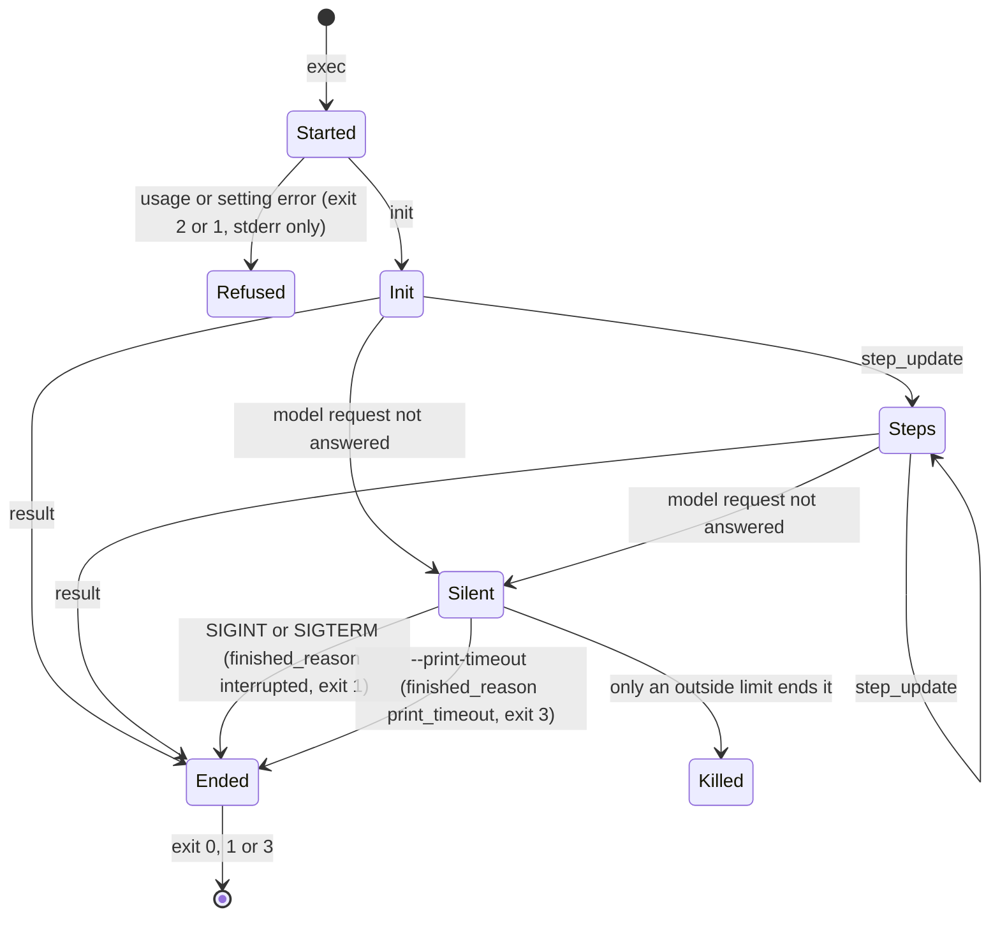

# Antigravity CLI (`agy`) headless spike: protocol, lifecycle and a proposed decision (#528)

- **Status:** proposed, for the maintainer to decide on #528 and EPIC #527
  (G0). The record proposes a **CONDITIONAL GO** for designing an adapter in
  G1, and **no go** for a production adapter or any routing change until the
  conditions of §11 are met. Finishing this spike authorizes no adapter
  (#528's gate).
- **Measured:** `agy` 1.5.13 (`agy --version`; binary sha256
  `c3fd2c848abf88a243936f33e25bf5970802a7651840b5199318fcd8eb3fdb65`,
  270,103,240 bytes), on Linux 7.0.14 x86_64 (Debian 13), `bwrap` 0.12.0, on
  2026-11-21. Every behaviour below comes from a run of that binary recorded
  by `tests/antigravity_probe.py` under `tests/fixtures/antigravity/1.5.13/`,
  one JSON record per scenario named in backticks (`deny-command` is
  `deny-command.json`), 147 in all. Each names the version the binary
  printed and the binary's sha256 (`agy_version`, `agy_sha256`), which the
  probe hashed before the first run and after the last.
  `tests/test_antigravity_probe.py` holds the records to what this document
  says and fails when they differ.
- **How:** each scenario runs `agy` once inside `bwrap`, against a loopback
  stand-in of the Gemini API that answers each request with a scripted
  step: a reply, a reply in chunks, a tool call, an HTTP error, a stream cut
  mid-record, or nothing. `agy` reaches it through its own API-key route: a
  synthetic `GEMINI_API_KEY`, `--settings '{"modelProvider":"gemini"}'`,
  and the Gemini SDK's `GOOGLE_GEMINI_BASE_URL`, which the 1.x changelog
  names for "a custom endpoint". **No model was called, and `agy` was given
  no credential:** every model request the stand-in saw carried the
  synthetic key (the tests check each one). The issue allows live calls
  only with the operator's explicit approval and a budget, and this run had
  neither.
- **The sandbox** (`isolation: private-root`, which every record names).
  `bwrap`'s own empty root, never the host's, holding only `/usr`
  read-only (with `/usr/local` hidden), the loader's cache, synthetic
  `/etc/passwd`, `/etc/group` and `/etc/hosts`, the probe, the binary and
  the run's spec directory read-only, and the run's own home and workspace
  read-write. The helper that starts `agy` has an empty environment
  (`--clearenv`; `bwrap` sets `PWD=/`), and `agy` gets only the variables
  the helper sets, ten at most. It has namespaces of its own for users,
  pids, the network (loopback only: no route out, and no socket of the
  host's, abstract ones included), IPC, UTS and cgroups.
  - **Setup inside it.** A workspace's setup is made by the helper inside
    the sandbox, before `agy` starts: the customized repository's `git
    init --template=` runs there with an environment of its own and every
    git configuration file off. Nothing of the caller's git (a `GIT_DIR`,
    a configuration, a template) is in reach, and the host starts no
    process for it.
  - **The record comes back as a stream, never as a file.** The helper
    writes the record on its stdout. The host reads that pipe to its end
    with a bound of 64 MiB: past it, the sandbox is killed and the record
    refused unread. Anything but one JSON object, from a sandbox that
    exited 0 in time, is refused too. The host gives the sandbox
    `/dev/null` as stdin and pipes of its own as stdout and stderr. A
    process of the run can open those three through `bwrap`'s own process
    inside (`/proc/1/fd/*`), which is why none of them may be the host's
    terminal or one of its files. It can also write into the record's
    pipe, so what arrives is the sandbox's claim, parsed strictly. The
    host opens no path the sandbox could write: the spec
    directory is read-only inside, and the home and workspace are never
    read after the run.
  - **Measured with a fake `agy` and harmless canaries.** A file of the
    test's, the checkout, the caller's home, `/run`, `/var` and the rest of
    `/etc` are not there. The value of a variable set in the caller's
    environment is in no process's `/proc/<pid>/environ`. A socket by
    path, an abstract socket and a loopback port of the host's refuse the
    connection. A link or a FIFO planted in the spec directory fails with
    `EROFS`. Junk, or more than the bound, written into the record's pipe
    stops the recording with nothing written. The caller's `GIT_DIR`,
    `GIT_TEMPLATE_DIR` and global configuration leave their directories
    untouched, and the workspace is the repository.
  - **All 147 records were made this way**, in one recording on 2026-11-21.
- **Earlier revisions of this PR** recorded in another sandbox. It mounted
  the host root read-only, with `/tmp` a tmpfs, gave `agy` an empty `HOME`,
  a minimal environment and namespaces of its own for pids and the network,
  started the helper with the caller's environment, ran the customized
  repository's `git init` on the host in the caller's environment, and read
  each record back from a file the sandbox could write. During those runs
  `agy` could read any host file the operator can, the caller's
  environment was in the helper's `/proc/<pid>/environ`, and path-based
  sockets of the host were there to connect to. Its network namespace had
  no route out, but that does not rule out that something left through
  one of those sockets to a service of the host's. Nothing shows what
  `agy` did with that access. None of those records remains: every
  committed record was made again in the sandbox above.
- **Not measured:** the real Gemini API (its error bodies and details, such
  as the per-day quota `QuotaFailure` the changelog says stops retries at
  once; its latency; tool use by a real model), the Google sign-in and ADC
  (`AGY_ADC_AUTH`) routes, anything `agy` sends to Google besides model
  requests (in the sandbox it could reach nothing, and nothing failed), the
  online documentation at antigravity.google (not read; the vendor text this
  record cites is the changelog the binary prints, `agy changelog`), macOS
  and Windows, and `agy` driven through AutoForge's own executor. Each is
  marked where it matters.
- **Re-measure:** `AUTOFORGE_AGY_PROBE_BIN=/path/to/agy uv run pytest
  tests/test_antigravity_probe.py` (Linux with `bwrap` and `/usr/bin/python3`,
  about four minutes, no model call) runs every scenario again against that
  binary, in the sandbox above, and fails on any fact here that no longer
  holds. It holds the fresh records to the behaviour, not to the label:
  they name whatever version the binary printed, and only the committed
  records must say 1.5.13. The version is asked like every other scenario,
  in the sandbox and under a timeout (`version`): the probe never runs the
  binary on the host. `python3 -I tests/antigravity_probe.py record --agy
  /path/to/agy --out DIR` writes the records, all of them only once every
  run has returned and the binary's hash has not changed. For another
  build, `DIR` is a directory of its own
  (`tests/fixtures/antigravity/<version>/`), and `python3 -I
  tests/antigravity_probe.py table --records DIR` writes its table of
  removed characters (§3) beside them. `table` refuses, and leaves any
  table there as it was, unless all of these hold:
  - every record is readable JSON and names the same version and sha256,
    and the `version` record printed that version;
  - both complete measurements of §3 are there;
  - each of their records is the run its plan made: the scenario's argv
    and stdin (the transport), a whole capture of a run that completed at
    exit 0, one model request with the synthetic key, and the prompt whole
    in `agy`'s wrapper;
  - each measured cleanly exactly its planned span: in order, nothing
    foreign, the dropped runs inside the span and apart, and received plus
    dropped equal to what was sent;
  - together they cover every scalar value once, and the two agree.

  An empty, partial, unlabelled or mixed directory, or a record that does
  not add up, would give a table that cannot tell no removal from no
  measurement. The 1.5.13 records stay as they are. Appendix B runs one
  scenario by hand, in the same sandbox.

## 1. Summary

`agy -p` has a usable unattended contract. `--output-format stream-json`
writes one JSON record per line. Every recorded one-shot run that sent the
model a request and ended on its own, under `stream-json` or `json`
output, wrote exactly one `result` record, which says `SUCCESS` or
`ERROR`, says why a turn ended early, and lists the tool actions it
refused. A run refused before any request wrote one `ERROR` result (alone,
or after `init` once it had begun to read `stream-json` input:
`stream-input-wrong-shape`, `stream-input-cut`), or nothing at all. Being
given a prompt is not enough for a result:

- These runs were given one, ended on their own and wrote **nothing on
  stdout**, each refused before any request: a prompt that spells a flag
  (`argv-flag-name`), a stray argument after `--`
  (`argv-after-double-dash`) and a flag of `acp` only
  (`acp-flag-in-print-mode`), each exit 2; an unknown setting
  (`settings-unknown-key`) and the API-key route with no key
  (`api-key-route-without-key`), each exit 1.
- An empty stdin wrote no result: as text, a terminal error on stdout
  (`stdin-empty`); as `stream-json`, `init` alone
  (`stdin-stream-json-empty`). Both exit 0.
- A run an outside limit killed ends wherever it was, and a `stream-json`
  input session writes one result per turn (§4, §6).

Model API failures exit with 3 and print a typed `AGY_ERROR` line. Exit 0
alone proves nothing, and three traps would make a naive adapter read a
failure as a completed run:

1. **A refused tool call is a `SUCCESS`.** Headless mode cannot ask, so a
   call that needs a permission is refused and the run ends at once: exit 0,
   `status: SUCCESS`, an empty `response`, and the refusal only in
   `denied_actions` and on stderr (`deny-command`).
2. **`result.response` is not the reply.** It joins the text of every agent
   response in the run: the cut text of a retried attempt
   (`cut-stream-then-success`) and both replies when a background task opened
   a second turn (`background-task`, `timer`). The reply is the last
   `agent_response` step's text.
3. **The prompt the model gets is not always the prompt sent.** Every
   character of Unicode general category C is removed, but TAB, LF, VT, FF,
   CR and NEL: controls, format characters, private use, and every code
   point unassigned in Unicode 17.0. That was measured over every scalar
   value through two inputs, text on stdin and the recommended framed
   message, with the same result (`fidelity-all-*`, `fidelity-framed-*`).
   A message over about 192 KB loses everything after that point,
   including the wrapper's closing tag, with no sign in the output
   (`fidelity-size-*`).

One finding blocks a production adapter as AutoForge's invariants stand.
**The repository's own `.agents/hooks.json` hooks and `.agents/mcp_config.json`
MCP servers run in a headless run, the hooks with `GEMINI_API_KEY` in
their environment, and no flag or setting tried turns them off**
(`repository-customizations`, `-untrusted`, `-sandbox`, and
`-recommended`, which is the fixed argv of §10, every flag of it). In each
of those four runs, the `SessionStart` and `PreInvocation` hooks had run
and the MCP server had started when the first model request arrived; the
`Stop` hook ran after (§8). AutoForge keeps every agent CLI's hooks and
MCP servers off (`--safe-mode` and `--strict-mcp-config` for Claude Code,
#165), so `agy` needs an equivalent before it can run on a pull request's
tree.

The recommended transport is one-shot, the prompt on stdin as one
`stream-json` message (§10). On it, `--print-timeout` bounds a run and
cleans nothing up: during a background task it ended the run at exit 0
with a `SUCCESS` result naming the timeout, and left the task running
(§7). The adapter contract is in §10 and the decision in §11.

## 2. Discovery (question 1)

`agy --version` prints `1.5.13` and nothing else (`version`). `agy --help`
lists `-p/--print/--prompt`, `--output-format text|json|stream-json`,
`--input-format text|stream-json`, `--model`, `--effort
low|medium|high|xhigh|max`, `--settings` (session-only, never saved),
`--print-timeout`, `--dangerously-skip-permissions`, `--mode`, `--sandbox`,
`-c/--continue`, `--conversation`, `--disable-slash-commands` and
`--json-schema`, on stderr with exit 0 (`help`; verbatim in Appendix A).
`agy help acp` shows further flags (`--gemini-dir`, `--app-data-dir`,
`--disable-telemetry`, `--cloud_code_endpoint`; `acp-help`), and print mode
refuses them with exit 2 (`acp-flag-in-print-mode`). There is no
machine-readable capability listing.

Two read-only probes start no turn and send no model request:

- `-p /config --output-format json` returns the settings catalogue
  (`settings-catalogue`). It has `agentMode: auto`, `toolPermission:
  request-review`, `allowNonWorkspaceAccess: false`, `trustedWorkspaces`
  and `permissions`, and no key for hooks, MCP servers or plugins.
- `agy models` lists 25 model ids under the API-key route
  (`model-list`). It reads only the saved `settings.json`, not
  `--settings`.

`--settings` refuses an unknown key with exit 1 (`settings-unknown-key`).
That is useful: a setting the adapter relies on that a later build drops
fails the launch instead of being ignored.

`--json-schema` was not exercised.

## 3. Where the prompt travels (question 2)

There are three inputs, and all three reach the model the same way:

| Input | How | Evidence |
|---|---|---|
| argv | `-p PROMPT` or `-p=PROMPT` | `success-stream-json`, `argv-leading-dash` |
| stdin, text | no `-p`; stdin a pipe or a file, read to EOF | `stdin-text` |
| stdin, `stream-json` | `--input-format stream-json` (needs `--output-format stream-json`), one `{"event":"user","message":{"content":PROMPT}}` per line, one turn per line | `stdin-stream-json`, `stream-input-two-turns` |

The `stream-json` input shape is not in `--help`. It was found from the
CLI's own refusals: `stream input message is missing the "event" field`
(`stream-input-wrong-shape`), then `stream input "user" message is missing
the "message" field`. With
both `-p` and stdin, `-p` wins and stdin is ignored without a word
(`stdin-and-argv`).

The argv form has two limits. Linux refuses a single argument of 131,072
bytes or more at `exec` (`E2BIG`; measured on this host, not through `agy`).
`agy` also refuses a prompt that spells one of its own flags, with exit 2,
even when it is attached as `-p=--version` (`argv-flag-name`). A prompt that
merely starts with `-` passes (`argv-leading-dash`). `--` does not help:
after it, `-p` is a stray argument and the run fails with exit 2
(`argv-after-double-dash`).

The model receives `<USER_REQUEST>\n` + prompt + `\n</USER_REQUEST>\n`,
then an `<ADDITIONAL_METADATA>` block with the local time and, on the first
turn, a note naming the selected model. Inside the wrapper the prompt
arrives as sent, newlines, CR LF, tabs, leading and trailing spaces, quotes,
backslashes, CJK, Hebrew and a literal `</USER_REQUEST>` included
(`fidelity-unicode-argv`, `fidelity-unicode-stdin`,
`fidelity-unicode-stream-json`), with three exceptions, each measured on
the inputs it names:

- **Characters removed.** Measured over every Unicode scalar value: all
  1,112,064 of them, each sent once in ascending order, in 31 prompts that
  each stay well below the cut at 192 KB, through two inputs:
  - as text on stdin (`fidelity-all-nul`, NUL alone, and `fidelity-all-00`
    to `fidelity-all-29`);
  - framed, as the recommended transport sends a prompt: each prompt as one
    `stream-json` message, written as `json.dumps` writes it, so every
    non-ASCII character is a `\u` escape, an astral one a surrogate pair,
    and a line is about three times its prompt's UTF-8 (450,082 bytes at
    most; `fidelity-framed-nul` and `fidelity-framed-00` to
    `fidelity-framed-29`).

  Every prompt arrived framed by agy's wrapper as sent, its characters in
  order and none added or changed, so what was missing was removed. Both
  inputs removed the same characters: 952,427 code points removed and
  159,637 kept. The removed ones are listed, as 744 ranges, in
  `tests/fixtures/antigravity/1.5.13/dropped.txt`, which the tests hold
  both measurements to exactly. The argv input was not swept: of it only
  the texts of `fidelity-unicode-argv` and `argv-leading-dash` were
  measured. Read with Unicode 17.0's database (Python 3.15's),
  the table is exactly general category C less six controls. Every Cc
  (control) is removed except TAB, LF, VT, FF, CR and NEL. So is every Cf
  (format: zero-width space and joiners, bidirectional controls, the BOM,
  tag characters), every Co (private use), and every Cn (unassigned, the
  noncharacters among them). Everything else arrived as sent: the
  no-break and ideographic spaces, the line and paragraph separators,
  variation selectors, combining marks and U+FFFD among them. An older
  database calls some characters unassigned that `agy` keeps: Python
  3.14's Unicode 16.0 lacks the 4,803 that 17.0 added. So the rule follows
  `agy`'s own Unicode version, and a prompt holding a character newer than
  that version loses it. `fidelity-sweep` (110 chosen code points, each
  between markers) agrees. The emoji sequence `👩‍💻` therefore arrives as
  two emoji. Not measured: whether a character fares otherwise in other
  company. Each code point was sent once, after its predecessor; the
  texts of `fidelity-unicode-*`, `fidelity-sweep` and the three framed
  prompts at the bound below are the only other contexts.
- **Invalid UTF-8** becomes U+FFFD, as text on stdin
  (`fidelity-invalid-utf8`). A framed message cannot carry it: the adapter
  writes the prompt as JSON, from a string.
- **Size.** As text on stdin, a 190,000-byte prompt arrived whole
  (`fidelity-size-190000`). At 196,608 bytes and above
  (`fidelity-size-196608`, `fidelity-size-262144`, and framed,
  `fidelity-size-262144-stream-json`), the message the model received was
  its first 192,001 bytes: the 15-byte opening tag and the prompt's first
  191,986 bytes, then `<truncated N bytes>`. The closing tag and the
  metadata were lost. The run still exited 0 with `SUCCESS`.
- **Framed at the bound.** Framed, the cut counts the prompt's UTF-8, not
  the line's. Three prompts of 160,000 UTF-8 bytes, the bound §10
  proposes, each of characters `agy` keeps, were framed and each arrived
  identical, closing tag and metadata kept:
  - a large mixed sample, mostly astral characters with CJK, Latin,
    quotes, a backslash, a tab, CR LF and a literal `</USER_REQUEST>` on
    every line, in a line of 416,882 bytes
    (`fidelity-near-limit-stream-json`);
  - one astral character, U+1F680, 40,000 times: 480,046 bytes, three
    framed bytes for each of UTF-8 (`fidelity-astral-stream-json`);
  - the widest line any prompt of that size the gate admits can make: a
    `|` and then VT (U+000B), which `json.dumps` writes as the six bytes
    `\u000b`, 159,999 times, in a line of 960,041 bytes
    (`fidelity-widest-stream-json`). No character `agy` keeps takes more
    than six framed bytes for one of UTF-8; every other takes three at
    most (the tests check every scalar value). A prompt of VTs alone is
    blank, which `agy` refuses (`stdin-whitespace`).

  So the framed line of an admitted prompt is at most 960,041 bytes, and
  that line was measured. The sizes between 160,000 and 191,986 bytes were
  not measured framed, nor any framed prompt at the bound other than these
  three.

An empty stdin is not refused cleanly. As text, `agy` tries to start its
terminal UI, prints `CLI error: bubbletea: error opening TTY ...` on
stdout, and exits 0 (`stdin-empty`). As `stream-json`, it writes `init` and
exits 0 with no result (`stdin-stream-json-empty`). A whitespace-only text
prompt fails properly: exit 1 and an `ERROR` result saying `empty prompt`
(`stdin-whitespace`).

## 4. The event stream and its terminal proof (question 3)

Every line of `--output-format stream-json` is one JSON object with an
`event` member, ended by LF. In every recorded one-shot `stream-json` run
that sent the model a request and ended on its own, the stream was `init`,
then `step_update` records, then exactly one `result`, and then the
process exited. A run refused before any request wrote one `ERROR` result,
alone (`stdin-whitespace`, `no-login-argv-prompt`) or after `init`
(`stream-input-cut`). None wrote a malformed line, a blank line, a member
twice or a second `result`. Only a `stream-json` input session writes
several (§6). Some runs write no `result` at all: an empty `stream-json`
input writes `init` and exits 0 (`stdin-stream-json-empty`), an empty text
stdin writes a terminal error that is no JSON (`stdin-empty`), a run an
outside limit killed ends wherever it was (`hang-no-limit`), and under
`--output-format json` a refusal before any request can write nothing at
all (`api-key-route-without-key`, §1).

| Record | Fields seen | Meaning |
|---|---|---|
| `init` | `conversation_id`; `init.cwd`, `init.tools` (60 names), `init.permission_mode` (`request-review`, or `always-proceed` under `--dangerously-skip-permissions`); `init.model` only when `--model` gave one | first record, written before the model is asked. Names the model only as asked (`init.model` repeats `--model`, `repository-customizations-recommended`), never the one that served the run. |
| `step_update` | `conversation_id`, `step_index`, `state` (`ACTIVE`, `DONE`), `step_type` (`user_input`, `agent_response`, `tool`, `error_message`, `system_message`, `unknown`), and, as they apply, `text_delta`, `tool_name`, `tool_info` (`name`, `parameters`, `output`), `usage`, `duration_seconds` | one step's progress. An `agent_response` is sent as deltas while `ACTIVE`, then a `DONE` whose delta is `\n` (`success-chunks`). |
| `result` | `conversation_id`, `status` (`SUCCESS` or `ERROR`), `response`, `error`, `duration_seconds`, `num_turns`, `usage` (`input_tokens`, `output_tokens`, `thinking_tokens`, `cache_read_tokens`, `total_tokens`), `finished_reason` (`error`, `interrupted`, `print_timeout`; absent on a normal end, and on a `SUCCESS` but once: a print timeout on the framed transport, §7), `denied_actions` (`action`, `display_name`) | the run's end |

`--output-format json` writes the `result` object alone, as one line,
when the run ends (`success-json`, `deny-command-json`), and `text` writes
the reply and a newline (`success-text`). Neither shows a step while the run
works, so neither gives the adapter progress or a terminal record of its own
kind.

An exploratory run before the records also showed `state: ERROR`, on a
refused tool step, with `tool_info.error` (`TOOL_ERROR`, `user denied
permission to run command`). The recorded run of the same scenario ended
that step `DONE` with no error (`deny-command`). A step's state therefore
does not say whether a call was refused; `denied_actions` does.

Stderr carries the rest. A turn that failed adds `error: ...` and one
`AGY_ERROR: {...}` line. Its JSON has `short_error`, `status` (a canonical
gRPC name), `error_code`, `code_kind` (`http` or `grpc`), `retryable` and
`error_id`, or, for a print timeout, `reason` and the terminated `tasks`.
Notices about refusals, background waits and terminated tasks are prose.



**The admissible streams.** Every one-shot record that ended on its own was
one of two shapes, and the contract admits no other:

- **a run:** `init`, then `step_update` records, then one `result`, then
  the end of stdout;
- **a refusal:** one `result` with `status: ERROR` and an empty
  `conversation_id`, when no session began (`stdin-whitespace`,
  `no-login-argv-prompt`). It is a failure, never a completed run.

**Framing.** Every record is one line: one JSON object and the LF that
ends it, nothing else. Each of these is a protocol failure, never a line to
skip or repair: a line without its LF (the last line, when the writer
stopped mid-record: a terminal object without its LF is no terminal
record), an empty or blank line, whitespace around the object (a CR before
the LF among it), a line longer than the reader's bound or cut by one, a
member given twice in one object (`{"status":"ERROR","status":"SUCCESS"}`:
which one counts would be the parser's choice), and a number JSON does not
have (`NaN`, `Infinity`, or one too large to be finite). The reader's
bound must allow at least twice the largest reply accepted, since the
`result` carries the whole joined response (§6).

Each record must have its shape, checked before anything in it is read:

- `init` is the first record, with a non-empty `conversation_id` and an
  `init` object.
- A `step_update` carries the init's `conversation_id`, an integer
  `step_index` of 0 or more, a `state` of `ACTIVE`, `DONE` or `ERROR`, a
  non-empty `step_type` and, when present, a string `text_delta`.
- Steps begin in index order: a step's first update has an index above
  every earlier step's. A step keeps its type. Nothing updates a step after
  it ended (`DONE` or `ERROR`). Every recorded stream kept to these rules.
- The `result` carries the init's `conversation_id`, a `status` of
  `SUCCESS` or `ERROR`, a string `response`, and one of the two shapes
  every recorded result had, never a mix:
  - **`SUCCESS`:** no `error` member and no `finished_reason`, and
    `denied_actions` either absent or a non-empty list of objects, each
    with a non-empty string `action`. A `null`, an empty list, or a
    `SUCCESS` that also carries an `error` (even an empty one) or a
    `finished_reason` contradicts itself.
  - **`ERROR`:** a non-empty string `error`, a `finished_reason` of
    `error`, `interrupted` or `print_timeout`, and no `denied_actions`.

Anything else is a protocol failure: a line that is not JSON or not a
known event, a value of another type in any of these places, a
contradictory result, a record out of this order, a record of another
conversation, or a record after the `result`.

**The capture.** What the reader saw proves nothing unless it saw both
streams whole, and only the executor can say so. Completion also needs
all of these, and a capture short of any of them never completes a run
(it cannot turn a failure into anything else):

- the process **exited on its own**: it ended by exiting, with a status of
  its own. No idle or runtime limit, kill or signal ended it, the
  executor's or any other: a negative status is a signal's, whoever sent
  it;
- stdout and stderr were each **read to EOF**: no process left behind
  still held either pipe, so the capture was not abandoned (the
  executor's `capture_abandoned`);
- **no capture bound dropped output** of either (the executor's
  `stdout_truncated` and `stderr_truncated`), and no line was skipped past
  the reader's per-line bound.

Stderr counts as much as stdout. Completion needs the absence of an
`AGY_ERROR` line, and typing a failure needs it to be the only one (§9).
Neither absence nor uniqueness can be read from part of a stream, so a
stderr not read whole stops a run from completing and leaves its failure
untyped.

The probe reports the same for its records: each says, for stdout and for
stderr, whether it reached EOF and whether a bound dropped any of it
(`capture`). The helper keeps at most 2 MiB and 20,000 lines of each
stream and reads on to the end past that, and a line cut for the record
(over 4,000 characters) counts as dropped. Every committed record reached
EOF on both streams and lost nothing, survivors and all.

**Terminal proof** for a one-shot run is a run of that shape and framing:
its one `result` written as the last record and ended by its LF, followed
by the process's exit on its own and EOF on stdout, with nothing dropped. A
run whose stream ends without a `result` has no terminal proof, whatever
its exit status (`hang-no-limit`, `stdin-stream-json-empty`).

**The reply** is the concatenated `text_delta` of the run's last step,
which must be an `agent_response` that ended `DONE`. `agy` ends it with a
`\n` the model did not send. A response still `ACTIVE` when the `result`
arrives is a protocol failure, however whole its text looks.
`result.response` is not the reply (§1, item 2).

**Liveness.** `agy` writes nothing while a model request is open. A request
the stand-in never answered kept it silent until the probe killed it at
120 seconds (`hang-no-limit`), with no retry and no timeout of its own.
What it wrote before is `init` and the `user_input` step: both come before
the model answers, so neither shows a model at work (§9,
`result_less_exit`).
While a background task runs, the stream holds back even records that have
happened. In `background-task`, `agy` said on stderr at 0.8 seconds that
the agent was idle, its reply received (`root agent idle; waiting for 1
background task(s) to finish`), yet the stream wrote that reply at 15.3
seconds, when the task ended. Nothing else was written in between. Unlike
Claude Code's stream, this one does not show a reply before `agy` ends.

## 5. Exit codes, statuses and soft refusals (question 4)

| Exit | When | Evidence |
|---|---|---|
| 0 | `result` with `SUCCESS` | `success-stream-json`, `api-503-then-success` |
| 0 | **`SUCCESS` after a refused tool call, with an empty response** | `deny-command`, `deny-command-json` |
| 0 | no `result` at all: empty stdin | `stdin-empty`, `stdin-stream-json-empty` |
| 0 | **`--print-timeout` expired on the framed transport**: a `SUCCESS` result that names `finished_reason: print_timeout`, and an `AGY_ERROR` (`DEADLINE_EXCEEDED`) | `print-timeout-background-recommended` |
| 1 | a setting, a model selection, a missing credential, stream input that does not decode, or a stop by SIGINT or SIGTERM (`finished_reason: interrupted`) | `settings-unknown-key`, `model-unknown`, `api-key-route-without-key`, `stream-input-cut`, `sigint-during-request` |
| 2 | a usage error: an unknown flag, a stray argument, a prompt that spells a flag | `argv-flag-name`, `argv-after-double-dash` |
| 3 | a turn ended on a model or agent error (`finished_reason: error`), or `--print-timeout` expired in argv print mode (`print_timeout`) | `api-400`, `hang-print-timeout`, `print-timeout-background` |

`result.status` was only ever `SUCCESS` or `ERROR`. No `WAITING`,
`CANCELED` or `INVALID` status appeared in any record. `finished_reason`
separates a failure, an interruption and a print timeout, and is absent on a
normal end, as the changelog says. One record breaks that pairing: on the
framed transport, a print timeout during a background task ended in
`SUCCESS` with `finished_reason: print_timeout`, at exit 0
(`print-timeout-background-recommended`, §7). The definitive terminal
states are therefore `SUCCESS` with no `finished_reason` and no
`denied_actions`, and `ERROR` with one of the three `finished_reason`
values. A `SUCCESS` that names a `finished_reason` contradicts itself, and
the contract reads it as a protocol failure (§4), never as completed.

**Soft refusals.** Without `--dangerously-skip-permissions`, a
`run_command` the default `request-review` permission needs to ask about is
refused. The run ends there: the model is not told and is not asked again
(one model request), the result is `SUCCESS` with `denied_actions:
[{"action":"command","display_name":"Bash"}]`, and stderr says
`jetski: no output produced — a tool required the "command" permission that
headless mode cannot prompt for, so it was auto-denied` (`deny-command`).
With the flag the command runs (`allow-command-skip`). A `write_file`
outside the workspace was **not** refused under the default permission
(`write-outside-default`), so `request-review` is no containment.

**Questions.** An `ask_question` call is answered at once with an empty
answer (`A1: ` in the tool result the model gets), and the run goes on to
a `SUCCESS` with a whole reply, at exit 0. The stream shows the step as
`step_type: unknown` with no tool name, so a question asked and answered
with nothing cannot be told from any other unknown step (`ask-question`).
The contract therefore fails closed: a run with any step of a type it
does not know, `unknown` among them, is ambiguous and never completed. The
cost is a false failure on any other step `agy` reports as `unknown`. None
of the other records has one. Whether `ask_question` can be removed from
the tool set was not measured.

## 6. Failures (question 5)

| Case | `agy` (1.5.13, against the stand-in) | Requests | Evidence |
|---|---|---|---|
| HTTP 400, 401, 403, 404 | exit 3, `AGY_ERROR` with the status and `retryable: false` | 1, no retry | `api-400`, `api-401`, `api-403`, `api-404` |
| HTTP 500 | the same: not retried, `retryable: false` | 1 | `api-500` |
| HTTP 429 | retried with backoff for about 2.5 minutes, then exit 3, `RESOURCE_EXHAUSTED`, `retryable: true` | 9 | `api-429` |
| HTTP 503 | the same as 429, `UNAVAILABLE` | 9 | `api-503` |
| 503 once, then a reply | `SUCCESS`, exit 0 (the 1.5.13 changelog's fix of a status reading `ERROR` after a retry holds) | 2 | `api-503-then-success` |
| stream cut mid-record, then a reply | `SUCCESS`; `result.response` starts with the cut attempt's `partial ` | 2 | `cut-stream-then-success` |
| stream cut on every attempt | retried, then exit 3, `UNKNOWN`, grpc code 2, `retryable: false` although it was retried | 9 | `cut-stream-always` |
| no answer at all | silent, no exit within 120 seconds | 1 | `hang-no-limit` |
| API-key route, no key | exit 1, stderr only, nothing on stdout even under `--output-format json` | 0 | `api-key-route-without-key` |
| no key and no sign-in, prompt on stdin | exit 1 at once, `ERROR` result `authentication failed or timed out` | 0 | `no-login-stdin-prompt` |
| no key and no sign-in, prompt in argv | waits 60 seconds for a pasted OAuth code, then exit 1 | 0 | `no-login-argv-prompt` |
| `stream-json` input: a malformed line after a good turn | a **second** `result`, `ERROR`, carrying the earlier turn's response; exit 1 | 1 | `stream-input-malformed-after-turn` |
| `stream-json` input cut at EOF | exit 1, `failed to decode stream input: unexpected EOF`, no request | 0 | `stream-input-cut` |
| `stream-json` input left open | the turn's `result`, then `agy` waits for more input until killed | 1 | `stream-input-left-open` |
| three runs at once, one home and one workspace | three conversations, each with its own prompt | 3 | `concurrent-1`, `concurrent-2`, `concurrent-3` |

`retryable` describes neither what `agy` did nor what a relaunch would
meet: it was `false` after nine attempts at a cut stream and after one 500.
An adapter should type a failure from `error_code` and `code_kind` and
ignore it. What the real API's 429 bodies look like, and whether the
changelog's immediate stop on an exhausted daily quota happens, is
**unverified**: the stand-in's errors carry no `details`.

Not exercised: stdout or stderr closed by the reader, and a reply large
enough to stress a reader. The `result` line carries the whole joined
response, so a reader's per-line bound must allow at least twice the
largest reply it accepts. The executor's capture bounds apply to `agy` as to
any CLI.

## 7. Processes and lifetime (question 6)

`agy` runs each tool command in a session of its own: the shell's process
group and session are its own pid, not `agy`'s (`sigterm-background-task`,
`detached-child`). A signal to `agy`'s process group therefore never
reaches them.

| Case | What is left | Evidence |
|---|---|---|
| normal end, background task still running | `agy` waits for it, opens a second turn on its completion, then exits. Nothing left. | `background-task`, `timer` |
| normal end, daemon task (`IsDaemon`) | `agy` terminates it (`terminating 1 daemon task(s) on exit`). Its tool step stays `ACTIVE` in the stream. Nothing left. | `daemon-task` |
| normal end, a child that ran `setsid -f` | it survives, re-parented, in its own session | `detached-child` |
| SIGINT or SIGTERM during a model request | exit 1 at once, after a `result` with `interrupted`. Nothing left. | `sigint-during-request`, `sigterm-during-request`, `sigint-during-request-json` |
| SIGTERM during a background task | exit 1, `interrupted`. **The task's shell survives**, re-parented, with its `sleep`. | `sigterm-background-task` |
| `--print-timeout` during a background task, argv print mode (`-p`) | exit 3, `print_timeout`, the task terminated and named in `AGY_ERROR`. Nothing left. | `print-timeout-background` |
| `--print-timeout` during a background task, **the fixed argv of §10** (the prompt framed on stdin) | exit **0**, a `SUCCESS` result with `finished_reason: print_timeout`, `AGY_ERROR` `DEADLINE_EXCEEDED` with no task named. **The task is not terminated:** its shell survives, re-parented, in its own session, with its `sleep`. | `print-timeout-background-recommended` |
| `--print-timeout` during a model request, argv print mode | exit 3, `print_timeout` | `hang-print-timeout` |

The two print timeouts during a background task differ only in the
transport: the same scripted steps and the same 5 seconds, `-p` against
the fixed argv. On the transport §10 recommends, `--print-timeout` bounds
the run but cleans nothing up, and the run's end reads as a protocol
failure (§5). A print timeout during a model request was measured in argv
print mode only.

So `agy` does not guarantee that nothing outlives it. On Linux, AutoForge's
executor collects re-parented descendants as a child subreaper (ADR 0002).
That was **not run with `agy`** in this spike, and on macOS, where there is
no subreaper, such survivors stay unchecked (`orphans_unchecked`).

## 8. Fresh context (question 7)

A run without `-c` or `--conversation` starts a new conversation. The
second of two runs in one home sent no text of the first, and both had the
same system prompt, compared after removing conversation ids (`fresh-first`,
`fresh-second`). `-c` resumed the most recent conversation in the home, the
second run's, not the first (`continue-latest`). With runs in parallel,
"most recent" is whichever finished last. Session resume is out of scope
(#491). An adapter must never pass `-c`, `--continue` or `--conversation`:
its argv is fixed, and it takes no `extra_args` (§10).

Each run leaves its conversation in the home, under
`~/.gemini/antigravity-cli/`: `conversations/<id>.db`,
`brain/<id>/.system_generated/logs/transcript*.jsonl`, `implicit/`, a
`presence/<id>.lock` still there after the exit, and
`conversation_summaries.db` (`fresh-second`'s `home_files`). The system
prompt gives the agent that directory's path (`names_app_data_dir`). A home
kept across launches therefore holds earlier transcripts the agent's tools
can read.
Under `sandbox.mode: required` every launch gets an empty private home,
which satisfies ADR 0015's fresh-context proof. Under `disabled` the adapter
must give each launch a home of its own. `agy` has no other way to move its
state: print mode refuses the `acp` subcommand's `--gemini-dir` and
`--app-data-dir`.

What the workspace contributes is a separate matter:

- `AGENTS.md`, `GEMINI.md` and `.agents/rules/*.md` (`always_on`) are put
  in the system prompt (`repository-customizations`). That is acceptable:
  every phase prompt tells the agent to read `AGENTS.md` anyway.
- `.agents/hooks.json` runs its `SessionStart`, `PreInvocation` and `Stop`
  commands. `.agents/mcp_config.json` starts its MCP server. Both happen
  without `--dangerously-skip-permissions`, in an empty home, and with
  `GEMINI_API_KEY` in the hook's environment (`repository-customizations`).
  Neither `trustedWorkspaces: []` (`repository-customizations-untrusted`)
  nor `--sandbox` (`repository-customizations-sandbox`) changes it, and the
  settings catalogue has no key that might (`settings-catalogue`). The
  recommended launch of §10 itself runs them the same way
  (`repository-customizations-recommended`): the fixed argv, every flag of
  it, with `--model gemini-4-argon --effort high --print-timeout 60s`, and
  the prompt framed on stdin.
- **When they ran.** The stand-in noted which of the hooks' and the
  server's marker files were in the workspace when each model request
  arrived (`markers_present`). In each of the four launches, the
  `SessionStart` and `PreInvocation` hooks had run and the MCP server had
  started before the first model request, and the `Stop` hook ran after
  it. That is one run of each launch. A server that takes longer to start
  might still be starting when the model is first asked; that it is
  started at all, before the run ends, is what every run shows.

**What those four scenarios measured, and no more.** One layout: a git
repository (made by `git init --template=` inside the sandbox) whose root
is the launch's working directory, holding
`AGENTS.md`, `GEMINI.md`, `.agents/rules/r.md`, `.agents/hooks.json` (one
`SessionStart`, `PreInvocation` and `Stop` command each) and
`.agents/mcp_config.json` (one stdio server), with an empty home. Four
launches of it: `-p` with `--output-format json`, the same with
`trustedWorkspaces: []`, the same with `--sandbox`, and the recommended
launch with the values above. Other models, efforts and timeouts in the
fixed argv were not measured with the repository. **Not measured:** the other directories the bundled customization
guide names (`.agent/`, `_agents/`, `_agent/`) and its other files
(`plugins.json`, `skills.json`, `plugins/`, workflows, skills);
customizations in a directory above the working directory, below it, or
above the repository root; a working directory below the repository root;
a symbolic link on the way; `--add-dir`, `--agent`, `--mode`, `--project`
and the remote flags; the home's own customizations (`~/.gemini/`); `acp`
sessions; and whether `agy` reads a hooks or MCP file written during the
run (by the agent itself, which can write files) after its session began.
The guide says discovery walks up from the working directory to the
repository root. That is the vendor's statement, not a measurement here.

## 9. Mapping to AutoForge's result (question 8)

| `AgentExecutionResult` | From | Status |
|---|---|---|
| `command`, `exit_code`, `stdout`, `stderr`, times, `timed_out`, truncation, leftovers | the executor, as for any CLI | available |
| `stdout` (the reply) | the last `agent_response` step's text, of a completed run only | available |
| `provider_failure` | a refusal (`denied_actions`), an `ERROR` result, a `SUCCESS` at a nonzero exit or with an `AGY_ERROR` line, a missing or second `result`, a record out of §4's framing, shape or order, a contradictory result (a `SUCCESS` that names a `finished_reason`, as the framed print timeout writes), an `unknown` step, a step or reply that never ended, an empty reply; and a run that would otherwise complete but whose capture is not whole, on stdout or stderr (§4) | available |
| `transient_failure` | the one `AGY_ERROR` line of an `ERROR` result has `code_kind: http` and an `error_code` that is an integer (never a float, a bool or a string) equal to 408 or from 500 to 599, and stderr was read whole (to EOF, nothing dropped), so that the line is known to be the only one | available; 500 is not retried by `agy` itself |
| `usage_limit` | the same, with an integer `error_code` of 429, on a whole stderr | available; per-minute and per-day limits not told apart (unverified) |
| `usage_reset_at` | nothing | unknown |
| `result_less_exit` | **never set in the MVP.** The engine relaunches on it (ADR 0012, #434), so it needs proof that the CLI exited on its own inside a session that was running: for Claude Code, a tool call of the model's before the exit. `init` and the `user_input` step are written before the model answers (`hang-no-limit`), so they show no running session, and no recorded run exited on its own, without a result, after the model had begun. A G1 adapter may set it only once a probe scenario shows such an exit, with both streams whole and an exit status of the process's own | unset; no evidence yet |
| `failed_before_limit` | `AGY_ERROR` comes only at the end; mid-run `error_message` steps carry no code | not derivable before the end |
| `reply_delivered` | **never set in the MVP.** The flag lets the engine accept the reply of a launch that failed after it (ADR 0012 D12), so it needs proof of a complete, successful final reply. A `result` record is no such proof: it may be an error or a refusal, or a successful turn that further activity followed (`background-task`, `timer`). `agy` writes a reply only with its result, at the end, so a launch that failed after it has none the stream proves whole | unset |
| `model`, `effort` | what was asked: `init.model` repeats `--model`, and no record names the model used | requested only; no read-back |
| `provider_summary` | `conversation_id`, `num_turns`, `usage`, `status`, `finished_reason`, number of `denied_actions` | available |
| `interaction` | `failed` when a refusal failed the run (as #258 does for the other CLIs) | available |
| progress, loop detection | `step_update`: step types, tool names and parameters | available |

`--model` and `--effort` are checked before any request. An unknown model
(`model-unknown`), an effort the model lacks (`model-effort-unsupported`)
and an effort that contradicts the model id's suffix
(`model-effort-conflict`) each exit 1 with nothing sent. A base id with
`--effort` is the form to use: `gemini-4-argon` with `--effort high` sends
`thinkingLevel: HIGH` to `models/gemini-4-argon` (`model-base-and-effort`);
`gemini-4-argon-medium` sends `MEDIUM` (`model-with-effort-suffix`); the
default is `gemini-3.1-pro-preview` with a 1,024-token thinking budget
(`model-default`).

Anything else in `AGY_ERROR` types nothing, and the failure stays an
error: another code or kind, a code of another JSON type (`429.0`, `true`,
`"429"`), a code outside 100 to 599 (`600`), a line that does not parse or
gives a member twice, more than one `AGY_ERROR` line in the run, and one
line on a stderr not read whole, which may have held another.

**What cannot be told apart safely:**

- a question the agent asked and got no answer to, from any other
  `unknown` step. So every run with an `unknown` step fails (§5);
- a prompt that was stripped or truncated, from one that was not: nothing
  in the output says so, so only a check before the launch can prevent it
  (§10);
- which model actually served the run;
- a per-minute 429 from an exhausted quota, until a real body is seen;
- a daemon task `agy` killed at exit, except by a stderr notice;
- a background task a print timeout left running on the framed transport,
  except by the processes left (§7): its `AGY_ERROR` names no task.

## 10. Transport and adapter contract (deliverables 3 and 5)

### Transport

| Transport | For | Against |
|---|---|---|
| one-shot, argv `-p` | documented, simplest | 131,071-byte argv limit on Linux; a prompt that spells a flag is refused; with no sign-in it waits 60 s for a pasted code |
| one-shot, text on stdin | no size or flag limit below `agy`'s own; fails at once with no sign-in | documented only in a refusal's wording; empty input exits 0 with no result |
| **one-shot, one `stream-json` message on stdin, then EOF** | no argv or flag limit either, and the input is framed: a message cut short fails with exit 1 (`stream-input-cut`) instead of running as a shorter prompt; what it does to a prompt is measured over every scalar value and at the proposed bound (§3) | the message shape is undocumented (§3); empty input exits 0 with only `init` |
| `stream-json` session, several messages | one process for several turns | several `result` records to tell apart; a bad line adds an `ERROR` result that carries the previous turn's response; the process waits until stdin closes |
| `agy acp` (Agent Client Protocol over stdio) | `session/request_permission` reaches the client, which can answer it (`acp-permission-rejected`); `stopReason` per prompt | an extra conversation-title model request per session (`acp-text`, `title_requests: 1`), which `-p` does not make; a rejection still ends the turn as `end_turn` with no reply; a JSON-RPC session to drive; the changelog fixes several `acp` defects in 1.5.12 and 1.5.13 |

**Recommended:** one-shot, `--input-format stream-json --output-format
stream-json`, one message on stdin, written as `json.dumps` writes it
(ASCII escapes, one line, LF), stdin closed after it. Text on stdin is the
fallback if a later build changes the message shape. The completion
condition is bounded and unambiguous. The stream must be a run of the
framing and shape of §4, with exactly one `result` as the last record,
ended by its LF, and the process must exit on its own under the executor's
idle and runtime limits, with stdout read to EOF and nothing dropped. The
run's last step must be an ended `agent_response`, and no step may be of a
type the contract does not know. ACP is worth a separate look once
AutoForge wants `agy` to ask a human (ADR 0007, #490). It buys nothing for
the MVP.

**Version gate:** exactly 1.5.13 until the probe passes on another build.
`doctor` would run `agy --version` and refuse any other output. The release
notes change print-mode behaviour often: a failed turn's exit status went
from 1 to 3, the default agent mode of a `-p` run became Auto where
available, and how a run waits for background tasks changed several times.
Admitting a build is the re-measurement in the header, which the tests make
possible for any version string. The build's records go in a directory of
their own, held to every fact here. A changed fact, its table of removed
characters among them, is a finding to resolve before the gate moves.

### Suggested adapter contract

- **`providers.py`, an `AntigravityProvider`.** It runs the prompt as
  `stdin_payload` on the duplex handle, with a reducer of its own (an
  `agy_stream.py` beside `claude_stream.py`). `tests/antigravity_probe.py`'s
  `classify` and `result_flags` are a prototype of that reducer's rules,
  held to every record and to synthetic faults by the tests.
- **A fixed argv, and no `extra_args`.** The adapter builds the whole
  command itself and refuses any `extra_args` in `validate_profile`, as the
  Pi and SDK adapters do:

  ```sh
  agy --input-format stream-json --output-format stream-json \
      --settings '{"modelProvider":"gemini"}' --model <id> --effort <effort> \
      --print-timeout <seconds>s --disable-slash-commands --dangerously-skip-permissions
  ```

  Only three values vary, each one the adapter checks: a model id from the
  configuration's allow-list, one of the five efforts, and a timeout it
  computes. **Two records ran exactly this argv**, with `gemini-4-argon`,
  `high`, and `60s` (`repository-customizations-recommended`) or `5s`
  (`print-timeout-background-recommended`), each with its prompt framed on
  stdin; the tests hold both records and the block above to it. Other
  models, efforts and timeouts are G1 checks, measured again for each value
  the configuration admits. No other flag is ever passed. Among those that
  would change where `agy` looks or what it loads: `--add-dir` (it widens
  the workspace, and with it where customizations are found), a second
  `--settings` (it would replace the guarded `modelProvider`, and a later
  build's keys are unknown), `--agent`, `--mode`, `--sandbox`, `--project`,
  `--new-project`, `--remote-agent`, `--remote-control`, `-c`,
  `--continue`, `--conversation`, `--log-file`, `--json-schema`, `-i` and
  `--prompt-interactive`, and every subcommand. A denylist would admit the
  next flag a release adds; the allow-list cannot.
  - `--dangerously-skip-permissions` is needed because headless mode
    refuses anything that would ask and then ends the run. Containment
    comes from the outer sandbox, as for Claude Code's `bypassPermissions`.
  - `--disable-slash-commands` is meant to keep a prompt that starts with
    `/` from running as a command or a skill. Both records ran with it,
    but no prompt starting with `/` was sent.
  - `--print-timeout` bounds the run below `max_runtime_seconds`, and
    nothing more. On this transport it is **no cleanup**: during a
    background task it ended the run at its time with exit 0, a `SUCCESS`
    result naming `finished_reason: print_timeout`, which the reducer reads
    as a protocol failure, and left the task's shell running
    (`print-timeout-background-recommended`, §7). Only argv print mode
    terminated the task (`print-timeout-background`). A survivor is
    therefore the executor's to collect, as for any CLI (§7), and the
    executor's limit stays the backstop. Whether the argv keeps the flag,
    and at what margin below the limit, is a G1 check; a print timeout
    during a model request was not measured on this transport.
- **The reducer.**
  - It checks every line against §4's framing and every record against its
    shape and order before reading it, so no record makes it raise. A
    violation is a protocol failure. No line is skipped: a blank line, a
    line over its bound or cut, a record without its LF, a member given
    twice, a contradictory result are each a violation.
  - Completed only when all of these hold: a run of §4's framing and shape
    with no violation; its `result` `SUCCESS` of the `SUCCESS` shape, with
    no `denied_actions`; exit 0 and no `AGY_ERROR` line; every step of a
    known type (`user_input`, `agent_response`, `tool`, `error_message`,
    `system_message`) and ended; the run's last step an `agent_response`
    that ended `DONE`, with a non-blank text; and the capture whole: the
    process exited on its own (no signal's negative status, whoever sent
    it), stdout and stderr each reached EOF (no `capture_abandoned`), and
    nothing of either was dropped (no `stdout_truncated`, no
    `stderr_truncated`).
  - Anything else is a `provider_failure` naming what failed:
    `interrupted`, `print_timeout`, a refusal, a protocol violation, an
    ambiguous step (an unanswered question), no result, no reply, a capture
    that was not whole. The typed failures and the two recovery flags are
    §9's: an integer HTTP code alone types a failure, and only on a whole
    stderr; neither `result_less_exit` nor `reply_delivered` is ever set.
  - A daemon task leaves its step `ACTIVE`, and the prototype fails such a
    run. Whether a run that started a daemon may still complete is a G1
    decision.
- **Launch checks, on the request: in `execute(req)`, not in a profile
  hook.** `integration_preflight(env_allowlist)` and
  `validate_profile(profile)` see neither the launch's working directory
  nor its prompt, so they cannot make these checks; `validate_profile`
  keeps the static half (no `extra_args`, the model and effort allow-lists).
  The adapter makes them in `execute(req)`, on the request it is about to
  launch, after `build_command(req)` and `sandboxed(...)` and before
  anything is spawned, and refuses with a typed error, as the sandbox
  refuses a launch its policy forbids. `doctor` runs the same scan on the
  checkout, as an early warning only.
  - **The launch tree.** On `req.cwd` resolved as the launch sees it:
    refuse when a directory named `.agents`, `.agent`, `_agents` or
    `_agent`, or a symbolic link of one of those names, exists in the
    working directory, in any directory above it up to the filesystem root,
    or anywhere below it, whatever it holds. The guide's file names and its
    "up to the repository root" are not measured (§8), so the scan does not
    lean on them: it refuses the directory, not a file list, and looks past
    the repository root and below the working directory. The launch's home
    is the adapter's own and empty (Home, below). This substitutes for the
    missing switch only under C1 (§11). It runs once, before the launch: a
    customization the agent writes during the run is not caught, and
    whether `agy` would read one is one of C1's conditions.
  - **The prompt, on the bytes the adapter frames** (`stdin_payload(req)`),
    for the pinned build and the framing measured, and for nothing else.
    Refuse a prompt over 160,000 UTF-8 bytes. The cut is at 191,986 bytes
    of the prompt's UTF-8, and at 160,000 three framed prompts arrived
    whole (§3): a large mixed sample, one astral character alone, and the
    widest framing an admitted prompt can have, whose 960,041-byte line is
    the longest the adapter would ever write. Refuse,
    or strip and record, a prompt holding a character the build's table
    lists (`dropped.txt`, §3). Look the character up in that table, never in
    a Unicode category: AutoForge's Python has its own Unicode version, and
    `agy` removes by its own. Then what the run log records is what the
    model saw, as far as §3's measurements reach: every character alone,
    through text on stdin and through the framing, and the texts measured.
    Other contexts are unmeasured.
  - **Fail closed outside what was verified.** The gate admits a prompt
    only for a build whose records hold both complete measurements, each
    clean and covering every scalar value, which agree (what `table`
    checks, §3), and only on the transport measured: the framing above or
    text on stdin. It refuses every prompt for any other build, for a build
    whose two measurements differ, and on any other input (argv, which was
    not swept, or a message written another way).
- **Credentials (`credential_routes`).**
  - `GEMINI_API_KEY`, projected like the other providers' keys.
  - The Google sign-in is an OAuth login with a refresh token
    (`access_type=offline` in the sign-in URL, `no-login-argv-prompt`),
    which the changelog says is kept in the OS keyring when one is there.
    Like the other logins a CLI refreshes in place, it would be refused.
    Where it lives without a keyring was not measured.
  - ADC was not measured.
- **Home.**
  - Under `sandbox.mode: required`, the private home suffices.
  - Under `disabled`, give each launch a home of its own under the issue's
    sandbox directory (`state_directories`). That also keeps the operator's
    `~/.gemini/config/` customizations out.
- **`config.py`.** `antigravity` in `KNOWN_PROVIDERS`, `agy` as the default
  command, base model ids, `effort` mapped to `--effort`. An effort the
  model lacks is a hard failure, which `agy` already enforces before any
  request.
- **`doctor.py`.** A version row (the pinned build), a `--help` row (every
  flag of the fixed argv), a `GEMINI_API_KEY` presence row (never its
  value), and the customization scan of the checkout. `-p /config
  --output-format json` checks the settings keys without a turn; under
  this probe it worked with no network.
- **Tests.** A fake `agy` replaying these records (as `tests/claude_fake.py`
  does for Claude Code), reducer and adapter tests, and this probe kept as
  the re-measurement for a new build.

**Approximate split:** the reducer and its tests (small); the adapter,
configuration and fake (medium); the launch checks and the per-launch home
(medium); the measurements C1 needs, as probe scenarios (small to
medium); the `doctor` rows (small); a bounded live smoke test with the
operator's approval (small, plus its budget); operator documentation and a
`docs/compatibility.md` row (small).

## 11. Decision (deliverable 6)

**Proposed: CONDITIONAL GO** for G1 to design and build the adapter of §10,
behind these conditions, with no default routing change:

- **C1, the blocker.** Repository hooks and MCP servers run in every
  headless run tried, the hooks with the model key in their environment,
  and nothing tried turns them off (§8). In each run, every hook but `Stop`
  had run and the MCP server had started when the model was first asked.
  AutoForge runs agents on untrusted trees, a pull request under review
  among them, and requires every agent CLI's hooks and MCP servers off. The
  maintainer must decide whether the request-aware refusal of §10 (the
  launch tree, with the fixed argv) is an acceptable substitute for a
  switch. What was measured covers one layout and four launches (§8), so
  accepting it is conditional on first measuring, for the pinned build,
  each discovery rule and launch mode the scan relies on, as a probe
  scenario each: every directory and file name the guide names; each at
  the working directory, above it (to and past the repository root) and
  below it; a working directory below the repository root; a symbolic link
  on the way; the home's `~/.gemini/` customizations; whether a hooks or
  MCP file written during a run is read after it began; and
  `--disable-slash-commands` with a prompt that starts with `/`. A rule
  known only from the guide is not a property of the scan. If one of these
  finds a customization the scan would miss, the scan changes and is
  measured again. If the answer is no, this record's decision is
  **NO-GO** until `agy` ships a switch, and the probe's four customization
  scenarios are the test of one.
- **C2.** One bounded live smoke test on the real Gemini API, with the
  operator's approval and a budget: a reply, one real tool call, and one
  real 4xx error body. It would confirm that the stand-in's success and
  error shapes are the API's.
- **C3.** The version gate of §10, with this probe as the step that admits
  another build.

Not blockers, but required of any adapter: typing a refusal as a failure,
holding the stream to §4's framing and shapes and the capture to whole,
failing a run with an `unknown` step, taking the reply from the last step,
the flags of §9 (neither `reply_delivered` nor `result_less_exit`), the
fixed argv, the launch checks on the request with the pinned build's
table, a home of its own per launch, collecting a run's survivors without
relying on `--print-timeout` (§7), and never `-c`.

Against a go: `agy` changes print-mode behaviour often, its `stream-json`
input shape is undocumented, a reply cannot be seen before the process ends,
the model that served a run cannot be read back, and `--print-timeout`
behaves otherwise on the recommended transport than in argv print mode
(exit 0, a contradictory `SUCCESS`, a task left running: §7). None of these makes the
contract ambiguous. Together they make an adapter more expensive to keep
correct than its first version suggests.

## Appendix A: `agy --help` (1.5.13, verbatim)

```text
Usage of agy:
  --add-dir                       Add a directory to the workspace (repeatable) (default [])
  --agent                         Agent for the current CLI session
  -c                              Short alias for --continue
  --continue                      Continue the most recent conversation
  --conversation                  Resume a previous conversation by ID
  --dangerously-skip-permissions  Auto-approve all tool permission requests without prompting
  --disable-slash-commands        Disable slash command and skill expansion in print mode
  --effort                        Reasoning effort for the current CLI session (low|medium|high|xhigh|max)
  -i                              Short alias for --prompt-interactive
  --input-format                  Input format for print mode (text, stream-json). stream-json reads one NDJSON message per line from stdin and runs a turn for each; it requires --output-format stream-json (default text)
  --json-schema                   Optional JSON schema string or path to a schema file to enforce structured output (for stream-json, only applicable to the final result)
  --log-file                      Override CLI log file path
  --mode                          Set the agent execution mode for this session (accept-edits, auto, plan)
  --model                         Model for the current CLI session
  --new-project                   Create a new project for this session
  --output-format                 Output format for print mode (text, json, stream-json) (default text)
  -p                              Short alias for --print
  --print                         Run a single prompt non-interactively and print the response
  --print-timeout                 Optional time limit for print mode; 0 waits until the turn completes (default 0s)
  --project                       Project ID or project name for the current CLI session
  --prompt                        Alias for --print
  --prompt-interactive            Run an initial prompt interactively and continue the session
  --remote-agent                  Run this session's conversations using remote agents; --project then names a remote project by ID or name, otherwise they open in this machine's default remote project
  --remote-control                Create a remote connection for the CLI session on start up
  --sandbox                       Run in a sandbox with terminal restrictions enabled
  --settings                      Settings for this session only, never saved: a JSON object of settings.json keys, inline or as a file path

Available subcommands:
  acp             Start the Agent Client Protocol (ACP) stdio server
  agent           List available agents
  agents          List available agents
  changelog       Show changelog and release notes
  help            Show help for subcommands
  install         Configure environment paths and shell settings
  mcp             Manage MCP servers (add, remove, list, enable, disable)
  mic-serve       Serve this machine's microphone to a CLI on another host
  models          List available models
  plugin          Manage plugins (install, uninstall, list, enable, disable)
  plugins         Alias for plugin
  remote-control  Manage the remote-control background daemon (start, status, stop)
  update          Update CLI
```

## Appendix B: reproducing one scenario by hand

Run it through the probe, which builds the sandbox of the header for it,
starts the stand-in inside the sandbox's own loopback, sets up the
scenario's workspace inside it, and writes the record:

```sh
python3 -I tests/antigravity_probe.py record --agy /path/to/agy \
    --out "$(mktemp -d)" --only success-stream-json
```

The sandbox is this `bwrap` command (`sandbox_argv` in the probe), with
`BASE` the run's directory holding `home/` and `work/`, `SPEC` its spec
directory, and the three synthetic `/etc` files the probe writes in
`SPEC/etc/`. It is started with an empty environment of its own (`env -i`)
and `/dev/null` as stdin, and its helper with another environment
(`--clearenv`). The helper writes the record on stdout, and nothing else
there; the probe reads it from a pipe with a bound, and opens no file of
the sandbox's:

```sh
env -i /usr/bin/bwrap --unshare-all --die-with-parent --new-session --clearenv \
  --ro-bind /usr /usr --tmpfs /usr/local \
  --symlink usr/bin /bin --symlink usr/sbin /sbin \
  --symlink usr/lib /lib --symlink usr/lib64 /lib64 \
  --dev /dev --proc /proc --tmpfs /tmp --dir /etc \
  --ro-bind /etc/ld.so.cache /etc/ld.so.cache \
  --ro-bind "$SPEC/etc/passwd" /etc/passwd --ro-bind "$SPEC/etc/group" /etc/group \
  --ro-bind "$SPEC/etc/hosts" /etc/hosts \
  --ro-bind tests/antigravity_probe.py /probe/antigravity_probe.py \
  --ro-bind /path/to/agy /probe/agy \
  --bind "$BASE" "$BASE" --ro-bind "$SPEC" "$SPEC" \
  --chdir / -- /usr/bin/python3 -I -S /probe/antigravity_probe.py inner "$SPEC/spec.json" \
  < /dev/null > record.json
```

(On a host whose `/bin` or `/lib` is a directory rather than a link, the
probe binds it read-only instead.) Inside, the helper makes the
scenario's workspace, starts the stand-in on `127.0.0.1` and runs `agy`
with the environment it builds and nothing else: `HOME`,
`PATH=/usr/bin:/bin`, `LANG=C.UTF-8`, `TERM=dumb`, the four `XDG_*_HOME`
under the home, the synthetic `GEMINI_API_KEY` and
`GOOGLE_GEMINI_BASE_URL`. By hand, `record.json` is the sandbox's claim
like any record: read it as data, with a bound, after the sandbox has
exited.

Do not reproduce a scenario by running `agy` on the host, even under
`env -i` with an empty `HOME`: that is no filesystem boundary, and the
host's files, sockets and network stay in reach. Without
`GOOGLE_GEMINI_BASE_URL` and with a real key, the same command calls the
real Gemini API and spends quota.
