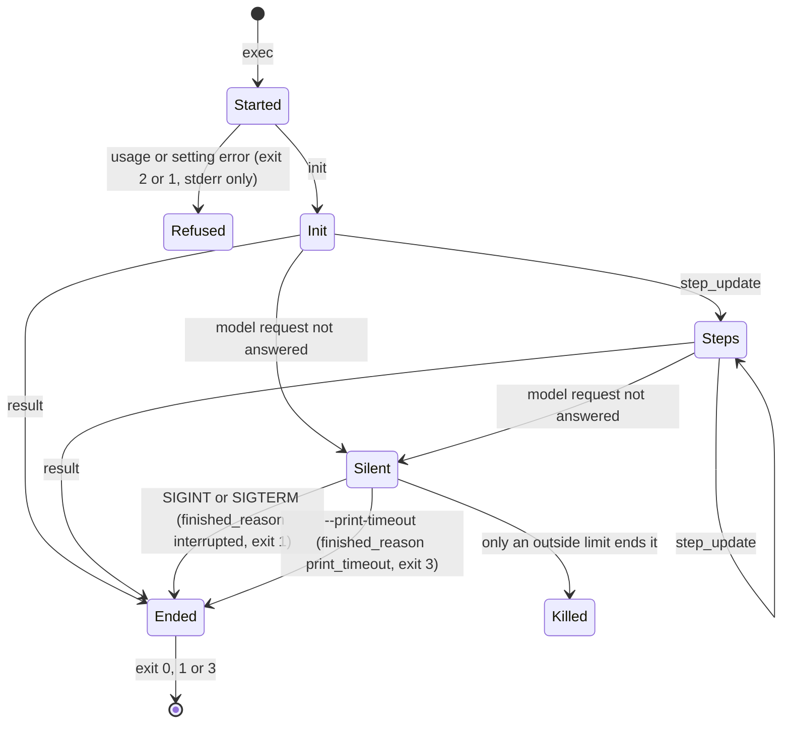

# Antigravity CLI (`agy`) headless spike: protocol, lifecycle and a proposed decision (#528)

- **Status:** proposed, for the maintainer to decide on #528 and EPIC #527
  (G0). The record proposes a **CONDITIONAL GO** for designing an adapter in
  G1, and **no go** for a production adapter or any routing change until the
  conditions of §11 are met. Finishing this spike authorizes no adapter
  (#528's gate).
- **Measured:** `agy` 1.5.13 (`agy --version`; binary sha256
  `c3fd2c848abf88a243936f33e25bf5970802a7651840b5199318fcd8eb3fdb65`,
  270,103,240 bytes), on Linux 7.0.14 x86_64 (Debian 13), `bwrap` 0.12.0, on
  2026-11-21. Every behaviour below comes from a run of that binary recorded
  by `tests/antigravity_probe.py` under `tests/fixtures/antigravity/1.5.13/`,
  one JSON record per scenario named in backticks (`deny-command` is
  `deny-command.json`). `tests/test_antigravity_probe.py` holds the records
  to what this document says and fails when they differ.
- **How:** each scenario runs `agy` once inside `bwrap` with a network
  namespace of its own (loopback only) and a pid namespace of its own (every
  process the run leaves is seen), an empty temporary `HOME` and a minimal
  environment. The model API is a loopback stand-in of the Gemini API that
  answers each request with a scripted step: a reply, a reply in chunks, a
  tool call, an HTTP error, a stream cut mid-record, or nothing. `agy`
  reaches it through its own API-key route: a synthetic `GEMINI_API_KEY`,
  `--settings '{"modelProvider":"gemini"}'`, and the Gemini SDK's
  `GOOGLE_GEMINI_BASE_URL`, which the 1.x changelog names for "a custom
  endpoint". **No model was called and no credential was read.** The issue
  allows live calls only with the operator's explicit approval and a budget,
  and this run had neither.
- **Not measured:** the real Gemini API (its error bodies and details, such
  as the per-day quota `QuotaFailure` the changelog says stops retries at
  once; its latency; tool use by a real model), the Google sign-in and ADC
  (`AGY_ADC_AUTH`) routes, anything `agy` sends to Google besides model
  requests (in the sandbox it could reach nothing, and nothing failed), the
  online documentation at antigravity.google (not read; the vendor text this
  record cites is the changelog the binary prints, `agy changelog`), macOS
  and Windows, and `agy` driven through AutoForge's own executor. Each is
  marked where it matters.
- **Re-measure:** `AUTOFORGE_AGY_PROBE_BIN=/path/to/agy uv run pytest
  tests/test_antigravity_probe.py` (Linux with `bwrap`, about three minutes,
  no model call) runs every scenario again against that binary and fails on
  any fact here that no longer holds. It holds the fresh records to the
  behaviour, not to the label: they name whatever version the binary
  printed, and only the committed records must say 1.5.13. The version is
  asked like every other scenario, in the sandbox and under a timeout
  (`version`): the probe never runs the binary on the host.
  `python3 -I tests/antigravity_probe.py record --agy /path/to/agy --out
  DIR` writes the records. For another build, `DIR` is a directory of its
  own (`tests/fixtures/antigravity/<version>/`), and `python3 -I
  tests/antigravity_probe.py table --records DIR` writes its table of
  removed characters (§3) beside them. The 1.5.13 records stay as they
  are.

## 1. Summary

`agy -p` has a usable unattended contract. `--output-format stream-json`
writes one JSON record per line. A run ends in exactly one `result` record
that says `SUCCESS` or `ERROR`, says why a turn ended early, and lists the
tool actions it refused. Model API failures exit with 3 and print a typed
`AGY_ERROR` line. Exit 0 alone proves nothing, and three traps would make a
naive adapter read a failure as a completed run:

1. **A refused tool call is a `SUCCESS`.** Headless mode cannot ask, so a
   call that needs a permission is refused and the run ends at once: exit 0,
   `status: SUCCESS`, an empty `response`, and the refusal only in
   `denied_actions` and on stderr (`deny-command`).
2. **`result.response` is not the reply.** It joins the text of every agent
   response in the run: the cut text of a retried attempt
   (`cut-stream-then-success`) and both replies when a background task opened
   a second turn (`background-task`, `timer`). The reply is the last
   `agent_response` step's text.
3. **The prompt the model gets is not always the prompt sent.** Every
   character of Unicode general category C is removed, but TAB, LF, VT, FF,
   CR and NEL: controls, format characters, private use, and every code
   point unassigned in Unicode 17.0 (`fidelity-all-*`, which sends every
   scalar value). A message over about 192 KB loses everything after that
   point, including the wrapper's closing tag, with no sign in the output
   (`fidelity-size-*`).

One finding blocks a production adapter as AutoForge's invariants stand.
**The repository's own `.agents/hooks.json` hooks and `.agents/mcp_config.json`
MCP servers run in a headless run, before the model is asked, the hooks
with `GEMINI_API_KEY` in their environment, and no flag or setting turns
them off** (`repository-customizations`, `-untrusted`, `-sandbox`). AutoForge
keeps every agent CLI's hooks and MCP servers off (`--safe-mode` and
`--strict-mcp-config` for Claude Code, #165), so `agy` needs an equivalent
before it can run on a pull request's tree.

The recommended transport is one-shot, the prompt on stdin as one
`stream-json` message (§10). The adapter contract is in §10 and the decision
in §11.

## 2. Discovery (question 1)

`agy --version` prints `1.5.13` and nothing else (`version`). `agy --help`
lists `-p/--print/--prompt`, `--output-format text|json|stream-json`,
`--input-format text|stream-json`, `--model`, `--effort
low|medium|high|xhigh|max`, `--settings` (session-only, never saved),
`--print-timeout`, `--dangerously-skip-permissions`, `--mode`, `--sandbox`,
`-c/--continue`, `--conversation`, `--disable-slash-commands` and
`--json-schema`, on stderr with exit 0 (`help`; verbatim in Appendix A).
`agy help acp` shows further flags (`--gemini-dir`, `--app-data-dir`,
`--disable-telemetry`, `--cloud_code_endpoint`; `acp-help`), and print mode
refuses them with exit 2 (`acp-flag-in-print-mode`). There is no
machine-readable capability listing.

Two read-only probes start no turn and send no model request:

- `-p /config --output-format json` returns the settings catalogue
  (`settings-catalogue`). It has `agentMode: auto`, `toolPermission:
  request-review`, `allowNonWorkspaceAccess: false`, `trustedWorkspaces`
  and `permissions`, and no key for hooks, MCP servers or plugins.
- `agy models` lists 25 model ids under the API-key route
  (`model-list`). It reads only the saved `settings.json`, not
  `--settings`.

`--settings` refuses an unknown key with exit 1 (`settings-unknown-key`).
That is useful: a setting the adapter relies on that a later build drops
fails the launch instead of being ignored.

`--json-schema` was not exercised.

## 3. Where the prompt travels (question 2)

There are three inputs, and all three reach the model the same way:

| Input | How | Evidence |
|---|---|---|
| argv | `-p PROMPT` or `-p=PROMPT` | `success-stream-json`, `argv-leading-dash` |
| stdin, text | no `-p`; stdin a pipe or a file, read to EOF | `stdin-text` |
| stdin, `stream-json` | `--input-format stream-json` (needs `--output-format stream-json`), one `{"event":"user","message":{"content":PROMPT}}` per line, one turn per line | `stdin-stream-json`, `stream-input-two-turns` |

The `stream-json` input shape is not in `--help`. It was found from the
CLI's own refusals: `stream input message is missing the "event" field`
(`stream-input-wrong-shape`), then `stream input "user" message is missing
the "message" field`. With
both `-p` and stdin, `-p` wins and stdin is ignored without a word
(`stdin-and-argv`).

The argv form has two limits. Linux refuses a single argument of 131,072
bytes or more at `exec` (`E2BIG`; measured on this host, not through `agy`).
`agy` also refuses a prompt that spells one of its own flags, with exit 2,
even when it is attached as `-p=--version` (`argv-flag-name`). A prompt that
merely starts with `-` passes (`argv-leading-dash`). `--` does not help:
after it, `-p` is a stray argument and the run fails with exit 2
(`argv-after-double-dash`).

The model receives `<USER_REQUEST>\n` + prompt + `\n</USER_REQUEST>\n`,
then an `<ADDITIONAL_METADATA>` block with the local time and, on the first
turn, a note naming the selected model. Inside the wrapper the prompt
arrives as sent, newlines, CR LF, tabs, leading and trailing spaces, quotes,
backslashes, CJK, Hebrew and a literal `</USER_REQUEST>` included
(`fidelity-unicode-argv`, `fidelity-unicode-stdin`,
`fidelity-unicode-stream-json`), with three exceptions that hold on every
input:

- **Characters removed.** Measured over every Unicode scalar value: all
  1,112,064 of them, each sent once in ascending order, in 31 prompts that
  each stay well below the cut at 192 KB (`fidelity-all-nul`, NUL alone,
  and `fidelity-all-00` to `fidelity-all-29`). Every prompt arrived framed
  as sent, its characters in order and none added or changed, so what was
  missing was removed. 952,427 code points were removed and 159,637 kept.
  The removed ones are listed, as 744 ranges, in
  `tests/fixtures/antigravity/1.5.13/dropped.txt`, which the tests hold the
  records to exactly. Read with Unicode 17.0's database (Python 3.15's),
  the table is exactly general category C less six controls. Every Cc
  (control) is removed except TAB, LF, VT, FF, CR and NEL. So is every Cf
  (format: zero-width space and joiners, bidirectional controls, the BOM,
  tag characters), every Co (private use), and every Cn (unassigned, the
  noncharacters among them). Everything else arrived as sent: the
  no-break and ideographic spaces, the line and paragraph separators,
  variation selectors, combining marks and U+FFFD among them. An older
  database calls some characters unassigned that `agy` keeps: Python
  3.14's Unicode 16.0 lacks the 4,803 that 17.0 added. So the rule follows
  `agy`'s own Unicode version, and a prompt holding a character newer than
  that version loses it. `fidelity-sweep` (110 chosen code points, each
  between markers) agrees. The emoji sequence `👩‍💻` therefore arrives as
  two emoji. Not measured: whether a character fares otherwise in other
  company. Each code point was sent once, after its predecessor; the
  texts of `fidelity-unicode-*` and `fidelity-sweep` are the only other
  contexts.
- **Invalid UTF-8** becomes U+FFFD (`fidelity-invalid-utf8`).
- **Size.** A 190,000-byte prompt arrived whole (`fidelity-size-190000`).
  At 196,608 bytes and above (`fidelity-size-196608`, `fidelity-size-262144`,
  `fidelity-size-262144-stream-json`), the message the model received was its
  first 192,001 bytes: the 15-byte opening tag and the prompt's first 191,986
  bytes, then `<truncated N bytes>`. The closing tag and the metadata were
  lost. The run still exited 0 with `SUCCESS`.

An empty stdin is not refused cleanly. As text, `agy` tries to start its
terminal UI, prints `CLI error: bubbletea: error opening TTY ...` on
stdout, and exits 0 (`stdin-empty`). As `stream-json`, it writes `init` and
exits 0 with no result (`stdin-stream-json-empty`). A whitespace-only text
prompt fails properly: exit 1 and an `ERROR` result saying `empty prompt`
(`stdin-whitespace`).

## 4. The event stream and its terminal proof (question 3)

Every line of `--output-format stream-json` is one JSON object with an
`event` member. In every one-shot run that ended on its own, the stream was
`init`, then `step_update` records, then exactly one `result`, and then the
process exited, or, when no session began, a lone `ERROR` result. None wrote
a malformed line or a second `result`. Only a `stream-json` input session
writes several (§6).

| Record | Fields seen | Meaning |
|---|---|---|
| `init` | `conversation_id`; `init.cwd`, `init.tools` (60 names), `init.permission_mode` (`request-review`, or `always-proceed` under `--dangerously-skip-permissions`) | first record, written before the model is asked. Names no model. |
| `step_update` | `conversation_id`, `step_index`, `state` (`ACTIVE`, `DONE`), `step_type` (`user_input`, `agent_response`, `tool`, `error_message`, `system_message`, `unknown`), and, as they apply, `text_delta`, `tool_name`, `tool_info` (`name`, `parameters`, `output`), `usage`, `duration_seconds` | one step's progress. An `agent_response` is sent as deltas while `ACTIVE`, then a `DONE` whose delta is `\n` (`success-chunks`). |
| `result` | `conversation_id`, `status` (`SUCCESS` or `ERROR`), `response`, `error`, `duration_seconds`, `num_turns`, `usage` (`input_tokens`, `output_tokens`, `thinking_tokens`, `cache_read_tokens`, `total_tokens`), `finished_reason` (`error`, `interrupted`, `print_timeout`; absent on a normal end), `denied_actions` (`action`, `display_name`) | the run's end |

`--output-format json` writes the `result` object alone, as one line,
when the run ends (`success-json`, `deny-command-json`), and `text` writes
the reply and a newline (`success-text`). Neither shows a step while the run
works, so neither gives the adapter progress or a terminal record of its own
kind.

An exploratory run before the records also showed `state: ERROR`, on a
refused tool step, with `tool_info.error` (`TOOL_ERROR`, `user denied
permission to run command`). The recorded run of the same scenario ended
that step `DONE` with no error (`deny-command`). A step's state therefore
does not say whether a call was refused; `denied_actions` does.

Stderr carries the rest. A turn that failed adds `error: ...` and one
`AGY_ERROR: {...}` line. Its JSON has `short_error`, `status` (a canonical
gRPC name), `error_code`, `code_kind` (`http` or `grpc`), `retryable` and
`error_id`, or, for a print timeout, `reason` and the terminated `tasks`.
Notices about refusals, background waits and terminated tasks are prose.



**The admissible streams.** Every one-shot record that ended on its own was
one of two shapes, and the contract admits no other:

- **a run:** `init`, then `step_update` records, then one `result`, then
  the end of stdout;
- **a refusal:** one `result` with `status: ERROR` and an empty
  `conversation_id`, when no session began (`stdin-whitespace`,
  `no-login-argv-prompt`). It is a failure, never a completed run.

Each record must have its shape, checked before anything in it is read:

- `init` is the first record, with a non-empty `conversation_id` and an
  `init` object.
- A `step_update` carries the init's `conversation_id`, an integer
  `step_index` of 0 or more, a `state` of `ACTIVE`, `DONE` or `ERROR`, a
  non-empty `step_type` and, when present, a string `text_delta`.
- Steps begin in index order: a step's first update has an index above
  every earlier step's. A step keeps its type. Nothing updates a step after
  it ended (`DONE` or `ERROR`). Every recorded stream kept to these rules.
- The `result` carries the init's `conversation_id` and a `status` of
  `SUCCESS` or `ERROR`. Its `response`, `error` and `finished_reason` are
  strings when present, and its `denied_actions` is a list of objects with
  a string `action`.

Anything else is a protocol failure: a line that is not JSON or not a
known event, a value of another type in any of these places, a record out
of this order, a record of another conversation, or a record after the
`result`.

**Terminal proof** for a one-shot run is a run of that shape: its one
`result` written as the last record, followed by the process's exit. A run
whose stream ends without a `result` has no terminal proof, whatever its
exit status (`hang-no-limit`, `stdin-stream-json-empty`).

**The reply** is the concatenated `text_delta` of the run's last step,
which must be an `agent_response` that ended `DONE`. `agy` ends it with a
`\n` the model did not send. A response still `ACTIVE` when the `result`
arrives is a protocol failure, however whole its text looks.
`result.response` is not the reply (§1, item 2).

**Liveness.** `agy` writes nothing while a model request is open. A request
the stand-in never answered kept it silent until the probe killed it at
120 seconds (`hang-no-limit`), with no retry and no timeout of its own.
While a background task runs, the stream holds back even records that have
happened. In `background-task`, `agy` said on stderr at 0.8 seconds that
the agent was idle, its reply received (`root agent idle; waiting for 1
background task(s) to finish`), yet the stream wrote that reply at 15.2
seconds, when the task ended. Nothing else was written in between. Unlike
Claude Code's stream, this one does not show a reply before `agy` ends.

## 5. Exit codes, statuses and soft refusals (question 4)

| Exit | When | Evidence |
|---|---|---|
| 0 | `result` with `SUCCESS` | `success-stream-json`, `api-503-then-success` |
| 0 | **`SUCCESS` after a refused tool call, with an empty response** | `deny-command`, `deny-command-json` |
| 0 | no `result` at all: empty stdin | `stdin-empty`, `stdin-stream-json-empty` |
| 1 | a setting, a model selection, a missing credential, stream input that does not decode, or a stop by SIGINT or SIGTERM (`finished_reason: interrupted`) | `settings-unknown-key`, `model-unknown`, `api-key-route-without-key`, `stream-input-cut`, `sigint-during-request` |
| 2 | a usage error: an unknown flag, a stray argument, a prompt that spells a flag | `argv-flag-name`, `argv-after-double-dash` |
| 3 | a turn ended on a model or agent error (`finished_reason: error`), or `--print-timeout` expired (`print_timeout`) | `api-400`, `hang-print-timeout` |

`result.status` was only ever `SUCCESS` or `ERROR`. No `WAITING`,
`CANCELED` or `INVALID` status appeared in any record. `finished_reason`
separates a failure, an interruption and a print timeout, and is absent on a
normal end, as the changelog says. The definitive terminal states are
therefore `SUCCESS` with no `finished_reason` and no `denied_actions`, and
the three `finished_reason` values.

**Soft refusals.** Without `--dangerously-skip-permissions`, a
`run_command` the default `request-review` permission needs to ask about is
refused. The run ends there: the model is not told and is not asked again
(one model request), the result is `SUCCESS` with `denied_actions:
[{"action":"command","display_name":"Bash"}]`, and stderr says
`jetski: no output produced — a tool required the "command" permission that
headless mode cannot prompt for, so it was auto-denied` (`deny-command`).
With the flag the command runs (`allow-command-skip`). A `write_file`
outside the workspace was **not** refused under the default permission
(`write-outside-default`), so `request-review` is no containment.

**Questions.** An `ask_question` call is answered at once with an empty
answer (`A1: ` in the tool result the model gets), and the run goes on to
a `SUCCESS` with a whole reply, at exit 0. The stream shows the step as
`step_type: unknown` with no tool name, so a question asked and answered
with nothing cannot be told from any other unknown step (`ask-question`).
The contract therefore fails closed: a run with any step of a type it
does not know, `unknown` among them, is ambiguous and never completed. The
cost is a false failure on any other step `agy` reports as `unknown`. None
of the other records has one. Whether `ask_question` can be removed from
the tool set was not measured.

## 6. Failures (question 5)

| Case | `agy` (1.5.13, against the stand-in) | Requests | Evidence |
|---|---|---|---|
| HTTP 400, 401, 403, 404 | exit 3, `AGY_ERROR` with the status and `retryable: false` | 1, no retry | `api-400`, `api-401`, `api-403`, `api-404` |
| HTTP 500 | the same: not retried, `retryable: false` | 1 | `api-500` |
| HTTP 429 | retried with backoff for about 2.5 minutes, then exit 3, `RESOURCE_EXHAUSTED`, `retryable: true` | 9 | `api-429` |
| HTTP 503 | the same as 429, `UNAVAILABLE` | 9 | `api-503` |
| 503 once, then a reply | `SUCCESS`, exit 0 (the 1.5.13 changelog's fix of a status reading `ERROR` after a retry holds) | 2 | `api-503-then-success` |
| stream cut mid-record, then a reply | `SUCCESS`; `result.response` starts with the cut attempt's `partial ` | 2 | `cut-stream-then-success` |
| stream cut on every attempt | retried, then exit 3, `UNKNOWN`, grpc code 2, `retryable: false` although it was retried | 9 | `cut-stream-always` |
| no answer at all | silent, no exit within 120 seconds | 1 | `hang-no-limit` |
| API-key route, no key | exit 1, stderr only, nothing on stdout even under `--output-format json` | 0 | `api-key-route-without-key` |
| no key and no sign-in, prompt on stdin | exit 1 at once, `ERROR` result `authentication failed or timed out` | 0 | `no-login-stdin-prompt` |
| no key and no sign-in, prompt in argv | waits 60 seconds for a pasted OAuth code, then exit 1 | 0 | `no-login-argv-prompt` |
| `stream-json` input: a malformed line after a good turn | a **second** `result`, `ERROR`, carrying the earlier turn's response; exit 1 | 1 | `stream-input-malformed-after-turn` |
| `stream-json` input cut at EOF | exit 1, `failed to decode stream input: unexpected EOF`, no request | 0 | `stream-input-cut` |
| `stream-json` input left open | the turn's `result`, then `agy` waits for more input until killed | 1 | `stream-input-left-open` |
| three runs at once, one home and one workspace | three conversations, each with its own prompt | 3 | `concurrent-1`, `concurrent-2`, `concurrent-3` |

`retryable` describes neither what `agy` did nor what a relaunch would
meet: it was `false` after nine attempts at a cut stream and after one 500.
An adapter should type a failure from `error_code` and `code_kind` and
ignore it. What the real API's 429 bodies look like, and whether the
changelog's immediate stop on an exhausted daily quota happens, is
**unverified**: the stand-in's errors carry no `details`.

Not exercised: stdout or stderr closed by the reader, and a reply large
enough to stress a reader. The `result` line carries the whole joined
response, so a reader's per-line bound must allow at least twice the
largest reply it accepts. The executor's capture bounds apply to `agy` as to
any CLI.

## 7. Processes and lifetime (question 6)

`agy` runs each tool command in a session of its own: the shell's process
group and session are its own pid, not `agy`'s (`sigterm-background-task`,
`detached-child`). A signal to `agy`'s process group therefore never
reaches them.

| Case | What is left | Evidence |
|---|---|---|
| normal end, background task still running | `agy` waits for it, opens a second turn on its completion, then exits. Nothing left. | `background-task`, `timer` |
| normal end, daemon task (`IsDaemon`) | `agy` terminates it (`terminating 1 daemon task(s) on exit`). Its tool step stays `ACTIVE` in the stream. Nothing left. | `daemon-task` |
| normal end, a child that ran `setsid -f` | it survives, re-parented, in its own session | `detached-child` |
| SIGINT or SIGTERM during a model request | exit 1 at once, after a `result` with `interrupted`. Nothing left. | `sigint-during-request`, `sigterm-during-request`, `sigint-during-request-json` |
| SIGTERM during a background task | exit 1, `interrupted`. **The task's shell survives**, re-parented, with its `sleep`. | `sigterm-background-task` |
| `--print-timeout` during a background task | exit 3, `print_timeout`, the task terminated and named in `AGY_ERROR`. Nothing left. | `print-timeout-background` |
| `--print-timeout` during a model request | exit 3, `print_timeout` | `hang-print-timeout` |

So `agy` does not guarantee that nothing outlives it. On Linux, AutoForge's
executor collects re-parented descendants as a child subreaper (ADR 0002).
That was **not run with `agy`** in this spike, and on macOS, where there is
no subreaper, such survivors stay unchecked (`orphans_unchecked`).

## 8. Fresh context (question 7)

A run without `-c` or `--conversation` starts a new conversation. The
second of two runs in one home sent no text of the first, and both had the
same system prompt, compared after removing conversation ids (`fresh-first`,
`fresh-second`). `-c` resumed the most recent conversation in the home, the
second run's, not the first (`continue-latest`). With runs in parallel,
"most recent" is whichever finished last. Session resume is out of scope
(#491). An adapter must never pass `-c`, `--continue` or `--conversation`,
and must refuse them in `extra_args`.

Each run leaves its conversation in the home, under
`~/.gemini/antigravity-cli/`: `conversations/<id>.db`,
`brain/<id>/.system_generated/logs/transcript*.jsonl`, `implicit/`, a
`presence/<id>.lock` still there after the exit, and
`conversation_summaries.db` (`fresh-second`'s `home_files`). The system
prompt gives the agent that directory's path (`names_app_data_dir`). A home
kept across launches therefore holds earlier transcripts the agent's tools
can read.
Under `sandbox.mode: required` every launch gets an empty private home,
which satisfies ADR 0015's fresh-context proof. Under `disabled` the adapter
must give each launch a home of its own. `agy` has no other way to move its
state: print mode refuses the `acp` subcommand's `--gemini-dir` and
`--app-data-dir`.

What the workspace contributes is a separate matter:

- `AGENTS.md`, `GEMINI.md` and `.agents/rules/*.md` (`always_on`) are put
  in the system prompt (`repository-customizations`). That is acceptable:
  every phase prompt tells the agent to read `AGENTS.md` anyway.
- `.agents/hooks.json` runs its `SessionStart`, `PreInvocation` and `Stop`
  commands. `.agents/mcp_config.json` starts its MCP server. Both happen
  without `--dangerously-skip-permissions`, in an empty home, and with
  `GEMINI_API_KEY` in the hook's environment (`repository-customizations`).
  Neither `trustedWorkspaces: []` (`repository-customizations-untrusted`)
  nor `--sandbox` (`repository-customizations-sandbox`) changes it, and the
  settings catalogue has no key that might (`settings-catalogue`). The
  bundled customization guide says discovery walks up from the working
  directory to the repository root and also reads `.agent/`, `_agents/` and
  `_agent/`. That was not measured.

## 9. Mapping to AutoForge's result (question 8)

| `AgentExecutionResult` | From | Status |
|---|---|---|
| `command`, `exit_code`, `stdout`, `stderr`, times, `timed_out`, truncation, leftovers | the executor, as for any CLI | available |
| `stdout` (the reply) | the last `agent_response` step's text | available |
| `provider_failure` | a refusal (`denied_actions`), an `ERROR` result, a missing or second `result`, a record out of §4's shape or order, an `unknown` step, a step or reply that never ended, an empty reply | available |
| `transient_failure` | `AGY_ERROR` with `code_kind: http` and `error_code` 408 or 5xx | available; 500 is not retried by `agy` itself |
| `usage_limit` | `AGY_ERROR` with `error_code` 429 | available; per-minute and per-day limits not told apart (unverified) |
| `usage_reset_at` | nothing | unknown |
| `result_less_exit` | `init` and a tool step seen, no `result`, exit on its own | derivable; not observed |
| `failed_before_limit` | `AGY_ERROR` comes only at the end; mid-run `error_message` steps carry no code | not derivable before the end |
| `reply_delivered` | the `result` itself: the stream holds replies back while background tasks run (§4) | only at the end |
| `model`, `effort` | what was asked: no record names the model used | requested only; no read-back |
| `provider_summary` | `conversation_id`, `num_turns`, `usage`, `status`, `finished_reason`, number of `denied_actions` | available |
| `interaction` | `failed` when a refusal failed the run (as #258 does for the other CLIs) | available |
| progress, loop detection | `step_update`: step types, tool names and parameters | available |

`--model` and `--effort` are checked before any request. An unknown model
(`model-unknown`), an effort the model lacks (`model-effort-unsupported`)
and an effort that contradicts the model id's suffix
(`model-effort-conflict`) each exit 1 with nothing sent. A base id with
`--effort` is the form to use: `gemini-4-argon` with `--effort high` sends
`thinkingLevel: HIGH` to `models/gemini-4-argon` (`model-base-and-effort`);
`gemini-4-argon-medium` sends `MEDIUM` (`model-with-effort-suffix`); the
default is `gemini-3.1-pro-preview` with a 1,024-token thinking budget
(`model-default`).

**What cannot be told apart safely:**

- a question the agent asked and got no answer to, from any other
  `unknown` step. So every run with an `unknown` step fails (§5);
- a prompt that was stripped or truncated, from one that was not: nothing
  in the output says so, so only a check before the launch can prevent it
  (§10);
- which model actually served the run;
- a per-minute 429 from an exhausted quota, until a real body is seen;
- a daemon task `agy` killed at exit, except by a stderr notice.

## 10. Transport and adapter contract (deliverables 3 and 5)

### Transport

| Transport | For | Against |
|---|---|---|
| one-shot, argv `-p` | documented, simplest | 131,071-byte argv limit on Linux; a prompt that spells a flag is refused; with no sign-in it waits 60 s for a pasted code |
| one-shot, text on stdin | no size or flag limit below `agy`'s own; fails at once with no sign-in | documented only in a refusal's wording; empty input exits 0 with no result |
| **one-shot, one `stream-json` message on stdin, then EOF** | no argv or flag limit either, and the input is framed: a message cut short fails with exit 1 (`stream-input-cut`) instead of running as a shorter prompt | the message shape is undocumented (§3); empty input exits 0 with only `init` |
| `stream-json` session, several messages | one process for several turns | several `result` records to tell apart; a bad line adds an `ERROR` result that carries the previous turn's response; the process waits until stdin closes |
| `agy acp` (Agent Client Protocol over stdio) | `session/request_permission` reaches the client, which can answer it (`acp-permission-rejected`); `stopReason` per prompt | an extra conversation-title model request per session (`acp-text`, `title_requests: 1`), which `-p` does not make; a rejection still ends the turn as `end_turn` with no reply; a JSON-RPC session to drive; the changelog fixes several `acp` defects in 1.5.12 and 1.5.13 |

**Recommended:** one-shot, `--input-format stream-json --output-format
stream-json`, one message on stdin, stdin closed after it. Text on stdin is
the fallback if a later build changes the message shape. The completion
condition is bounded and unambiguous. The stream must be a run of the shape
of §4, with exactly one `result` as the last record, and the process must
exit under the executor's idle and runtime limits. The run's last step must
be an ended `agent_response`, and no step may be of a type the contract
does not know. ACP is worth a separate look once AutoForge wants `agy` to
ask a human (ADR 0007, #490). It buys nothing for the MVP.

**Version gate:** exactly 1.5.13 until the probe passes on another build.
`doctor` would run `agy --version` and refuse any other output. The release
notes change print-mode behaviour often: a failed turn's exit status went
from 1 to 3, the default agent mode of a `-p` run became Auto where
available, and how a run waits for background tasks changed several times.
Admitting a build is the re-measurement in the header, which the tests make
possible for any version string. The build's records go in a directory of
their own, held to every fact here. A changed fact, its table of removed
characters among them, is a finding to resolve before the gate moves.

### Suggested adapter contract

- **`providers.py`, an `AntigravityProvider`.** `agy --input-format
  stream-json --output-format stream-json --settings
  '{"modelProvider":"gemini"}' --model <base id> --effort <effort>
  --disable-slash-commands --dangerously-skip-permissions`, the prompt as
  `stdin_payload`, run on the duplex handle with a reducer of its own (an
  `agy_stream.py` beside `claude_stream.py`). `tests/antigravity_probe.py`'s
  `classify` is a prototype of that reducer's rules, held to every record by
  the tests.
  - `--dangerously-skip-permissions` is needed because headless mode
    refuses anything that would ask and then ends the run. Containment
    comes from the outer sandbox, as for Claude Code's `bypassPermissions`.
  - `--disable-slash-commands` keeps a prompt that starts with `/` from
    running as a command or a skill; it was not exercised here.
  - Refuse `-c`, `--continue`, `--conversation`, `--remote-*`, `--project`
    and `--new-project` in `extra_args`.
  - Pass `--print-timeout` a little below `max_runtime_seconds`, so `agy`
    terminates its own background tasks and says so
    (`print-timeout-background`). The executor's limit stays the backstop.
- **The reducer.**
  - It checks every record against §4's shapes and order before reading it,
    so no record makes it raise. A violation is a protocol failure.
  - Completed only when all of these hold: a run of §4's shape with no
    violation; its `result` `SUCCESS`, with no `finished_reason` and no
    `denied_actions`; exit 0; every step of a known type (`user_input`,
    `agent_response`, `tool`, `error_message`, `system_message`) and ended;
    the run's last step an `agent_response` that ended `DONE`, with a
    non-blank text.
  - Anything else is a `provider_failure` naming what failed:
    `interrupted`, `print_timeout`, a refusal, a protocol violation, an
    ambiguous step (an unanswered question), no result, no reply.
  - A daemon task leaves its step `ACTIVE`, and the prototype fails such a
    run. Whether a run that started a daemon may still complete is a G1
    decision.
- **Preflight (`integration_preflight`, `validate_profile`).**
  - Refuse a launch whose worktree, or any directory above it up to the
    repository root, has `.agents/`, `.agent/`, `_agents/` or `_agent/` with
    a `hooks.json`, `mcp_config.json`, `plugins.json`, `skills.json` or
    `plugins/`. This is the substitute for the missing switch (§11, C1).
  - Refuse a prompt over a margin below the measured cut (160,000 bytes
    leaves room for the metadata).
  - Refuse, or strip and record, a prompt holding a character that the
    pinned build's measured table (`dropped.txt`, §3) lists. Look the
    character up in that table, never in a Unicode category: AutoForge's
    Python has its own Unicode version, and `agy` removes by its own.
    Then what the run log records is what the model saw, for the build
    the table measured, as far as §3's measurements reach: every
    character alone, and the texts measured. Other contexts are
    unmeasured.
  - A build without such a table, or a table that does not cover every
    scalar value, is unverified: the preflight refuses every prompt rather
    than promise fidelity.
- **Credentials (`credential_routes`).**
  - `GEMINI_API_KEY`, projected like the other providers' keys.
  - The Google sign-in is an OAuth login with a refresh token
    (`access_type=offline` in the sign-in URL, `no-login-argv-prompt`),
    which the changelog says is kept in the OS keyring when one is there.
    Like the other logins a CLI refreshes in place, it would be refused.
    Where it lives without a keyring was not measured.
  - ADC was not measured.
- **Home.**
  - Under `sandbox.mode: required`, the private home suffices.
  - Under `disabled`, give each launch a home of its own under the issue's
    sandbox directory (`state_directories`). That also keeps the operator's
    `~/.gemini/config/` customizations out.
- **`config.py`.** `antigravity` in `KNOWN_PROVIDERS`, `agy` as the default
  command, base model ids, `effort` mapped to `--effort`. An effort the
  model lacks is a hard failure, which `agy` already enforces before any
  request.
- **`doctor.py`.** A version row (the pinned build), a `--help` row (every
  flag the adapter passes), a `GEMINI_API_KEY` presence row (never its
  value), and the customization scan of the checkout. `-p /config
  --output-format json` checks the settings keys without a turn; under
  this probe it worked with no network.
- **Tests.** A fake `agy` replaying these records (as `tests/claude_fake.py`
  does for Claude Code), reducer and adapter tests, and this probe kept as
  the re-measurement for a new build.

**Approximate split:** the reducer and its tests (small); the adapter,
configuration and fake (medium); the preflights and the per-launch home
(medium); the `doctor` rows (small); a bounded live smoke test with the
operator's approval (small, plus its budget); operator documentation and a
`docs/compatibility.md` row (small).

## 11. Decision (deliverable 6)

**Proposed: CONDITIONAL GO** for G1 to design and build the adapter of §10,
behind these conditions, with no default routing change:

- **C1, the blocker.** Repository hooks and MCP servers run in every
  headless run, before the model is asked, the hooks with the model key in
  their environment, and nothing turns them off (§8). AutoForge runs agents on
  untrusted trees, a pull request under review among them, and requires
  every agent CLI's hooks and MCP servers off. The maintainer must decide
  whether the preflight refusal of §10 is an acceptable substitute for a
  switch. Its weakness is that its completeness rests on the discovery
  rules of one build, read from the bundled guide and partly measured. If
  the answer is no, this record's decision is **NO-GO** until `agy` ships a
  switch, and the probe's three customization scenarios are the test of
  one.
- **C2.** One bounded live smoke test on the real Gemini API, with the
  operator's approval and a budget: a reply, one real tool call, and one
  real 4xx error body. It would confirm that the stand-in's success and
  error shapes are the API's.
- **C3.** The version gate of §10, with this probe as the step that admits
  another build.

Not blockers, but required of any adapter: typing a refusal as a failure,
holding the stream to §4's shapes, failing a run with an `unknown` step,
taking the reply from the last step, the prompt preflight with the pinned
build's table, a home of its own per launch, and never `-c`.

Against a go: `agy` changes print-mode behaviour often, its `stream-json`
input shape is undocumented, a reply cannot be seen before the process ends,
and the model that served a run cannot be read back. None of these makes the
contract ambiguous. Together they make an adapter more expensive to keep
correct than its first version suggests.

## Appendix A: `agy --help` (1.5.13, verbatim)

```text
Usage of agy:
  --add-dir                       Add a directory to the workspace (repeatable) (default [])
  --agent                         Agent for the current CLI session
  -c                              Short alias for --continue
  --continue                      Continue the most recent conversation
  --conversation                  Resume a previous conversation by ID
  --dangerously-skip-permissions  Auto-approve all tool permission requests without prompting
  --disable-slash-commands        Disable slash command and skill expansion in print mode
  --effort                        Reasoning effort for the current CLI session (low|medium|high|xhigh|max)
  -i                              Short alias for --prompt-interactive
  --input-format                  Input format for print mode (text, stream-json). stream-json reads one NDJSON message per line from stdin and runs a turn for each; it requires --output-format stream-json (default text)
  --json-schema                   Optional JSON schema string or path to a schema file to enforce structured output (for stream-json, only applicable to the final result)
  --log-file                      Override CLI log file path
  --mode                          Set the agent execution mode for this session (accept-edits, auto, plan)
  --model                         Model for the current CLI session
  --new-project                   Create a new project for this session
  --output-format                 Output format for print mode (text, json, stream-json) (default text)
  -p                              Short alias for --print
  --print                         Run a single prompt non-interactively and print the response
  --print-timeout                 Optional time limit for print mode; 0 waits until the turn completes (default 0s)
  --project                       Project ID or project name for the current CLI session
  --prompt                        Alias for --print
  --prompt-interactive            Run an initial prompt interactively and continue the session
  --remote-agent                  Run this session's conversations using remote agents; --project then names a remote project by ID or name, otherwise they open in this machine's default remote project
  --remote-control                Create a remote connection for the CLI session on start up
  --sandbox                       Run in a sandbox with terminal restrictions enabled
  --settings                      Settings for this session only, never saved: a JSON object of settings.json keys, inline or as a file path

Available subcommands:
  acp             Start the Agent Client Protocol (ACP) stdio server
  agent           List available agents
  agents          List available agents
  changelog       Show changelog and release notes
  help            Show help for subcommands
  install         Configure environment paths and shell settings
  mcp             Manage MCP servers (add, remove, list, enable, disable)
  mic-serve       Serve this machine's microphone to a CLI on another host
  models          List available models
  plugin          Manage plugins (install, uninstall, list, enable, disable)
  plugins         Alias for plugin
  remote-control  Manage the remote-control background daemon (start, status, stop)
  update          Update CLI
```

## Appendix B: reproducing one scenario by hand

The probe does this for every scenario. By hand, with a stand-in of your
own listening on `127.0.0.1:PORT` and an empty home:

```sh
env -i HOME="$EMPTY_HOME" PATH=/usr/bin:/bin LANG=C.UTF-8 \
  GEMINI_API_KEY=synthetic GOOGLE_GEMINI_BASE_URL=http://127.0.0.1:PORT \
  agy --input-format stream-json --output-format stream-json \
      --settings '{"modelProvider":"gemini"}' \
  <<<'{"event":"user","message":{"content":"Say hello"}}'
```

Without `GOOGLE_GEMINI_BASE_URL` and with a real key, the same command
calls the real Gemini API and spends quota.
